<p align="center"></p>

<h1 align="center">Spa Booking</h1>

<p align="center"><b>La spa dell'hotel in Home Assistant</b>: agenda, prenotazioni, operatori,
clienti, voucher, WhatsApp e Telegram, modulo per il sito e shop online, in una sola card.</p>

<p align="center">Versione <b>3.0.0</b> · <a href="docs/GUIDA.md"><b>Guida completa con le immagini</b></a></p>

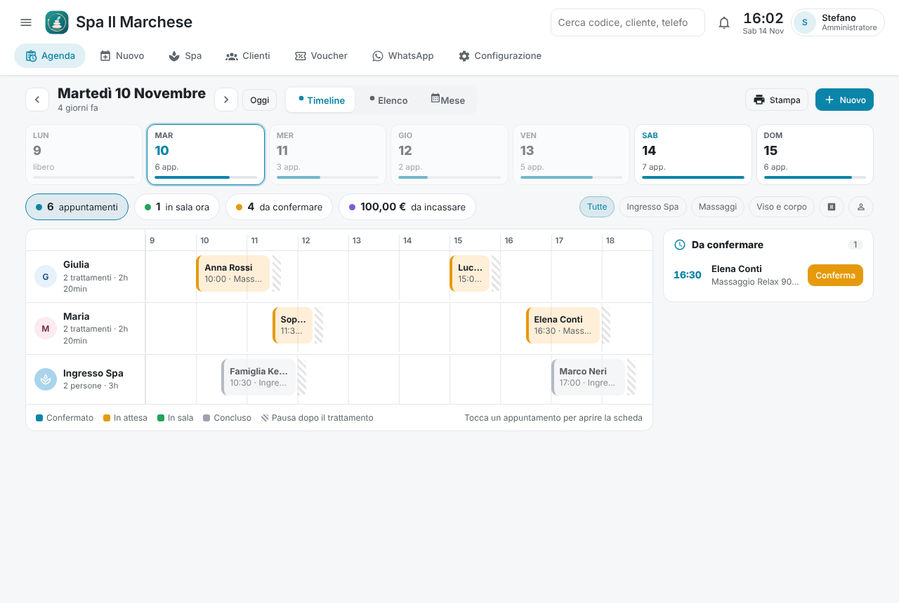

## Cosa fa

| | |
|---|---|
| 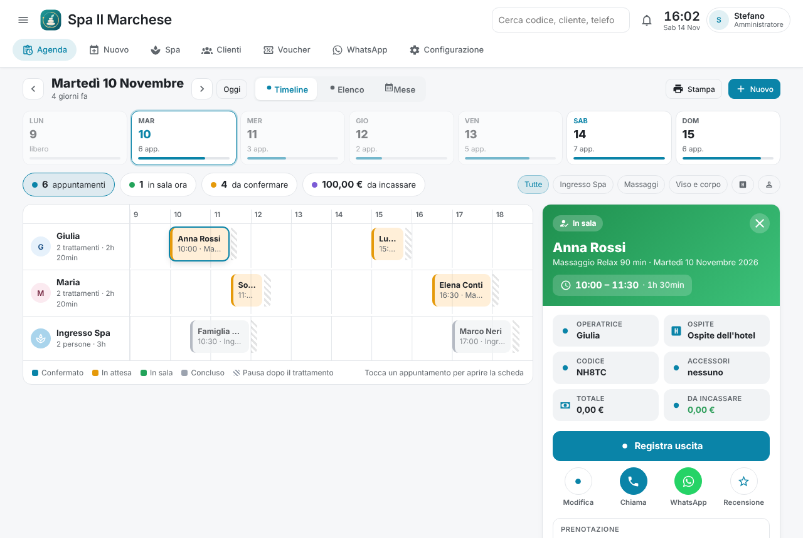 | **Agenda** in tre viste (Timeline per operatrice e categoria, Elenco, Mese), settimana con il riempimento dei giorni, pillole per in sala, da confermare e da incassare, stampa della giornata. **Scheda dell'appuntamento** con entrata e uscita (anche di gruppo), conto e incassi, conferma, promemoria, acconto, recensione e storico modifiche. |
| 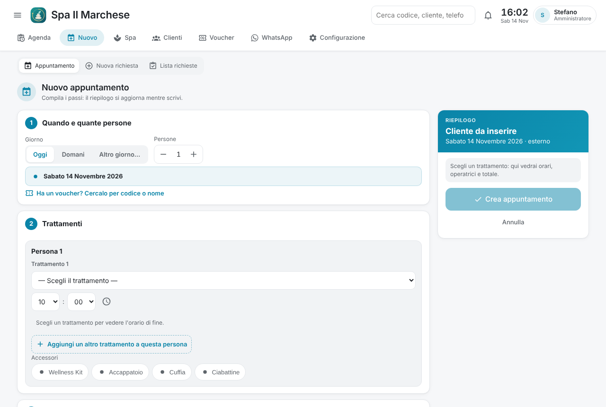 | **Nuovo appuntamento a passi** per una o più persone, ognuna con i suoi trattamenti, orari, operatrice e accessori; pacchetti dello shop, voucher, partner e sconti. Controlli su operatrici occupate, pause, chiusure, regole delle categorie e **categorie che non si accavallano**. Un solo codice per prenotazione di gruppo. |
| 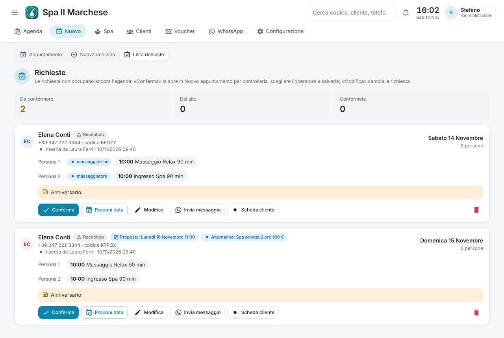 | **Richieste** dal sito e dal banco: conferma in un tocco con la scelta dell'operatrice, proposta di un'altra data con trattamenti alternativi, conferma di ricezione su WhatsApp. |
| 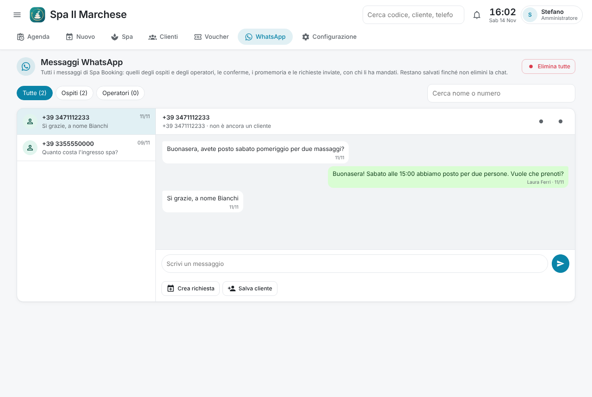 | **WhatsApp integrato** (si collega da solo al numero dell'hotel) e **bot Telegram integrato**: offerte agli operatori con SI/NO e passaggio automatico alla successiva libera, conferme, promemoria, acconti, annullamenti, recensioni, report; tutte le chat dentro la card. |
| 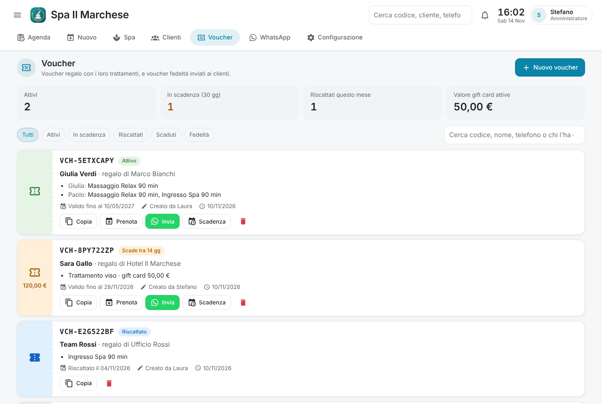 | **Voucher regalo e gift card** firmati con il PIN, usati come pagamento con credito residuo; **voucher dallo shop WooCommerce** importati da soli e riscattati sul sito all'entrata. |
| 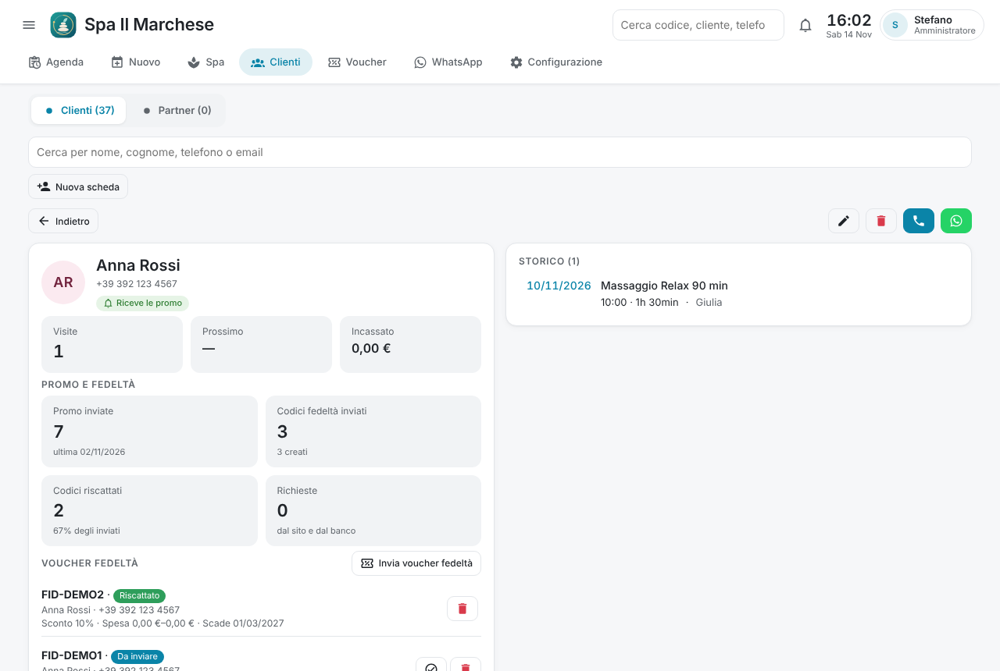 | **Clienti** riconosciuti dal telefono, **punti fedeltà** e voucher fedeltà automatici o a mano, **partner** con link personale, sconto ai loro ospiti, punti e premi, campagne email. |
| 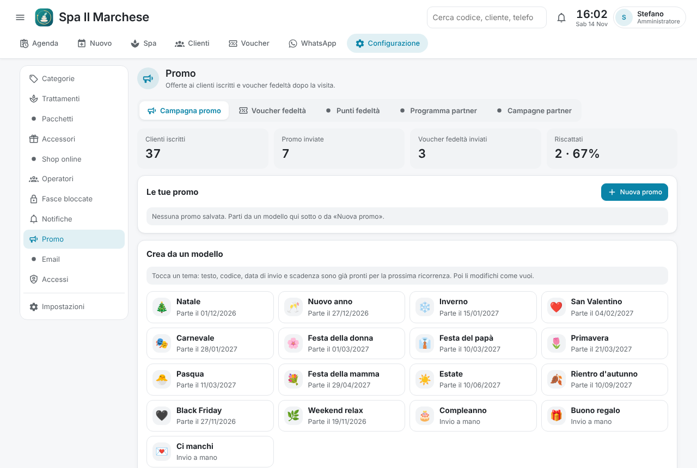 | **Promo WhatsApp** da modelli pronti (Natale, San Valentino, Black Friday…), programmate o ricorrenti, anche con un pacchetto dello shop. |
| 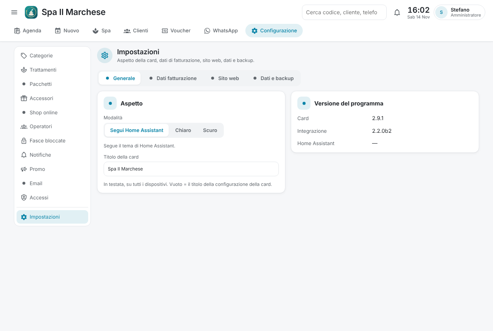 | **Ruoli** (Massaggiatrice, Reception, Manager, Amministratore) controllati anche dal server, utenti creati dalla card e **tablet della reception con PIN**; IVA e dati di fatturazione; email con Google o SMTP; backup automatico su Google Drive; aggiornamenti dalla card. |

Il **modulo per il sito** (italiano, inglese, tedesco) propone solo gli
orari liberi, i pacchetti dello shop e lo sconto partner, e si aggiorna da
solo con Spa Booking.

| | | |
|---|---|---|
| 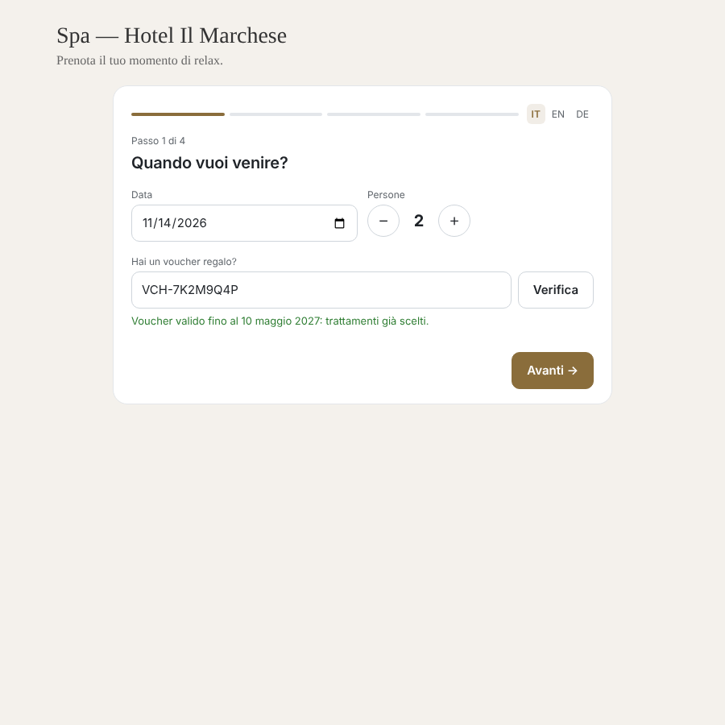 | 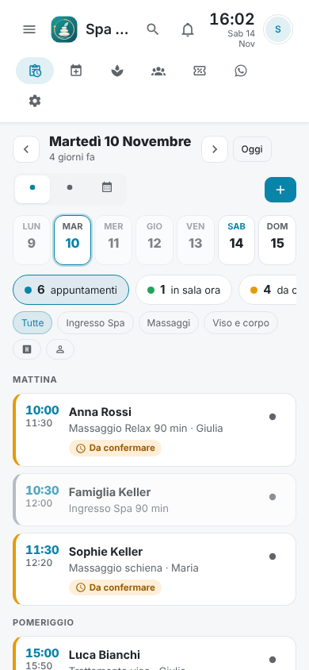 | 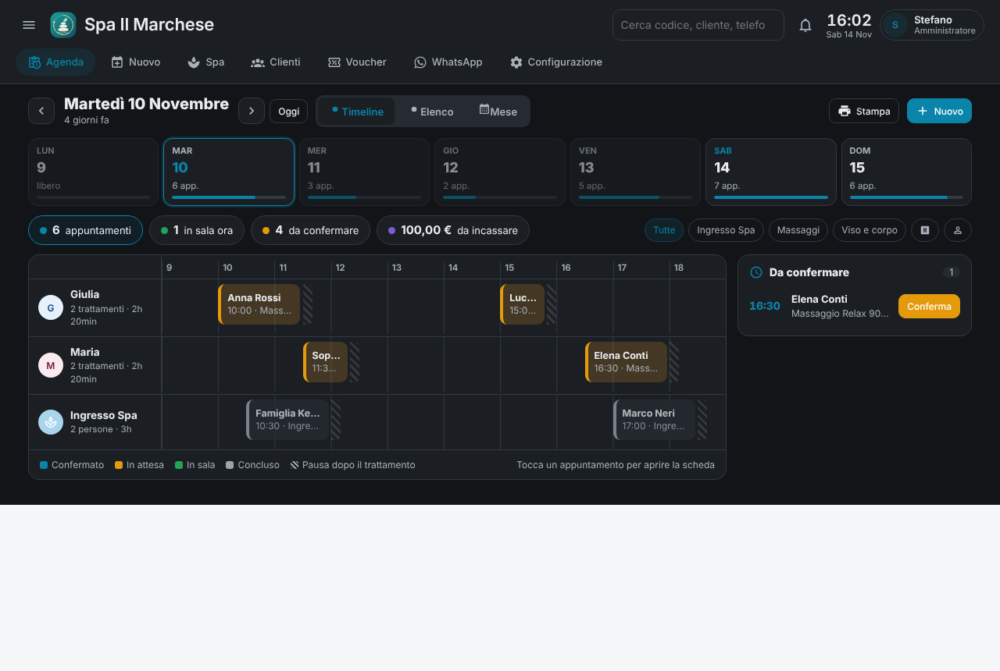 |

## Installazione

### HACS (consigliato)
1. HACS → Integrazioni → tre puntini → *Repository personalizzati* →
   `https://github.com/stepsolar/ha-spa-booking`, categoria *Integration*.
2. Installa **Spa Booking** e riavvia Home Assistant.
3. Impostazioni → Dispositivi e servizi → Aggiungi integrazione → *Spa Booking*.

### Manuale
Copia `custom_components/spa_booking/` in `/config/custom_components/` e
riavvia. La card e il modulo del sito sono inclusi nella cartella
`frontend/`: non serve copiare altro.

La card di gestione viene caricata automaticamente in ogni dashboard; è
disponibile anche come pagina a sé su `/spa_booking`.

## WhatsApp e Telegram

**WhatsApp** — Configurazione › Notifiche › Collegamenti › **Collega
WhatsApp**, poi dal telefono dell'hotel: WhatsApp › Dispositivi collegati ›
Collega un dispositivo e inquadra il QR (oppure *Ottieni codice* con il
numero). Non è un canale ufficiale di WhatsApp: il telefono deve restare con
WhatsApp installato e connettersi almeno ogni 14 giorni. Funziona su
processori Intel/AMD a 64 bit (mini PC, NUC, macchine virtuali).

**Telegram** — su Telegram crea un bot con **@BotFather** (`/newbot`),
incolla il token in Collegamenti e premi **Salva e collega**. Ogni operatore
scrive `/start` al bot e riceve il codice della sua chat da inserire nella
sua scheda. Non serve l'integrazione Telegram di Home Assistant (se usa lo
stesso bot, va rimossa).

## Modulo per il sito web

Nella card: Configurazione › Impostazioni › Sito web. Attiva il sito, poi
premi **Copia codice per il sito** e incolla il codice in un blocco «HTML
personalizzato» di WordPress. Il codice ha già il token ed è di due righe:

```html
<div id="spa-booking"></div>
<script src="https://IL-TUO-HOME-ASSISTANT/api/spa_booking/public/form.js" data-token="..." async></script>
```

Il modulo arriva da Home Assistant: quando aggiorni Spa Booking il sito
mostra subito la nuova versione e WordPress non si tocca più. Il modulo è a
4 passi:
1. data, persone e voucher;
2. trattamenti e orari per persona;
3. dati dell'ospite;
4. riepilogo.

È in italiano, inglese e tedesco: la lingua si sceglie da sola dal browser
dell'ospite, oppure con i pulsanti IT, EN e DE. Facoltativi sul tag
`<script>`:
- `data-lang` fissa la lingua;
- `data-accent` imposta il colore;
- `data-target` indica il riquadro dove mettere il modulo.

Prezzi, colore e indirizzo pubblico si impostano nella stessa sezione. Il
«Codice completo (vecchio)» resta disponibile per i siti che non possono
caricare uno script da un altro indirizzo.

## Sviluppo

```bash
pip install homeassistant pytest ruff
ruff check --select F,E9,B,ASYNC custom_components tests
python -m pytest tests
node tests/frontend/form_test.js custom_components/spa_booking/frontend/spa-booking-form.txt
node tests/frontend/card_request_test.js custom_components/spa_booking/frontend/spa-booking-card.js
node tests/frontend/card_spa_test.js custom_components/spa_booking/frontend/spa-booking-card.js
node tests/frontend/card_whatsapp_test.js custom_components/spa_booking/frontend/spa-booking-card.js
node tests/frontend/card_login_test.js custom_components/spa_booking/frontend/spa-booking-card.js
cd bridge && go test ./...   # programma WhatsApp integrato (Go 1.26+)
```

La CI (`.github/workflows/ci.yml`) esegue lint, test, controllo della card,
hassfest e validazione HACS a ogni push e pull request. Lavora su un branch e
apri una pull request: `main` resta sempre installabile.

## Changelog

- **v3.0.2** — (basta ricaricare la pagina)
  - Agenda: accanto alla data c'è il pulsante **calendario** per scegliere il
    giorno da visualizzare; anche un tocco sulla data apre il calendario
    (prima il selettore c'era ma era invisibile e su Chrome non si apriva).
- **v3.0.1** — (serve il riavvio di Home Assistant)
  - **Risposte delle operatrici** su WhatsApp: l'offerta restava «in
    attesa di conferma» anche dopo la risposta. Cause corrette:
    - le offerte di una prenotazione **ancora in attesa** (non confermata
      all'ospite) non venivano mai abbinate alla risposta;
    - «Conferma», «Confermato/a», «Perfetto» (e le reazioni 👌) non erano
      riconosciuti, solo «Confermo», «Sì», «Ok»;
    - una risposta con «oggi», «domani», «mese»… dentro (es. «Confermo, oggi
      ci sono») veniva presa per una richiesta di elenco e la conferma si
      perdeva: ora l'elenco parte solo se il messaggio è la sola parola;
    - una sola risposta conferma tutti i trattamenti della stessa
      prenotazione proposti a quell'operatrice (prima solo il primo).
  - **Conferma di gruppo**: «Conferma» su una prenotazione di più persone o
    trattamenti apre un popup — tutto il gruppo, una persona o singoli
    trattamenti — e poi chiede se inviare all'ospite la conferma su
    WhatsApp, che riporta solo quanto confermato (`send_guest_summary` con
    `only: true`).
- **v3.0.0** — (serve il riavvio di Home Assistant)
  - **Nuovo logo** di Spa Booking (pietre zen con la foglia, sull'acqua,
    dentro l'anello dorato del tempo) nella testata, nel tablet con PIN e
    come icona dell'integrazione.
  - **Nuova schermata di caricamento**: il logo si compone con
    un'animazione (pietre che si posano, foglia che spunta, anello che gira),
    sia nella card sia nella pagina `/spa_booking`, chiara e scura.
  - Popup **Fascia oraria già occupata**: dice solo quali categorie non
    possono accavallarsi, senza cliente, trattamento, orario e codice
    dell'appuntamento che occupa la fascia.
  - **Guida completa 3.0** (`docs/GUIDA.md`) riorganizzata per schede, con
    tutte le funzioni e nuove immagini; README con le immagini di Spa
    Booking.
- **v2.9.1** — (serve il riavvio di Home Assistant)
  - **Categorie che non si accavallano** (es. spa privata e spa condivisa):
    appena scegli una fascia oraria già occupata dall'altra categoria (ora,
    giorno, trattamento o pacchetto) compare il popup «Fascia oraria già
    occupata»; il salvataggio è sempre rifiutato con lo stesso popup, in
    Nuovo appuntamento, Modifica gruppo e Modifica appuntamento.
  - Questa regola non si può più forzare con «Prenota comunque» (prima il
    pulsante la scavalcava): vale anche lato server.
- **v2.9.0** — (serve il riavvio di Home Assistant)
  - **Entrata e uscita di gruppo**: su una prenotazione di più persone si
    apre un popup per far entrare (o uscire) tutto il gruppo o solo le
    persone spuntate.
  - Un gruppo che esce riceve **un solo voucher fedeltà**; «Invia
    recensione» vale per tutta la prenotazione (un messaggio per numero).
  - **Add-on WAHA rimosso**: WhatsApp è sempre quello integrato.
  - **Telegram integrato**: basta il token del bot (da @BotFather) in
    Notifiche › Collegamenti; Spa Booking invia offerte con i pulsanti,
    promemoria e report e riceve le risposte da solo, senza l'integrazione
    Telegram di Home Assistant. Con /start l'operatore riceve il codice della
    sua chat, che compare anche nella card da copiare.
  - **Ordinamento a trascinamento** con la maniglia ⋮⋮, fluido anche col
    dito: pacchetti (Configurazione › Pacchetti) e categorie/trattamenti
    (Configurazione › Trattamenti › matita, categorie richiudibili).
  - In agenda i trattamenti senza operatore stanno sotto il **nome della
    loro categoria** (es. «Ingresso Spa») invece di «Senza operatore».
- **v2.8.13** — **I pulsanti WhatsApp aprono la chat di Spa Booking** (basta
  ricaricare la pagina). Il pulsante WhatsApp di clienti, partner, operatori,
  appuntamenti e contatti apre la scheda WhatsApp della card sulla chat di
  quel numero, anche se non ci sono ancora messaggi: si scrive e il messaggio
  parte dal numero dell'hotel e resta nello storico. L'icona «Apri in
  WhatsApp» nella chat porta comunque a WhatsApp Web o all'app del telefono.
  Chi non vede la scheda WhatsApp continua ad aprire WhatsApp Web.
- **v2.8.12** — **Modulo del sito più compatto e ordine personalizzato**
  (serve il riavvio di Home Assistant). Nel modulo del sito pacchetti e
  trattamenti non sono più box: un menu «Scegli un pacchetto…» e, per ogni
  persona, i trattamenti scelti con i loro orari e un menu «Aggiungi un
  trattamento…» diviso per categoria. L'**ordine dei trattamenti** è quello
  di Configurazione › Trattamenti (matita: trascina categorie e trattamenti),
  ora usato anche dal sito e da tutti i menu; l'**ordine dei pacchetti** si
  decide con le frecce in Configurazione › Pacchetti e vale per il sito e per
  Nuovo appuntamento e richiesta.
- **v2.8.11** — **Voucher fedeltà a mano e scheda Pacchetti** (serve il
  riavvio di Home Assistant). Nella scheda di ogni cliente e di ogni partner,
  «Invia voucher fedeltà» crea e invia subito un voucher fedeltà (sconto,
  validità e spesa minima modificabili; WhatsApp, o email se manca il numero)
  anche senza una prenotazione. Nuova scheda Configurazione › **Pacchetti**,
  sotto Trattamenti: i pacchetti dello shop abbinati, con persone, trattamenti,
  accessori e prezzo; ognuno si può nascondere dal **modulo web** e dal menu
  di **Nuovo appuntamento e richiesta**.
- **v2.8.10** — Correzioni (serve il riavvio di Home Assistant). I
  **pacchetti** in Nuovo appuntamento, Nuova richiesta e Modifica gruppo sono
  ora una riga sola: un menu «Scegli un pacchetto dello shop…» e i pacchetti
  scelti come etichette. Togliendo un pacchetto (✕) si tolgono anche le sue
  persone: il numero di persone e il riepilogo tornano giusti. Una persona
  **scollegata** da una prenotazione ora compare in agenda come prenotazione a
  sé (prima restava nascosta sotto la riga del gruppo, perché aveva stesso
  cliente, orario e trattamento).
- **v2.8.9** — **Pacchetti dello shop nelle prenotazioni** (serve il riavvio
  di Home Assistant). Con 2 o più persone, in Nuovo appuntamento, Nuova
  richiesta e Modifica gruppo compare «Pacchetti dello shop»: i prodotti dello
  shop abbinati ai trattamenti (Shop online › Abbinamenti). Un tocco assegna
  il pacchetto alle prossime persone, con i suoi trattamenti uno dopo l'altro
  e i suoi accessori; con due coppie si sceglie due volte, anche due pacchetti
  diversi. Il prezzo è quello dello shop, ripartito sui trattamenti, e gli
  accessori del pacchetto sono inclusi. Anche il **modulo del sito** offre i
  pacchetti all'ospite (prezzo del pacchetto nel totale) e la richiesta li
  porta con sé fino alla conferma. In Modifica gruppo **Scollega** è nel box di
  ogni persona e **Aggiungi una prenotazione già inserita** è nel passo 1; il
  riquadro con l'elenco delle persone non compare più nel modulo.
- **v2.8.8** — **Un codice per prenotazione di gruppo** (serve il riavvio di
  Home Assistant). Le nuove prenotazioni con più persone o più trattamenti
  hanno **un solo codice**, anche le persone aggiunte dopo. «Modifica» su un
  appuntamento di gruppo apre la modifica del gruppo. Nella scheda (e in
  Modifica gruppo) il riquadro «Prenotazione CODICE» elenca le persone con i
  loro trattamenti: **Scollega** toglie una persona dal gruppo e le dà un
  codice suo (stesso cliente, incassi con lei); **Aggiungi** unisce al gruppo
  un'altra prenotazione digitandone il codice. Il gruppo è definito dal
  codice: due prenotazioni separate dello stesso cliente nello stesso giorno
  non si uniscono più da sole.
- **v2.8.7** — **Annullamento con messaggio all'ospite e sconto nella
  conferma** (serve il riavvio di Home Assistant). «Annulla appuntamento» apre
  un popup: per una prenotazione di più persone chiede se annullare solo
  quella o **tutto il gruppo**, e se **inviare all'ospite il messaggio di
  annullamento** su WhatsApp (testo in Notifiche › Annullamento, un solo
  messaggio per il gruppo). La conferma all'ospite mostra lo **sconto**:
  prezzo pieno barrato accanto a quello scontato e la riga «🎁 Sconto partner
  10%: −16,00 €» (`{sconto}`, che sparisce se non c'è sconto).
- **v2.8.6** — **Programma partner** (serve il riavvio di Home Assistant).
  Nuova scheda Promo › Programma partner: link del modulo, **sconto agli
  ospiti** che prenotano col link di un partner (generale o per partner), punti
  sull'importo scontato e **premio** (es. 300 punti = buono da 30 €) con il
  suo messaggio. Il modulo del sito mostra all'ospite lo sconto e il totale
  scontato (il codice partner resta nascosto); l'appuntamento nasce col prezzo
  scontato e mostra «Sconto partner». La **scheda partner** si apre: link da
  copiare, punti con barra verso il premio, **«Genera voucher e invia»** (gift
  card inviata su WhatsApp o per email, punti tolti), premi e rettifiche,
  prenotazioni dei suoi ospiti con importo e punti.
- **v2.8.5** — **Pacchetto dello shop nelle promo** (serve il riavvio di Home
  Assistant). Nella Campagna promo, nuovo passo «Pacchetto in promozione»: si
  sceglie un prodotto dello shop online (letto con «Prova collegamento») e,
  volendo, un prezzo in promo. Nel testo: `{pacchetto}`, `{prezzo_pacchetto}`
  (quello in promo se indicato), `{prezzo_listino}` e `{link_pacchetto}` (la
  pagina per acquistarlo); scegliendo il pacchetto il blocco si aggiunge da
  solo al testo. Plugin WordPress **1.1.0**: invia anche pagina e immagine dei
  prodotti (con l'1.0.0 il link funziona lo stesso).
- **v2.8.4** — **Tutti i messaggi WhatsApp nella scheda WhatsApp** (serve il
  riavvio di Home Assistant). Ogni messaggio che Spa Booking invia (conferme,
  promemoria, richieste d'acconto, richieste e avvisi agli operatori, report,
  promo, risposte scritte dalla card) e ogni messaggio ricevuto, anche dagli
  operatori, resta nella conversazione: una chat per numero, con chi l'ha
  mandato («Automatico» per gli invii programmati). Filtri Tutte / Ospiti /
  Operatori e ricerca per nome o numero.
- **v2.8.3** — **Conferma richiesta modificabile e operatori sempre avvisati**
  (serve il riavvio di Home Assistant). «Conferma» su una richiesta (dal banco
  o dal sito) ora la apre in Nuovo appuntamento già compilata: si possono
  cambiare giorno, orari, trattamenti e persone e scegliere chi fa ogni
  massaggio (Automatica, massaggiatrice, massaggiatore o per nome); salvando
  diventa appuntamento e la richiesta risulta confermata. Corretti tre bug:
  la conferma di una richiesta creava i massaggi **senza operatore** e senza
  avvisare nessuno; cambiando operatore in Modifica la scelta poteva essere
  **ignorata** (restava quella di prima); e il nuovo operatore **non riceveva
  la richiesta**. Ora il nuovo operatore riceve la richiesta da accettare e
  quello di prima è avvisato che l'appuntamento non è più suo.
- **v2.8.2** — **Conferma WhatsApp di gruppo completa** (serve il riavvio di
  Home Assistant). «Invia conferma» su un appuntamento di una coppia o di un
  gruppo manda un solo messaggio con tutte le persone prenotate insieme: ogni
  trattamento con il suo prezzo, il totale complessivo e il saldo da pagare.
  Prima partiva solo l'appuntamento cliccato (es. 80 € invece di 160 €).
- **v2.8.1** — **Voucher e gift card come pagamento, nuovo «Conto»** (serve
  il riavvio di Home Assistant). Prenotando con un voucher, Spa Booking
  registra da solo gli incassi: i trattamenti del voucher come «Voucher», poi
  la gift card come «Gift card» fino al suo valore; il resto è il saldo da
  incassare. Una gift card più grande del conto lascia il **credito residuo**
  sul voucher per la volta dopo; annullando l'appuntamento il voucher torna
  disponibile. Il voucher non deve più coincidere esattamente: persone o
  trattamenti in più si pagano a parte, una gift card vale per qualsiasi
  trattamento. Nuovo riquadro Conto (Totale · Pagato · Da saldare, barra,
  incassi con icona e codice voucher, «Incassa il saldo» con un tocco in
  Contante/Carta/Bonifico, «Altro importo» con i metodi a pulsanti e «Tutto
  il saldo»/«Metà») in nuova prenotazione, modifica e scheda appuntamento.
- **v2.8.0** — **Backup automatico su Google Drive** (serve il riavvio di
  Home Assistant): in Impostazioni › Dati e backup, «Collega Google Drive»
  (stesso progetto Google dell'email, permesso `drive.file`: Spa Booking vede
  solo i file che crea). Ogni giorno all'ora scelta (03:30 di default) il
  backup completo va nella cartella «Spa Booking backup»; si tengono gli
  ultimi 3, il più vecchio viene cancellato; un secondo backup nello stesso
  giorno sostituisce quello del giorno. «Fai il backup ora», elenco dei
  backup su Drive e «Ripristina». Servizi `gdrive_backup`, `gdrive_list`,
  `gdrive_restore`.
- **v2.7.3** — **Corretto: i partner non comparivano.** La card non
  caricava partner, punti dei partner e punti fedeltà dei clienti (erano
  salvati, ma la lista restava vuota dopo ogni aggiornamento della pagina):
  ora si vedono. Partner: filtro per città, lista a pagine (100 alla volta),
  tasto «Svuota lista» con conferma. Campagne partner: «Solo alcune città»,
  con il numero di destinatari aggiornato (serve il riavvio di Home
  Assistant).
- **v2.7.2** — Shop online: nell'abbinamento il campo **gift card (valore
  in €)**: nessuna, valore fisso o «prezzo pagato» (per le gift card a
  importo libero). Il credito va sul voucher (prima persona) e si aggiorna
  anche sui voucher già ricevuti non usati (serve il riavvio di Home
  Assistant).
- **v2.7.1** — Shop online: nell'abbinamento dei prodotti anche gli
  **accessori inclusi** (per persona) e una nota «altro incluso» per ciò che
  non è in Spa Booking; tasti rapidi «Nuovo trattamento» / «Nuovo accessorio»
  senza perdere l'abbinamento in corso. L'abbinamento si può rifare quando si
  vuole: al salvataggio i voucher dal sito non ancora usati si aggiornano
  subito (serve il riavvio di Home Assistant).
- **v2.7.0** — **Shop online (WooCommerce · Buoni PDF)** (serve il riavvio di
  Home Assistant e il plugin `wordpress/spa-booking-connector.zip` sul sito):
  i voucher venduti sul sito arrivano da soli in Spa Booking (ogni 15 minuti e
  subito alla notifica dell'ordine pagato), con acquirente, destinatario,
  dedica, valore e scadenza; al primo collegamento si importano quelli degli
  ultimi 6 mesi non ancora usati. Nuova scheda Configurazione › Shop online:
  collegamento (chiave, indirizzo di notifica, prova, sincronizza) e
  abbinamento di ogni prodotto/variante del sito a uno o più trattamenti, con
  il numero di persone. All'arrivo del cliente (Entrata) il voucher risulta
  riscattato anche sul sito; un voucher usato o rimborsato sul sito si
  aggiorna anche qui. Servizi `wp_sync`, `wp_test`, `wp_new_secret`,
  `wp_redeem`.
- **v2.6.1** — Importa partner più affidabile: niente finestra di conferma
  del browser (in alcuni browser e nell'app non compariva e l'import non
  partiva), anteprima del file con il tasto «Importa N partner», invio a
  blocchi di 150 con avanzamento, lettura anche dei CSV salvati da Excel su
  Windows, messaggio chiaro se serve riavviare Home Assistant.
- **v2.6.0** — **Partner: importa file e newsletter** (serve il riavvio di
  Home Assistant): in Clienti › Partner il tasto «Importa file» carica un CSV
  (Nome struttura, Tipo, Nome, Cognome o Titolare, Città, Telefono, WhatsApp,
  Email) senza creare doppioni a parità di email; «Modello» scarica il file
  d'esempio. Nuovi campi città, tipo di struttura, WhatsApp e «Iscritto a
  email e promo» (attivo di default). Ogni campagna partner ha in fondo il
  link per cancellarsi: chi si cancella non riceve più nulla, nemmeno dopo un
  nuovo import. Filtri Iscritti, Disiscritti, Senza email.
- **v2.5.5** — **Nuova vista Mese** dell'agenda (basta ricaricare la pagina):
  intestazione come la giornata (Timeline / Elenco / Mese), pillole del mese,
  primi appuntamenti dentro ogni giorno coi colori delle categorie, barretta
  di riempimento, giorni chiusi tratteggiati; a lato il giorno scelto con il
  carico degli operatori, gli appuntamenti e «Apri la giornata». Sul telefono
  pallini colorati e il giorno sotto il calendario.
- **v2.5.4** — Agenda (basta ricaricare la pagina): il dettaglio aperto a
  destra si chiude anche passando alla vista Mese (prima ricompariva come
  popup).
- **v2.5.3** — Agenda (basta ricaricare la pagina): il dettaglio aperto a
  destra si chiude quando si cambia scheda (prima ricompariva come popup in
  Configurazione o nelle altre schede); la timeline mostra solo gli operatori
  con almeno un appuntamento nel giorno.
- **v2.5.2** — **Dati fatturazione e nuova Modifica appuntamento** (serve il
  riavvio di Home Assistant): nuova scheda Configurazione › Impostazioni ›
  Dati fatturazione con l'aliquota IVA predefinita (spostata da Generale),
  ragione sociale, partita IVA, codice fiscale, SDI, sede, contatti e nota
  della ricevuta. Aliquota IVA anche per gli accessori («Predefinita» o
  22/10/5/4/0%). Modifica appuntamento ridisegnata come Nuovo appuntamento
  (passi, riepilogo a lato, barra sul telefono) e chiusa senza salvare quando
  si cambia scheda.
- **v2.5.1** — **IVA sulle tariffe** (serve il riavvio di Home Assistant):
  aliquota predefinita in Configurazione › Impostazioni › Generale (22%) e
  aliquota per trattamento (22, 10, 5, 4, 0% esente) in Configurazione ›
  Trattamenti, con imponibile e IVA calcolati (prezzi IVA inclusa). Ogni
  appuntamento conserva l'aliquota del momento in cui è stato prenotato. «di
  cui IVA» nel riepilogo di Nuovo appuntamento e nel dettaglio.

- **v2.5.0** — **Campagne partner e punti ai partner** (serve il riavvio di
  Home Assistant; aggiornate anche il modulo del sito, che si aggiorna da solo):
  - Promo › **Campagne partner**: campagne email ai partner per vendere la spa
    ai loro ospiti. Testo pronto con il **link di prenotazione personale**
    (`{link_prenotazione}` = pagina del sito + `?partner=CODICE`), codice e
    punti; anteprima email, **data e ora di inizio invio** (o a mano),
    **invio di prova**, invio una sola volta a tutti i partner attivi con
    email.
  - Il modulo del sito legge `?partner=CODICE` (e lo ricorda 30 giorni): la
    richiesta e gli appuntamenti che ne nascono portano il partner.
  - **Punti ai partner**: punti per euro prenotato (impostabili), calcolati
    sugli appuntamenti non annullati: se un appuntamento si annulla, i suoi
    punti spariscono. Saldo, prenotazioni portate, email ricevute, link da
    copiare e rettifica punti in Clienti › Partner.
  - Partner scelto a mano in Nuovo appuntamento / Nuova richiesta (passo
    Cliente) e modificabile nel dettaglio dell'appuntamento.
  - Servizi `send_partner_campaign`, `partner_points_adjust`,
    `set_appointment_partner`.

- **v2.4.2** — **Accedi con Google** per le email (serve il riavvio di Home
  Assistant): Spa Booking si collega da solo a Gmail (OAuth, senza
  l'integrazione Google di Home Assistant e senza password), chiedendo solo il
  permesso di inviare email (`gmail.send`, non legge la posta). Le email
  partono con la Gmail API. Mittente scelto fra l'account e gli indirizzi
  «Invia messaggi come» di Gmail. Guida passo passo per le chiavi Google (una
  volta), indirizzo di ritorno da copiare, «Cambia account» e «Scollega» (revoca
  il permesso). Resta disponibile l'accesso con password (SMTP).

- **v2.4.1** — Configurazione › **Email** (serve il riavvio di Home Assistant):
  la casella da cui inviare le email. Provider pronti (Gmail, Outlook /
  Microsoft 365, Aruba, Libero) o «Altro» con server, porta e sicurezza;
  utente e password (mai rimandata alla card: si vede solo che è salvata);
  nome mittente, indirizzo e «rispondi a»; «Invia email di prova» con errori
  spiegati (es. Gmail senza password per le app). Nuovi servizi `send_email` e
  `test_email`.

- **v2.4.0** — Dettaglio a lato, punti fedeltà e partner (serve il riavvio di
  Home Assistant):
  - **Dettaglio appuntamento**: su computer non è più un popup, si apre a
    destra dell'Agenda (Timeline ed Elenco, anche per i gruppi con «Singolo /
    Gruppo»). Nuova grafica: testata colorata per stato, orario grande, riquadri
    con operatrice, ospite, codice, accessori, totale e da incassare, un grande
    pulsante per l'azione del momento (Conferma, Entrata, Uscita) e pulsanti
    tondi (Modifica, Chiama, WhatsApp, Recensione). Sul telefono sale dal basso.
  - **Punti fedeltà** (Configurazione › Promo › Punti fedeltà): punti per euro
    impostabili, calcolati sugli incassi delle prenotazioni (non su quelli
    pagati con voucher o gift card) e sui voucher acquistati; un appuntamento
    annullato perde i suoi punti. Alla soglia il cliente riceve un buono in euro
    su WhatsApp (automatico o dalla scheda cliente), i punti si scalano.
    Saldo, barra verso il premio, rettifiche e storico nella scheda cliente;
    classifica in Promo. Servizi `loyalty_reward` e `loyalty_adjust`.
  - **Partner** (Clienti › Partner): elenco con codice PRT-XXXX, aggiunta,
    modifica ed eliminazione a mano. Servizi `save_partner` e `delete_partner`.
    La registrazione dal sito arriverà più avanti.

- **v2.3.12** — Agenda rinnovata (cambia solo la card):
  - In alto il giorno per esteso («Sabato 14 novembre, fra 3 giorni») con le
    frecce, «Oggi» e le viste **Timeline**, **Elenco** e **Mese**.
  - **Striscia della settimana**: ogni giorno con il numero di appuntamenti e
    una barretta di quanto è pieno; un tocco lo apre.
  - I numeri del giorno sono pillole che filtrano: in sala ora, da confermare,
    da incassare.
  - **Timeline**: una riga per operatrice (le libere si vedono subito) e una per
    i trattamenti senza operatrice; i blocchi sono colorati per stato
    (confermato, in attesa, in sala, concluso), con la pausa tratteggiata e la
    linea rossa dell'ora attuale. Tocchi un blocco e si apre la scheda con
    tutte le azioni. A lato: uscite, prossimi arrivi con «Entrata», da
    confermare.
  - **Sul telefono** un elenco per fasce (mattina, pomeriggio, sera): una
    scheda per appuntamento con un solo pulsante (Conferma, Entrata o Uscita) e
    «⋯» per il resto.
  - **Elenco** è la vista di prima, per operatrice.

- **v2.3.11** — Nuova richiesta come Nuovo appuntamento (cambia solo la card):
  - Quattro passi: **Quando e quante persone** (con il codice voucher a
    richiesta), **Trattamenti**, **Cliente** (con ospite e preferenza
    massaggiatrice o massaggiatore), **Note**.
  - Riepilogo sempre visibile con «Salva richiesta» (sul telefono, barra in
    basso).
  - «Una scheda cliente per ogni persona» ora è spenta di default: si spunta
    solo quando serve (due persone con lo stesso nome).

- **v2.3.10** — Nuovo appuntamento riorganizzato (cambia solo la card):
  - Cinque passi numerati: **Quando e quante persone** (Oggi, Domani o Altro
    giorno, persone, voucher a richiesta), **Trattamenti**, **Cliente**,
    **Prezzo e pagamento**, **Stato e note**.
  - **Chi lo fa** a pulsanti: Automatica, Massaggiatrice, Massaggiatore e i
    nomi, con il pallino verde (libera a quell'ora) o arancione (già
    impegnata).
  - **Riepilogo** sempre visibile a destra: cliente, giorno, ogni trattamento
    con orario, operatrice, accessori e prezzo, totale, incassato, da
    incassare, stato e il pulsante «Crea». Sul telefono diventa una barra in
    basso con totale e «Crea».
  - L'ordine dei blocchi è fisso: la matita per spostarli non c'è più.

- **v2.3.9** — Promo salvate e modelli a tema:
  - **Le tue promo**: ogni campagna resta in un elenco, con stato
    (Programmata, Ogni giorno, Inviata, Scaduta, Bozza), data e ora di inizio
    dell'invio automatico, codice e scadenza. Si apre, si modifica e si elimina.
  - **Crea da un modello**: 17 temi sul benessere in spa (Natale, Nuovo anno,
    Inverno, San Valentino, Carnevale, Festa della donna, Festa del papà,
    Primavera, Pasqua, Festa della mamma, Estate, Rientro d'autunno, Black
    Friday, Weekend relax, Compleanno, Buono regalo, Ci manchi). Ognuno porta
    testo, codice con l'anno, giorno di invio e scadenza per la prossima
    ricorrenza (Pasqua, Carnevale e Black Friday calcolati sul calendario).
    Cambiando tema nella promo il testo si aggiorna.
  - Ogni promo ha il suo invio automatico: **un giorno preciso** o **ogni
    giorno** da un giorno, con l'ora di inizio; più promo possono essere
    programmate insieme e ognuna parte una volta sola al giorno.
  - La promo singola delle versioni precedenti diventa la prima dell'elenco.
  - Servizio `send_promo`: nuovo campo `promo_id`.

- **v2.3.8** — Promo e Impostazioni riorganizzate (cambia solo la card, le
  impostazioni salvate restano le stesse):
  - **Promo** con due sotto-schede, **Campagna promo** e **Voucher fedeltà**,
    e i numeri in alto (iscritti, promo inviate, voucher inviati, riscattati).
  - La campagna è in tre passi: **il messaggio** (con anteprima WhatsApp e
    segnaposto da toccare), **a chi** e **quando** (Adesso, Un giorno preciso,
    Ogni giorno), con una frase che dice quanto dura l'invio. Pausa e invii
    massimi sono in «Opzioni avanzate».
  - Il voucher fedeltà mostra la regola riassunta in una frase e l'editor del
    messaggio con anteprima.
  - **Impostazioni** con tre sotto-schede: **Generale** (aspetto, titolo,
    versione), **Sito web** (in quattro passi: attivo, orari con frase
    riassuntiva, avvisi alla reception con «Prova avviso», modulo con codice
    da copiare) e **Dati e backup** (CSV clienti, backup JSON).
  - Una sola barra «Salva» per pagina, che compare solo se cambi qualcosa.

- **v2.3.7**:
  - **Correzione salvataggio Notifiche.** «Salva» dava l'errore «not a valid
    option at 'appointment_reminder_message'». Il servizio `update_settings`
    non accettava le impostazioni del promemoria appuntamento (testo, invio
    automatico, ore), quindi neanche prima si potevano salvare. Ora le accetta,
    e un test controlla che ogni impostazione salvata dalla scheda Notifiche
    sia accettata.

- **v2.3.6** — Notifiche riorganizzate:
  - Quattro sotto-schede: **Messaggi agli ospiti**, **Operatrici**, **Report**
    e **Collegamenti**.
  - I messaggi agli ospiti sono in ordine di percorso (richiesta, proposta di
    un'altra data, acconto, conferma, promemoria, recensione), ognuno con
    «Automatico» o «Manuale» e quando parte.
  - Editor con anteprima in stile WhatsApp che si aggiorna mentre scrivi,
    segnaposto da toccare per inserirli, «Ripristina testo base».
  - Un solo numero di prova per tutti i messaggi.
  - Un'unica barra «Salva», che compare solo quando ci sono modifiche.
  - Su telefono elenco e messaggio sono due schermate.

- **v2.3.5**:
  - **Correzioni voucher.** Dopo la firma con il PIN compariva per un attimo
    la pagina d'errore della card, ed eliminando un voucher appena creato
    usciva «Failed to execute 'appendChild'». La causa era la stessa: il
    riquadro «Voucher creato» per un voucher non (ancora) presente.
  - **Chat WhatsApp conservate.** Le conversazioni della scheda WhatsApp
    (messaggi ricevuti e risposte, con chi ha risposto) restano salvate dopo
    un riavvio. Si eliminano solo a mano: la chat aperta (cestino) o «Elimina
    tutte» (Manager e Amministratore).
  - **Messaggi più curati.** Nuovi testi per conferma (riepilogo), richiesta
    ricevuta, promemoria e richiesta d'acconto. I testi base si aggiornano da
    soli, quelli personalizzati restano come sono.
  - **Un solo messaggio per più persone.** Conferma e promemoria di una
    prenotazione per due o più persone ora partono come un unico messaggio con
    un appuntamento per riga («Persona 1», «Persona 2»).
  - **Acconto.** Nel dettaglio di un appuntamento in attesa compaiono la data
    della richiesta e il pulsante «Reinvia richiesta».
  - **Offerte alle massaggiatrici verificate** con test sull'intero giro:
    proposta in ordine di priorità, rifiuto che passa alla successiva,
    promemoria e scadenza. Novità: se nessuna accetta, la reception riceve un
    WhatsApp (sui numeri degli avvisi) e una notifica in Home Assistant.
  - **Nuova grafica** per Trattamenti (schede per categoria con durata, prezzo
    e operatrici), Accessori (schede e popup con icone pronte da scegliere,
    icone predefinite più adatte) e Operatori (avatar, interruttore Attiva,
    trattamenti, contatti e azioni).

- **v2.3.4**:
  - **Preferenza per ogni persona nel modulo del sito.** «Per il massaggio
    preferisci…» compare nel riquadro di ciascuna persona che ha scelto un
    massaggio, quindi in una coppia una può chiedere la massaggiatrice e
    l'altra il massaggiatore. Il riepilogo lo mostra persona per persona. La
    richiesta lo riporta accanto a «Persona 1/2» e ogni appuntamento confermato
    lo eredita.

- **v2.3.3** — Massaggi:
  - **Correzione «Automatica».** Nel modulo Nuovo, con la massaggiatrice su
    «Automatica», un massaggio veniva rifiutato con «Seleziona un operatore»:
    la card non inviava nessuna candidata. Ora invia tutte quelle abili e il
    server le propone in ordine di priorità (numero più basso prima, saltando
    chi è disattivata, chiusa o ha rifiutato quella fascia).
  - **Genere dell'operatore** (Donna / Uomo) nella sua scheda.
  - **Preferenza dell'ospite** «Massaggiatrice / Massaggiatore /
    Indifferente»: nel modulo del sito (IT/EN/DE, solo se il massaggio scelto
    lo fanno sia donne sia uomini), nella Nuova richiesta e in Nuovo
    («Automatica: massaggiatrice / massaggiatore»). Passa dalla richiesta
    all'appuntamento confermato e compare come «Preferisce …».
  - **Assegnazione automatica con preferenza**: si propone solo a chi è del
    genere chiesto, in ordine di priorità. Se nessuno è libero, la reception
    riceve un avviso invece di un'assegnazione forzata. Un'operatrice scelta a
    mano dalla reception non viene mai cambiata.

- **v2.3.2** — Clienti:
  - **Promo e fedeltà nella scheda cliente**: promo inviate (con l'ultima),
    codici fedeltà inviati, codici riscattati (con la percentuale) e richieste
    del cliente. Da questa versione ogni promo inviata viene contata sul
    cliente.
  - **Clienti dalle richieste**: ogni richiesta, dal sito o dal banco, salva
    già la scheda del cliente (per telefono, senza doppioni); ora la scheda si
    apre dalla richiesta con «Scheda cliente».

- **v2.3.1** — WhatsApp:
  - **Conferma e promemoria dall'appuntamento.** Nel dettaglio
    dell'appuntamento le righe «Conferma WhatsApp» e «Promemoria» mostrano se
    e quando sono stati inviati, con i pulsanti «Invia conferma» / «Reinvia
    conferma» e «Invia promemoria» / «Reinvia promemoria». Prima il pulsante
    del riepilogo non compariva mai (cercava il telefono nel posto sbagliato);
    lo stesso valeva per la richiesta d'acconto e per la domanda «Inviare il
    riepilogo?» dopo la conferma.
  - **Promemoria manuali.** Con i promemoria in modalità manuale, «Invia
    promemoria ora» in Notifiche non inviava nulla: ora invia quelli in
    scadenza.
  - **Avviso richieste dal sito a più numeri** (reception, manager…), con
    «Aggiungi numero» e «Prova avviso».
  - Lo storico modifiche registra anche gli invii di conferma e promemoria.

- **v2.3.0** — Firme e storico:
  - **Voucher firmati con il PIN.** «Crea voucher» chiede il PIN di 4 cifre:
    il voucher resta firmato con il nome di chi l'ha inserito, da qualunque
    dispositivo. Il campo libero «Creato da» non c'è più. Ogni PIN deve essere
    diverso: due persone non possono usare lo stesso.
  - **Chi ha inserito.** Ogni prenotazione e ogni richiesta registra chi l'ha
    inserita (persona collegata, PIN del tablet, oppure «Sito web»). È visibile
    nel dettaglio dell'appuntamento e sulla scheda della richiesta.
  - **Storico modifiche, solo per l'amministratore.** Ogni appuntamento tiene
    l'elenco delle modifiche: quando, chi, cosa è cambiato (orario,
    operatrice, trattamento, stato, prezzo, incassi, entrata e uscita, note…).
    Comprende anche le risposte delle operatrici su WhatsApp. Gli altri ruoli
    non lo ricevono nemmeno dal server.

- **v2.2.4**:
  - **Chiusure con giorni esclusi.** In Fasce bloccate, per una chiusura di
    più giorni si possono escludere alcuni giorni della settimana, che restano
    aperti: ad esempio «chiuso tutto novembre esclusi i sabati». Vale per la
    spa intera, una categoria o un'operatrice, a giornata intera o con orario.
    Agenda, calendario, prenotazioni e modulo del sito ne tengono conto, e
    l'elenco mostra «esclusi i sabati».
  - Servizio `add_closure`: nuovo campo `skip_weekdays` (0 = lunedì … 6 =
    domenica). Le chiusure esistenti non cambiano.

- **v2.2.3**:
  - **Campo Telefono sul telefono.** Nelle schede strette, ad esempio Nuovo
    appuntamento, Nuovo cliente o Voucher, il numero restava schiacciato in un
    quadratino tra il prefisso e il campo Email, e si finiva per scriverlo
    nel campo sbagliato. Ora Telefono occupa tutta la riga, con il prefisso e
    il numero affiancati. Se lo spazio non basta, il numero va a capo sotto il
    prefisso, a larghezza piena. Stessa protezione nel modulo del sito.

- **v2.2.2**:
  - **Trattamenti alternativi in «Proponi data».** Oltre alla prima data
    disponibile si possono proporre uno o più trattamenti alternativi, ognuno
    con prezzo (preso dal listino, modificabile), giorno (di base quello
    chiesto dall'ospite) e orario facoltativo. Compaiono nel messaggio
    WhatsApp, ad esempio «Spa privata 2 ore, sabato 14 novembre, al prezzo di
    € 160», e sulla richiesta come «Alternativa: …».
  - In Notifiche › Proposta di un'altra data: nuovo segnaposto
    `{alternativa}`, più l'introduzione e la riga di ogni alternativa. Il testo
    di base della 2.2.1 si aggiorna da solo; uno personalizzato riceve le
    alternative prima di «Ci risponda…».
  - Servizio `propose_request_date`: nuovo campo `alternatives`.

- **v2.2.1**:
  - **«Proponi data» nella Lista richieste.** Quando la data chiesta è piena,
    si sceglie la prima data disponibile (e, se vuoi, l'orario). Il messaggio
    WhatsApp è già pronto, si può modificare e poi si invia; la richiesta
    mostra «Proposta: …».
  - Il testo si cambia in Notifiche › Proposta di un'altra data. Nuovo
    servizio `propose_request_date`.
  - **Utenti e ruoli sul telefono.** Corretto l'impaginazione che metteva
    tutto in colonne strette. Ogni utente è un riquadro con il ruolo sotto, e
    «Cosa può fare ogni ruolo» diventa un elenco per ruolo.

- **v2.2.0**: versione stabile che raccoglie le beta 2.2.0b1–b4.
  - WhatsApp integrato in Spa Booking, senza add-on (beta).
  - Login personale con ruoli Massaggiatrice, Reception, Manager e
    Amministratore, e PIN per il tablet della reception.
  - Prefisso internazionale su ogni telefono.
  - Voucher con «Creato da», biglietti e invio su WhatsApp.
  - Modulo del sito a passi in tre lingue, caricato da Home Assistant.
  - Avviso con «Prenota comunque» per le regole delle categorie.
  - Aggiornamenti installabili dalla card.
  - Nuovo stile di tutte le schede.
  - [Guida con le anteprime](docs/GUIDA.md).

- **v2.2.0b4** (beta):
  - **Aggiornamenti dalla card.** Quando HACS ha una nuova versione,
    l'Amministratore la vede in alto e la installa con un tocco. Dopo
    l'installazione la card dice cosa serve:
    - se è cambiata solo la card o il modulo del sito, basta ricaricare la
      pagina;
    - se è cambiato il programma, c'è il pulsante «Riavvia ora».

    Nuovi servizi: `update_status`, `install_update` e
    `restart_home_assistant`.
  - **Nuovo stile di altre schede:**
    - Lista richieste a riquadri, con i numeri in alto;
    - scheda del cliente con profilo e numeri;
    - nuova scheda cliente;
    - categorie a riquadri colorati;
    - modifica e creazione di categorie, trattamenti e operatrici in un unico
      riquadro, con i giorni come pulsanti e le fasce orarie su una riga;
    - titolo e spiegazione in ogni sotto-scheda di Configurazione.
  - Il pulsante dice «Salva categoria» e «Salva trattamento», non più
    «category» e «treatment».

- **v2.2.0b3** (beta):
  - **Modulo del sito.**
    - Su WordPress bastano due righe: il modulo arriva da Home Assistant e si
      aggiorna da solo.
    - È diviso in 4 passi, con i trattamenti a schede e gli orari come
      pulsanti.
    - È in italiano, inglese e tedesco.
    - Si possono mostrare prezzi e totale indicativo, e scegliere il colore.
  - **Regole delle categorie.** Quando una prenotazione è fuori dai giorni o
    dalle fasce di una categoria, oppure si sovrappone a una categoria
    esclusa, la card mostra un avviso con «Prenota comunque» oppure «Annulla
    e modifica». Vale anche in modifica. Forzare è permesso alla reception in
    su; chiusure e operatrice già occupata restano bloccanti.

- **v2.2.0b2** (beta):
  - **Login e ruoli.** Ognuno entra con il proprio utente, nei ruoli
    Massaggiatrice, Reception, Manager e Amministratore. Una massaggiatrice
    prenota e modifica solo i suoi appuntamenti e non vede incassi né totali.
    I permessi sono controllati anche dal server.
  - **Utenti dalla card.** In Configurazione › Accessi si creano gli utenti,
    si cambia la password e si disattiva chi non lavora più qui.
  - **Tablet della reception.** Con un utente condiviso, ognuno entra con il
    suo PIN di 4 cifre. Il tablet esce da solo dopo qualche minuto e si
    blocca dopo 5 PIN sbagliati.
  - **Prefisso internazionale.** Accanto a ogni telefono (anche nel modulo
    WordPress) c'è il prefisso, +39 di serie. I numeri salvati prima si
    aprono come +39.
  - **Voucher.**
    - Nuovo campo obbligatorio «Creato da»: è il nome di chi è collegato e
      si può anche cercare.
    - Nuova scheda con il riepilogo, i filtri e i voucher a forma di
      biglietto.
    - Creazione guidata in 3 passi.
    - Pulsante «Invia» su WhatsApp.
    - La creazione è permessa da Reception in su.
  - **Nuovo stile di tutte le schede.**
    - Agenda con il riepilogo del giorno e le fasce Mattina, Pomeriggio e
      Sera.
    - Calendario colorato in base a quanto è pieno ogni giorno.
    - WhatsApp diviso in conversazioni.
    - Configurazione con il menu a lato.
    - Clienti con le iniziali.
  - Corretta una regola di stile non chiusa che annullava lo stile della
    lista WhatsApp.

- **v2.2.0b1** (beta): WhatsApp integrato in Spa Booking, alternativa
  all'add-on WAHA: collegamento con QR code o codice dalla card, invio di
  testi e immagini con ritmo umano (pausa tra i messaggi, "sta scrivendo"),
  controllo che il numero sia su WhatsApp, ricezione di messaggi e reazioni,
  riavvio automatico, sessione nei backup di Home Assistant.
- **v2.1.2**: nuovo stile della scheda Spa. Riquadri divisi in sezioni (Luci,
  Clima, Servizi e sensori) con riepilogo, colore secondo il tipo (luci ambra,
  servizi verde acqua, clima arancio/azzurro), termostato con temperatura
  grande e solo − e +, sensori con il valore in evidenza, una sola barra di
  luminosità per luce, entità mancanti mostrate come "Non disponibile" invece
  di bloccare la scheda. Le sezioni si spengono dal pulsante "Sezioni" in
  modalità modifica.
- **v2.1.1**: nella scheda Richiesta, con 2 o più persone compare un box per
  persona (trattamenti, orari e accessori di ciascuna, "Copia dalla 1ª"); alla
  conferma ogni trattamento viene prenotato solo per la sua persona. "Modifica"
  su una richiesta ora la aggiorna invece di crearne una nuova. "Crea
  richiesta" e "Salva cliente" dai messaggi WhatsApp non aggiungono più "39"
  ai numeri stranieri.
- **v2.1.0**: pianificatore interno (niente più package YAML), card e modulo
  dentro l'integrazione (compatibile HACS), permessi applicati lato server e
  segreti nascosti ai non amministratori, limite di richieste sull'API del
  sito, pausa dell'operatrice in entrambi i sensi, offerta alla prima
  operatrice libera, disponibilità del sito allineata alle regole della
  reception, report mensile completo fino all'ultimo giorno, rollback corretto
  della modifica di gruppo, invii WhatsApp fuori dal lock dei dati, avvisi di
  scadenza voucher funzionanti, test e CI.
- **v2.0.16**: ripristinata la card di gestione (sovrascritta per errore dal
  modulo del sito) e riscritto il modulo WordPress; verifica voucher dal sito
  di nuovo funzionante; "non confermo"/"non va bene" letti come rifiuto;
  numeri TIM 390-393/397, fissi e stranieri convertiti correttamente.
- **v2.0.15**: voucher precompilato dal sito tramite `/public/treatments`.
- **v2.0.14**: ampia zona di tocco in agenda per aprire il dettaglio.
- **v2.0.13**: avviso di sovrapposizione in modifica, storico cliente
  cliccabile, modifica gruppo senza errore di tupla.
- **v2.0.12**: annulla modifica gruppo torna all'agenda; icone MDI autonome.
- **v2.0.10**: servizio `get_dashboard_config`, aggiornamento in tempo reale.
- **v2.0.8–2.0.9**: tipo di riquadro nella scheda Spa, salvato correttamente.
- **v2.0.5–2.0.7**: raggruppamento per cliente e giornata, stato delle offerte
  conservato in modifica, check-in dall'agenda.
- **v2.0.0–2.0.4**: backup JSON completo, editor di gruppo multi-riga.

## Licenza e autore

Autore: stepsolar. Segnalazioni e proposte:
`https://github.com/stepsolar/ha-spa-booking/issues`.
