

# Spa Booking 3.16 — la guida completa

Questa guida spiega **tutto quello che fa Spa Booking**, scheda per scheda:
dalla prenotazione al banco al modulo del sito, dai messaggi WhatsApp ai
voucher, dalla fedeltà dei clienti al programma partner. Le immagini sono
fatte con dati di prova.

Spa Booking è un'integrazione di Home Assistant: si apre come pagina a sé
(`/spa_booking`) oppure come card in qualsiasi dashboard. Il tema chiaro o
scuro segue Home Assistant, oppure la scelta fatta in Impostazioni › Generale.

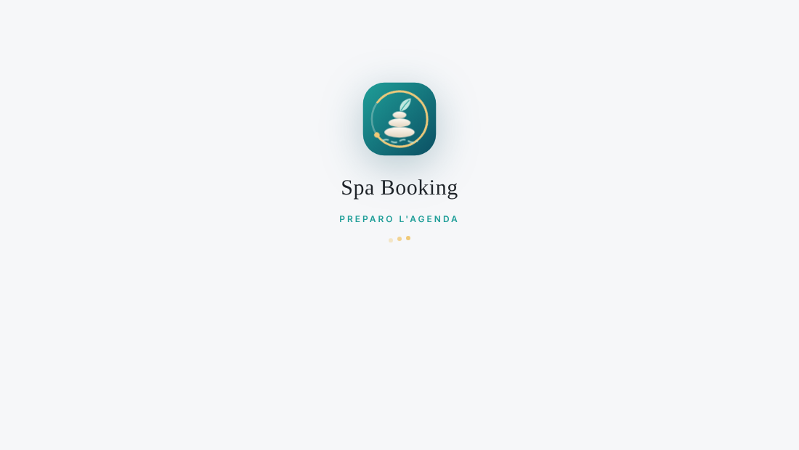

## Indice

1. [Accesso, ruoli e tablet della reception](#1-accesso-ruoli-e-tablet-della-reception)
2. [Agenda](#2-agenda)
3. [Scheda dell'appuntamento](#3-scheda-dellappuntamento)
4. [Nuovo appuntamento](#4-nuovo-appuntamento)
5. [Richieste](#5-richieste)
6. [Modifica e prenotazioni di gruppo](#6-modifica-e-prenotazioni-di-gruppo)
7. [Spa](#7-spa)
8. [Clienti](#8-clienti)
9. [Partner](#9-partner)
10. [Voucher](#10-voucher)
11. [WhatsApp e Telegram](#11-whatsapp-e-telegram)
12. [Configurazione](#12-configurazione)
13. [Modulo del sito](#13-modulo-del-sito)
14. [Shop online (WooCommerce)](#14-shop-online-woocommerce)
15. [Aggiornamenti](#15-aggiornamenti)
16. [Telefono, tablet e tema scuro](#16-telefono-tablet-e-tema-scuro)

---

## 1. Accesso, ruoli e tablet della reception

Ognuno entra in Home Assistant con **il proprio nome utente e la propria
password**; in alto a destra c'è sempre chi è collegato e il suo ruolo. Il
ruolo decide cosa si vede e cosa si può fare, e lo stesso controllo è fatto
dal server: un pulsante nascosto non basta per fare un'operazione non
permessa.

| | Massaggiatrice | Reception | Manager | Amministratore |
|---|---|---|---|---|
| Agenda e calendario | ✓ | ✓ | ✓ | ✓ |
| Prenotare e modificare | solo i suoi | ✓ | ✓ | ✓ |
| Incassi | — | ✓ | ✓ | ✓ |
| Creare voucher | — | ✓ | ✓ | ✓ |
| Estendere o eliminare voucher | — | — | ✓ | ✓ |
| Scheda Spa | ✓ | ✓ | ✓ | ✓ |
| Report e totali | — | — | ✓ | ✓ |
| Configurazione e utenti | — | — | — | ✓ |

**Tablet della reception con PIN.** Il tablet al banco resta collegato con
un utente *condiviso*: chi lo usa tocca il proprio nome e inserisce il suo
**PIN di 4 cifre**. Da quel momento prenotazioni, incassi e voucher portano
il suo nome. *Cambia utente* lascia il tablet al collega; dopo qualche minuto
senza tocchi il tablet torna da solo alla scelta della persona. Cinque PIN
sbagliati di fila bloccano il tablet per un minuto.

**Cosa vede una massaggiatrice.** Tutta l'agenda del giorno, ma modifica
solo i propri appuntamenti; non vede incassi e totali; quando prenota,
l'operatrice è già impostata su di lei.

| | |
|---|---|
| 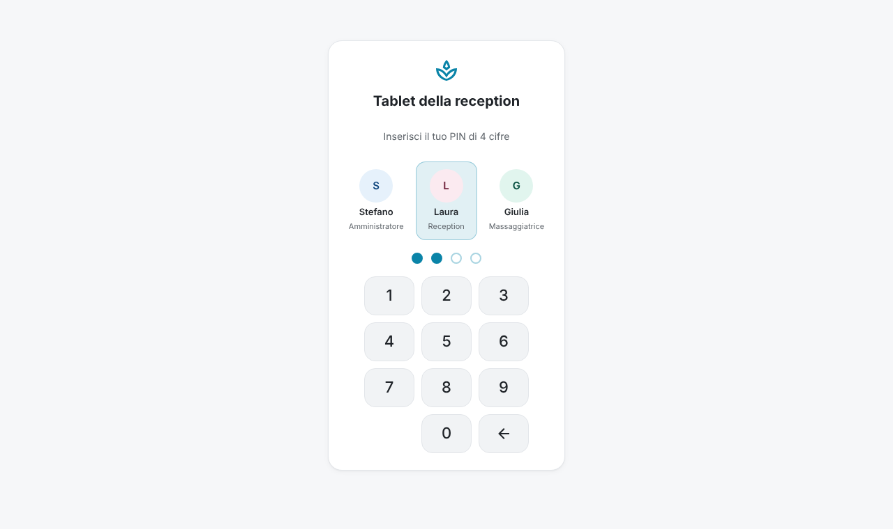 | 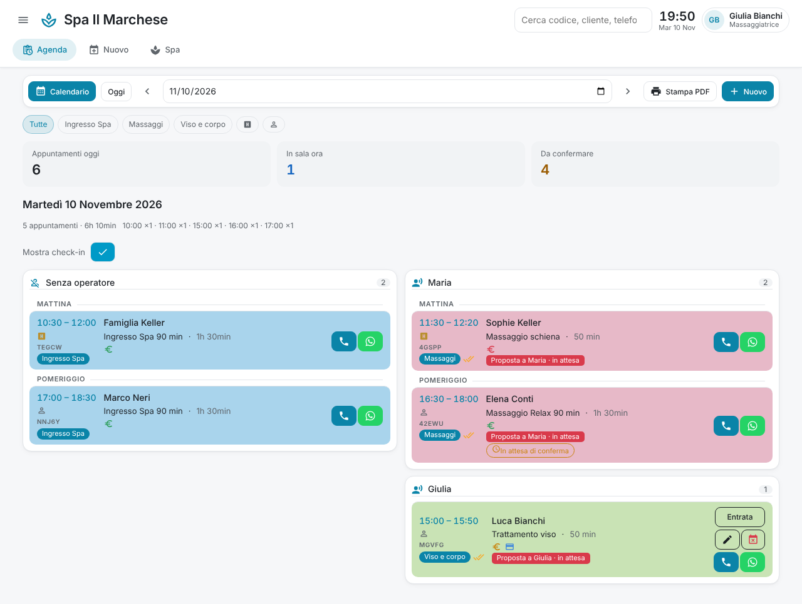 |

Utenti, ruoli e PIN si gestiscono in [Configurazione › Accessi](#accessi).

---

## 2. Agenda

L'agenda ha tre viste: **Timeline**, **Elenco** e **Mese**.

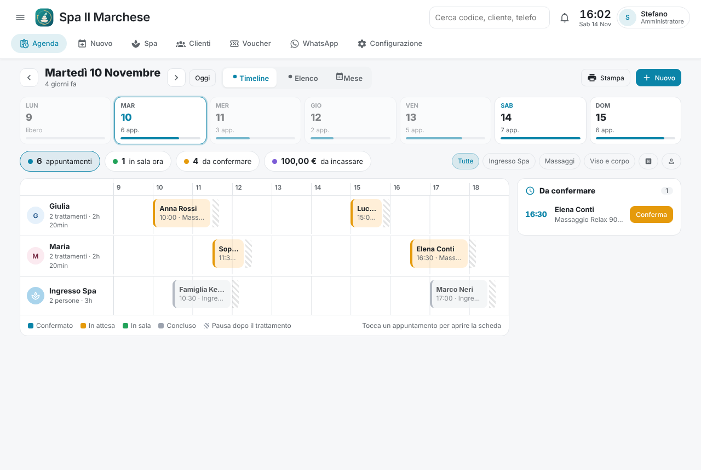

- **In alto**: il giorno per esteso, le frecce, il pulsante **calendario**
  (anche un tocco sulla data apre il calendario), *Oggi*, le tre viste,
  **Stampa** (vedi sotto) e **Nuovo**.
- **La striscia dei giorni**: sette riquadri alla volta con il numero di
  appuntamenti e una barretta di quanto è pieno il giorno. Scorre in
  orizzontale una settimana alla volta (col dito, con la rotellina del mouse
  o con le frecce ai lati) per vedere le 4 settimane prima e le 12 dopo; il
  lunedì e il primo del mese mostrano il mese. Tocca un giorno per aprirlo.
- **Le pillole**: appuntamenti, *in sala ora*, *da confermare*, *da
  incassare*. Toccane una per vedere solo quelli. Accanto, i filtri per
  categoria e per ospite (hotel o esterno).
- **Timeline**: una riga per operatrice; i trattamenti senza operatrice
  (Ingresso Spa, Spa privata…) hanno una riga per **categoria**, con il suo
  nome e colore. Colori: blu confermato, arancione in attesa, verde in sala,
  grigio concluso; il tratteggio è la pausa dopo il trattamento, la linea
  rossa è l'ora attuale. A lato: uscite del momento, prossimi arrivi con
  *Entrata* e quelli da confermare.
- **Elenco**, in tre modi scelti nella sua barra (la scelta resta
  ricordata su quel dispositivo):
  - **Per orario**: una riga per appuntamento in ordine di ora, divisa in
    mattina, pomeriggio e sera, con la linea rossa dell'ora attuale. Ogni
    riga ha ora di inizio e fine, il colore della categoria, ospite, persone,
    codice, trattamento e accessori, operatrice, stato, quanto c'è da
    incassare e i pulsanti Entrata/Uscita/Conferma, WhatsApp e Modifica.
  - **Per operatrice**: una colonna per ogni operatrice e per le categorie
    senza operatrice (Ingresso Spa, Spa privata…), con le **ore libere** tra
    un appuntamento e l'altro.
  - **Per prenotazione**: una scheda per codice con telefono, tutte le
    persone e i trattamenti con i prezzi, totale, da saldare e il pulsante
    del momento.

  In fondo, richiudibili, gli *Usciti* e gli *Annullati*.

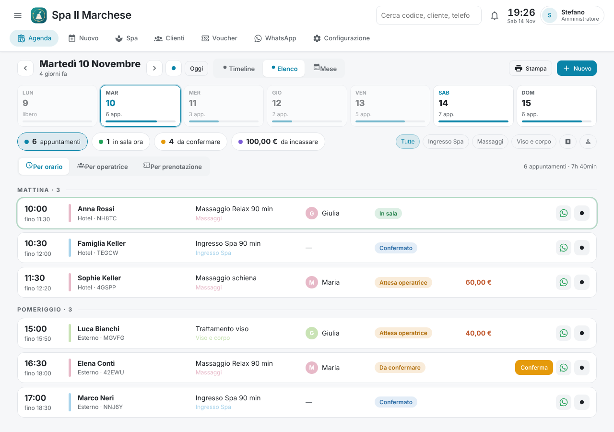

| | |
|---|---|
| 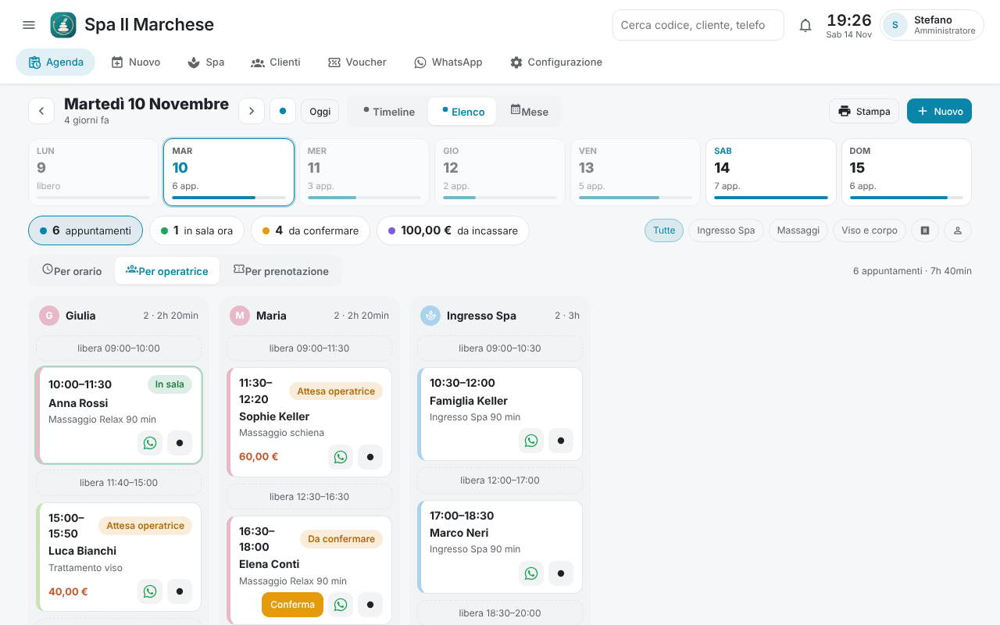 | 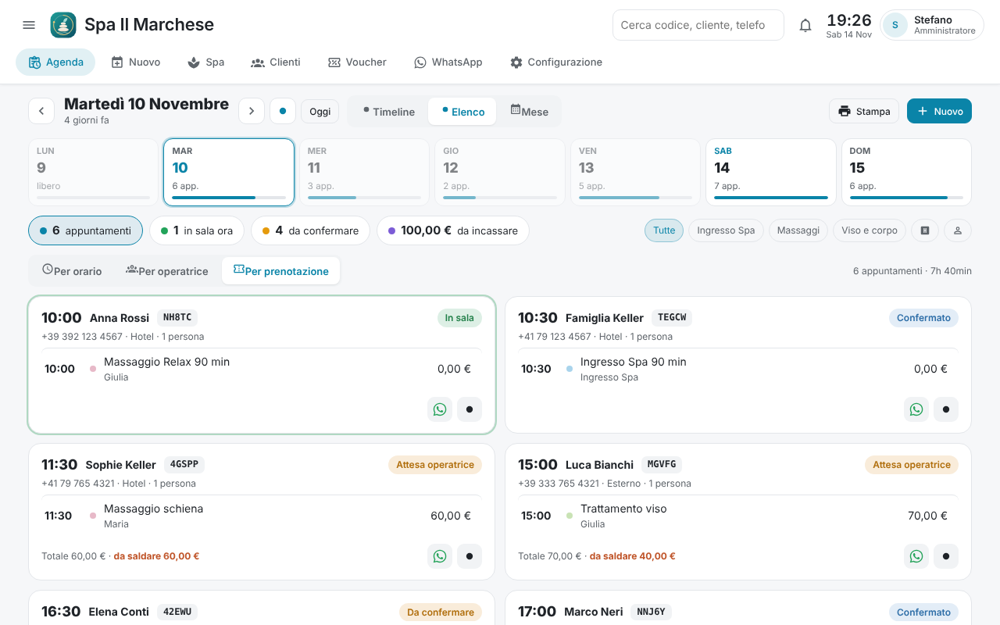 |

**Stampa.** Il tasto apre un piccolo menu con tre fogli, che si aprono in
una nuova scheda pronti da stampare o salvare in PDF (seguono i filtri di
categoria e ospite; importi solo per Manager e Amministratore):

- **Foglio della reception**: logo, data, chi ha stampato, i numeri del
  giorno (prenotazioni, persone, trattamenti, totale, da incassare), poi una
  riga per prenotazione con codice, telefono, trattamenti di ogni persona,
  note, stato, da incassare e le caselle **Entrata** e **Uscita** (già
  spuntate se registrate). In fondo lo spazio per le note e i totali di
  contanti, carta e bonifico.
- **Per operatrice**: il programma di ognuna (e delle categorie senza
  operatrice) con orari, ospiti, accessori, note e la casella «Fatto».
- **Planning orizzontale**: foglio orizzontale con il grafico delle ore per
  operatrice e categoria, e sotto l'elenco completo con i telefoni.

| | |
|---|---|
| 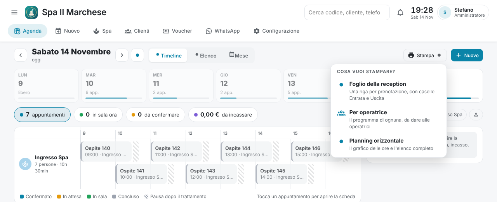 | 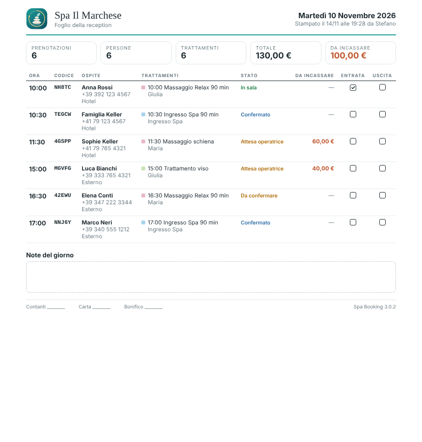 |
| 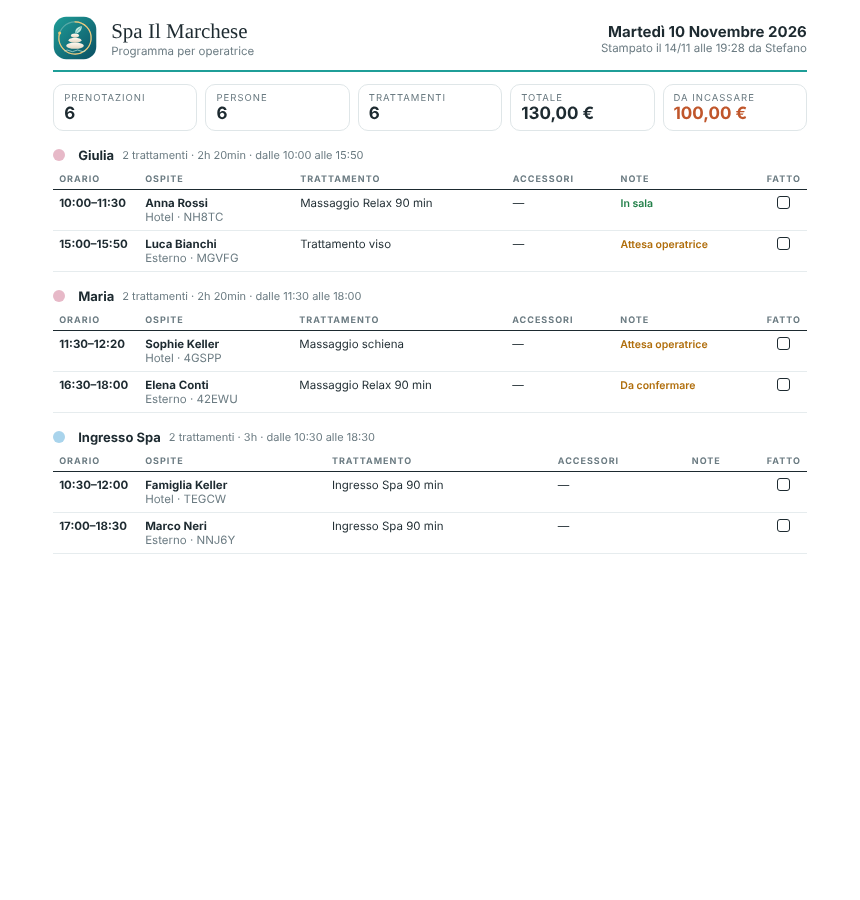 | 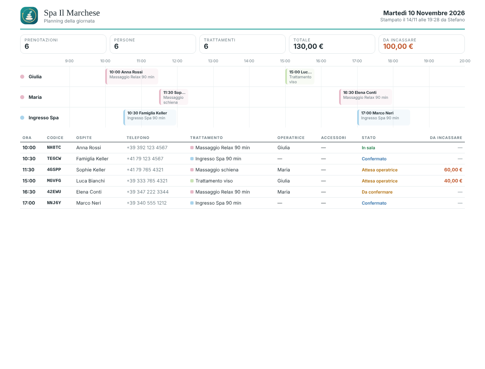 |

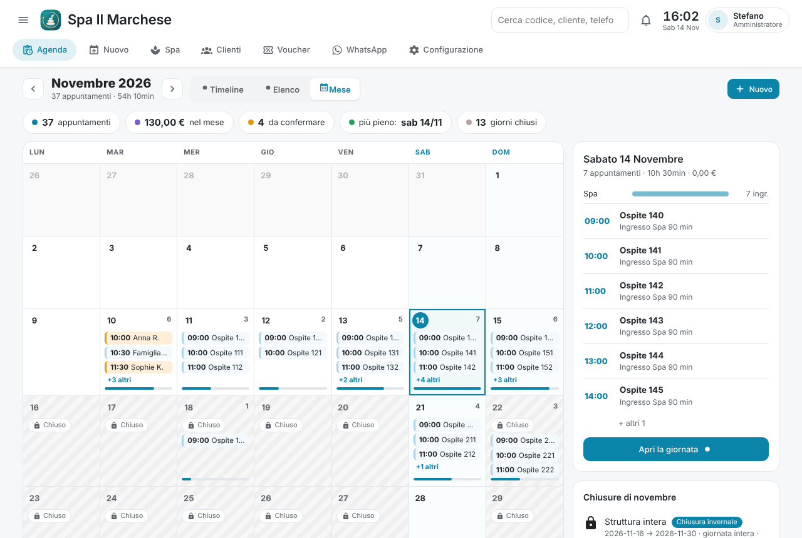

**Mese.** Ogni giorno mostra i primi appuntamenti (ora e nome, col colore
della categoria; in arancione quelli da confermare), «+N altri» e una
barretta di riempimento. I giorni chiusi sono tratteggiati con «Chiuso». In
alto le pillole del mese: appuntamenti, incasso, da confermare, giorno più
pieno, giorni chiusi. Tocca un giorno per vedere a lato carico e
appuntamenti; *Apri la giornata* (o il doppio clic) passa alla timeline.

---

## 3. Scheda dell'appuntamento

Tocca un appuntamento: su computer la scheda si apre a destra senza coprire
la giornata, sul telefono sale dal basso.

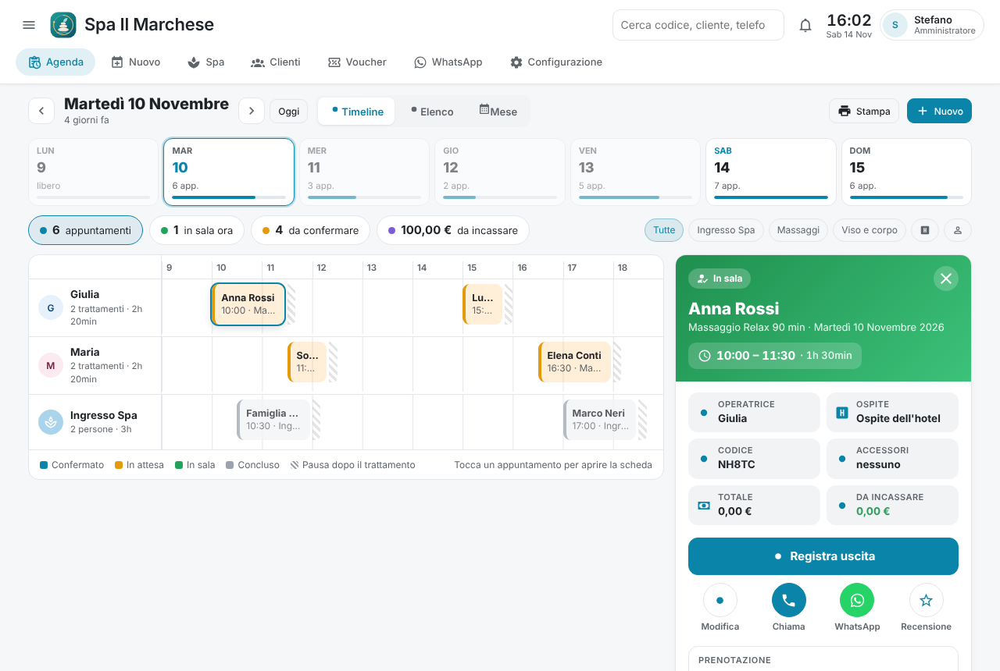

- **Testata** colorata con lo stato, nome, trattamento e orario; per un
  gruppo scegli *Singolo* o *Gruppo*.
- **Riquadri**: operatrice, ospite, codice, accessori, totale, da incassare,
  partner e sconto, pacchetto dello shop.
- **Il pulsante del momento**: *Conferma*, *Registra entrata* o *Registra
  uscita*. Su una prenotazione di più persone Entrata e Uscita aprono un
  popup: **Tutto il gruppo** oppure solo le persone spuntate.
- **Pulsanti tondi**: Modifica, Chiama, WhatsApp (apre la chat interna di
  Spa Booking), Recensione.
- **Conferma e promemoria WhatsApp**: «non inviata» o la data dell'invio,
  con *Invia* / *Reinvia*. In attesa: **Richiedi acconto**.
- **Inserito da** e, per l'Amministratore, lo **storico modifiche** (chi ha
  cambiato cosa e quando).

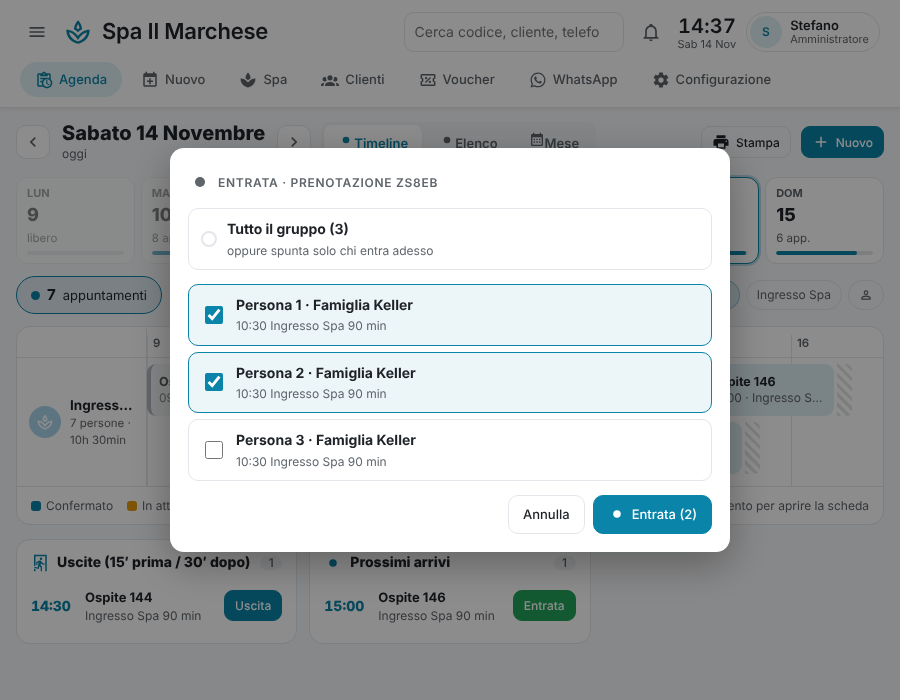

**Confermare una prenotazione di gruppo.** *Conferma* su una prenotazione
in attesa di più persone o trattamenti apre un popup: **Tutto il gruppo**,
**Una persona** (scegli quale) o **Singoli trattamenti** (spunta quali).
Subito dopo Spa Booking chiede se inviare la conferma all'ospite su WhatsApp:
il messaggio riporta **solo** quello che hai appena confermato.

| | |
|---|---|
| 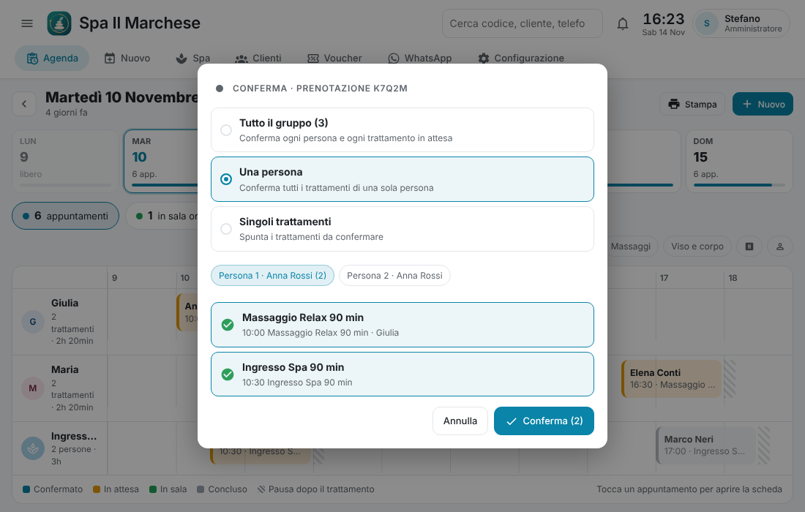 | 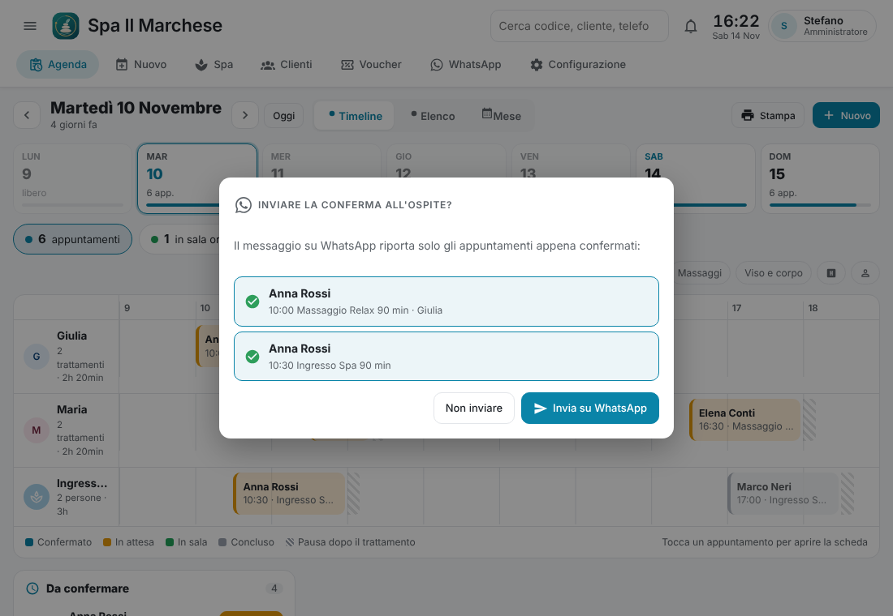 |

### Conto e incassi

Ogni prenotazione ha il riquadro **Conto**: Totale, Pagato, Da saldare e gli
incassi uno per uno. Un tocco su **Contante**, **Carta** o **Bonifico**
incassa il saldo; **Altro importo** serve per una parte o un altro metodo.

Con un **voucher** gli incassi si registrano da soli: i trattamenti compresi
risultano pagati, la **gift card** paga il resto fino al suo valore e
l'eventuale credito residuo resta sul voucher. Se annulli, il voucher torna
disponibile.

| | |
|---|---|
| 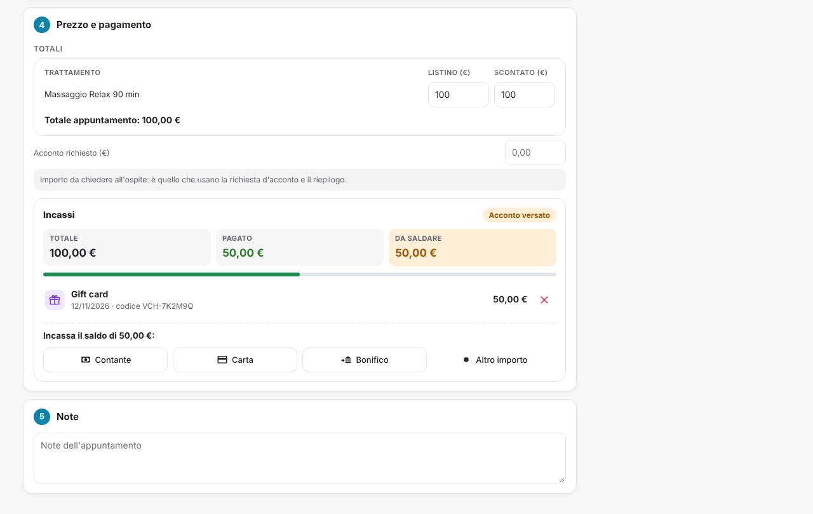 | 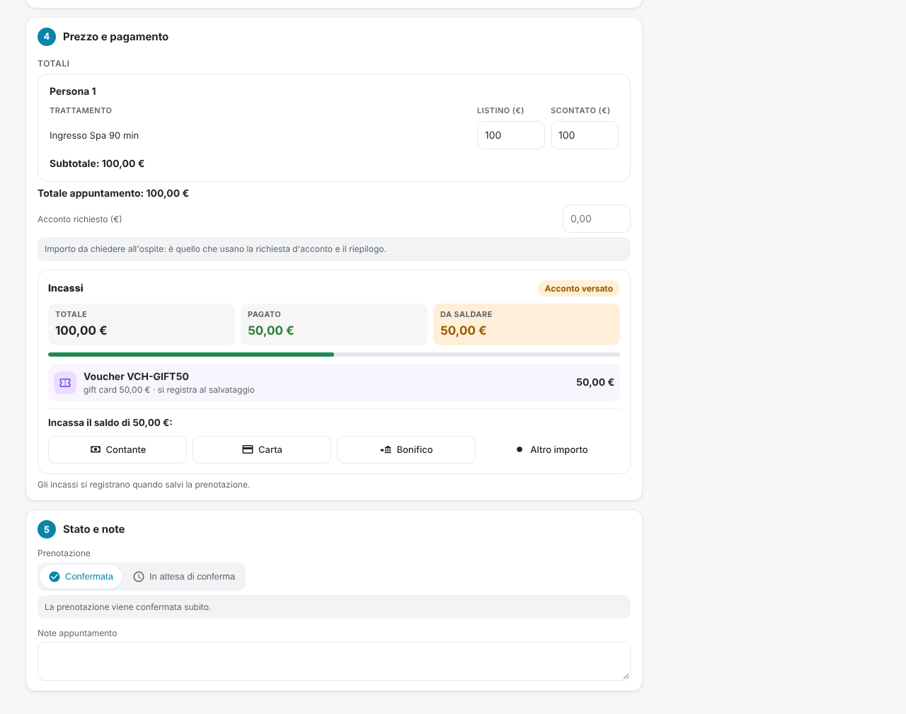 |

I prezzi sono **IVA inclusa**: ogni appuntamento conserva l'aliquota del
giorno in cui è stato prenotato e la scheda mostra imponibile e IVA.

### Uscita, voucher fedeltà e recensione

All'uscita il cliente può ricevere in automatico un **voucher fedeltà** (uno
solo per tutto il gruppo) e, dopo qualche ora, la **richiesta di
recensione**. Il pulsante *Recensione* la manda subito: vale per tutta la
prenotazione, un solo messaggio per numero.

### Annullare

*Annulla appuntamento* apre un popup che chiede, per un gruppo, se annullare
**solo questo** o **tutto il gruppo**, e se **avvisare l'ospite** su
WhatsApp (con il motivo, se lo scrivi). Gli operatori sono sempre avvisati.

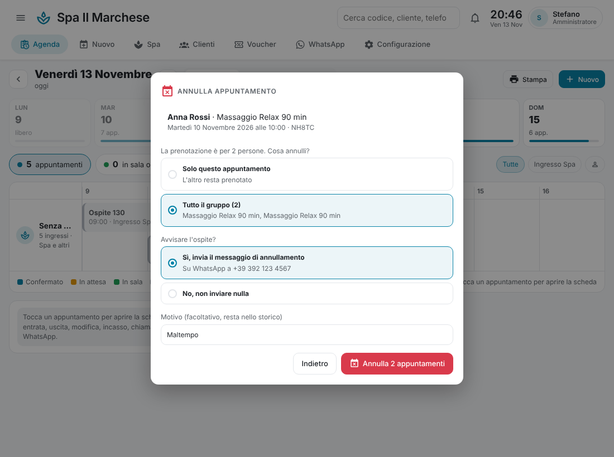

---

## 4. Nuovo appuntamento

Nuovo › **Appuntamento** si compila in cinque passi, con il **riepilogo** a
destra (sul telefono una barra in basso con il totale).

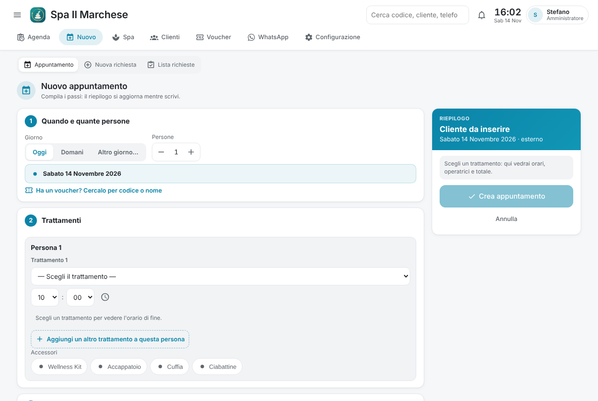

1. **Quando e quante persone**: Oggi, Domani o «Altro giorno…», persone con
   − e +, *Uguale per tutti* per copiare la persona 1. *Ha un voucher?*
   cerca il codice e compila trattamenti e destinatario.
   Con 2 o più persone compaiono i **Pacchetti dello shop**: scegline uno e
   va alle prossime persone, con trattamenti uno dopo l'altro, accessori e
   prezzo del pacchetto. La ✕ sull'etichetta toglie pacchetto e persone.
2. **Trattamenti**: per ogni persona trattamento, ora e **Chi lo fa**:
   *Automatica* (in ordine di priorità), *Massaggiatrice*, *Massaggiatore* o
   un nome. Pallino verde = libera a quell'ora, arancione = impegnata.
   Accessori per persona.
3. **Cliente**: nuovo o esistente (ricerca per nome o telefono, con
   prefisso internazionale), ospite dell'hotel o esterno, partner.
   «Una scheda cliente per ogni persona» solo per omonimi.
4. **Prezzo e pagamento**: listino e prezzo applicato per riga, acconto da
   chiedere, incassi.
5. **Stato e note**: confermata o in attesa.

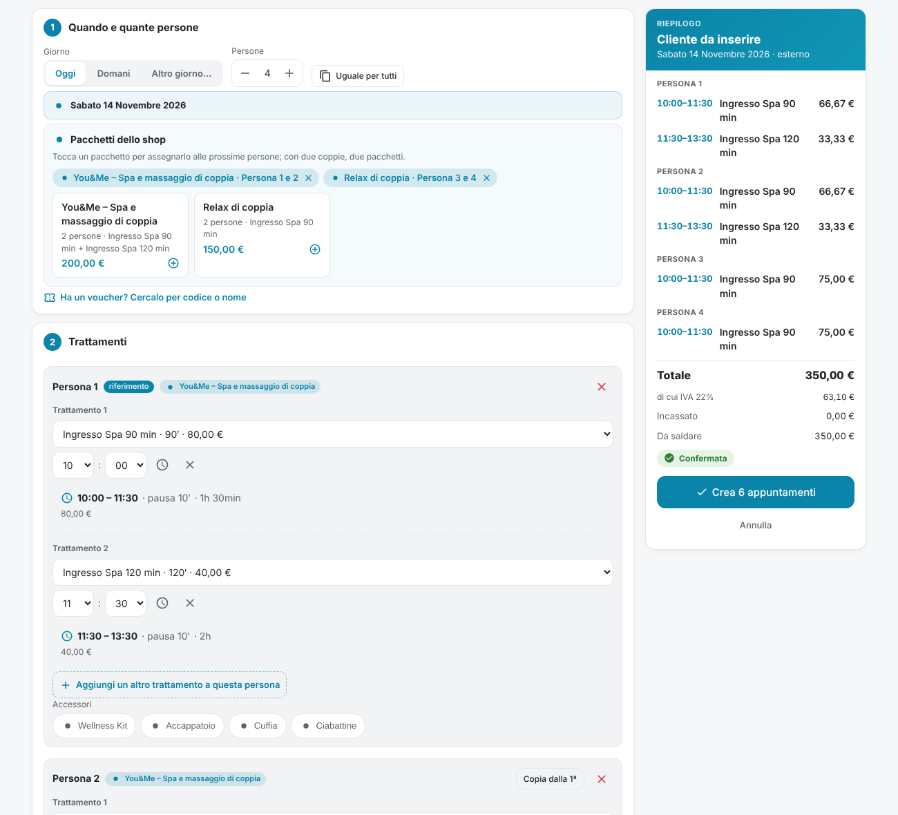

Dopo il salvataggio Spa Booking chiede cosa mandare all'ospite: il
**riepilogo** (confermata) o la **richiesta d'acconto** (in attesa). Le
massaggiatrici ricevono l'**offerta** su WhatsApp o Telegram e rispondono SI o
NO: se nessuna accetta, la reception viene avvisata. Valgono anche
«Conferma», «Confermato», «Ok», «Perfetto» e le reazioni ✅ 👍 👌; una sola
risposta conferma tutti i trattamenti della stessa prenotazione proposti a lei,
anche se la prenotazione è ancora in attesa dell'ospite.

### I controlli

- **Operatrice occupata** e pause dopo i trattamenti: sempre bloccanti.
- **Chiusure** (Fasce bloccate): sempre bloccanti.
- **Regole di giorni e fasce della categoria**: compare un avviso con
  *Prenota comunque* (Reception, Manager, Amministratore) o *Annulla e
  modifica*.
- **Categorie che non si accavallano** (es. Spa privata e Ingresso Spa):
  appena scegli una fascia occupata dall'altra categoria compare il popup
  **Fascia oraria già occupata**; il salvataggio è sempre rifiutato e la
  regola non si può forzare.

| | |
|---|---|
| 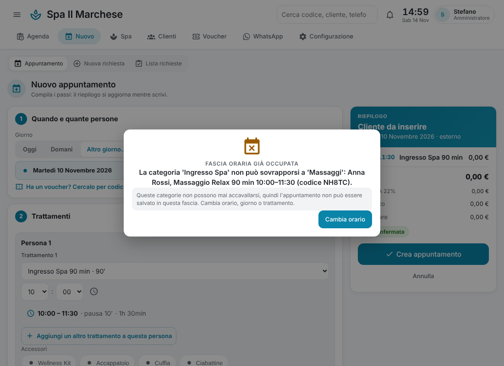 | 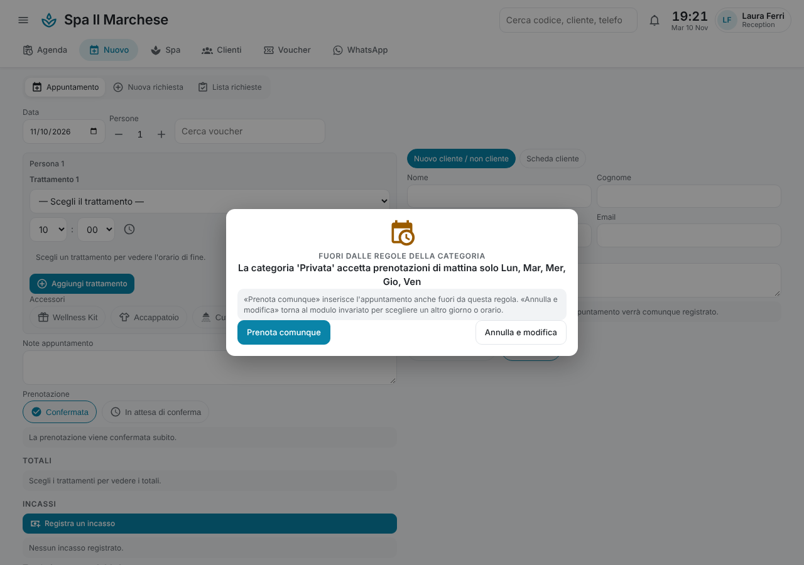 |

---

## 5. Richieste

**Messaggi alle operatrici quando si modifica** (3.14): se una prenotazione
cambia giorno, ora o trattamento e l'operatrice resta la stessa, lei riceve
**APPUNTAMENTO MODIFICATO** con il nuovo orario e la riga *Prima: …* (e
risponde CONFERMO o NON DISPONIBILE), non più un «nuovo appuntamento». Se
cambia l'operatrice, la nuova riceve la proposta del turno e la precedente
«Appuntamento non più assegnato a te»; un trattamento tolto dalla
prenotazione manda alla sua operatrice «Appuntamento annullato».

Una **richiesta** non occupa ancora l'agenda: si usa quando l'ospite chiede
ma l'orario va confermato. Arrivano dal [modulo del sito](#13-modulo-del-sito)
o si inseriscono in Nuovo › **Nuova richiesta** (stessi passi, senza
l'operatrice, con la preferenza massaggiatrice/massaggiatore). Al salvataggio
l'ospite riceve la conferma di ricezione su WhatsApp.

| | |
|---|---|
|  | 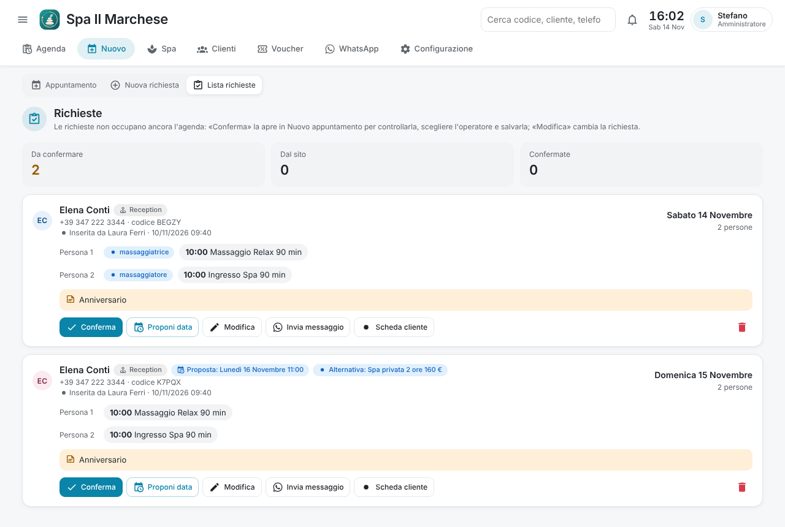 |

**Lista richieste**: numeri in alto (da confermare, dal sito, confermate),
poi una scheda per richiesta con ospite, provenienza, «Nuova», voucher,
codice, persone e trattamenti, note. La campanella in alto conta le
richieste dal sito non ancora aperte (dalla 3.10, insieme ai messaggi
WhatsApp: vedi *Avvisi*).

- **Conferma** apre la richiesta in Nuovo appuntamento già compilata: cambi
  quello che serve, scegli chi fa i massaggi (la preferenza dell'ospite è già
  selezionata) e *Conferma e crea*.
- **Proponi data**: se la data è piena proponi la prima disponibile e, se
  vuoi, **trattamenti alternativi** con prezzo e giorno. Il messaggio è già
  scritto e si può cambiare prima dell'invio.
- **Modifica**, **Invia messaggio**, **Scheda cliente**, cestino.

| | |
|---|---|
| 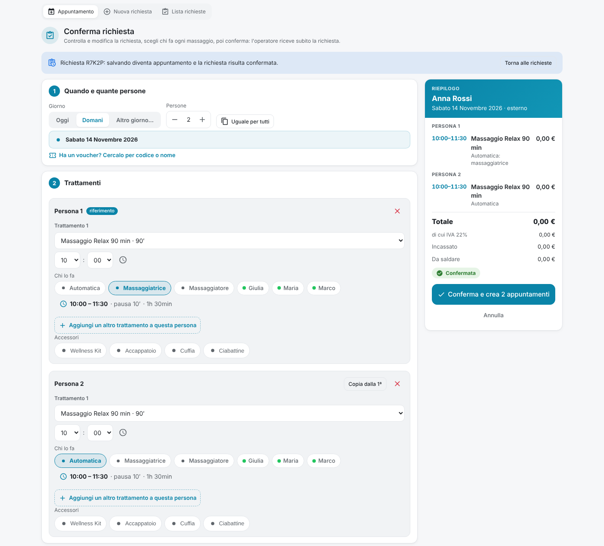 | 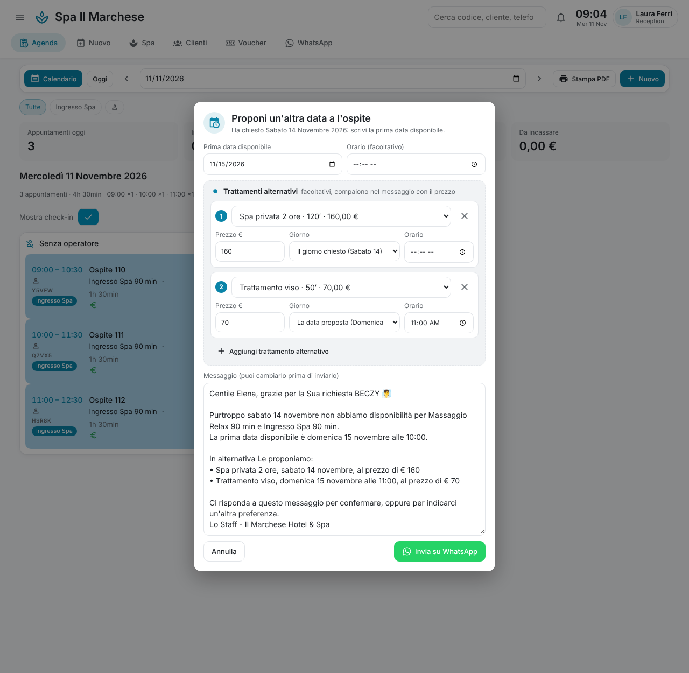 |

---

## 6. Modifica e prenotazioni di gruppo

**Modifica appuntamento** ha gli stessi passi di Nuovo appuntamento, con il
riepilogo a lato. Se cambi operatore (o l'orario) il nuovo operatore riceve
la richiesta da accettare e quello di prima viene avvisato. Se cambi scheda
senza salvare, la modifica si chiude.

Una prenotazione con più persone o più trattamenti ha **un solo codice**.
*Modifica* su uno qualsiasi dei suoi appuntamenti apre **Modifica gruppo**:

- **Scollega** (nel box di ogni persona): la persona diventa una
  prenotazione a parte, con un nuovo codice e i suoi incassi;
- **Aggiungi una prenotazione già inserita**: scrivi il codice di un'altra
  prenotazione e le sue persone entrano nel gruppo;
- pacchetti dello shop, persone e trattamenti si aggiungono come in Nuovo.

| | |
|---|---|
| 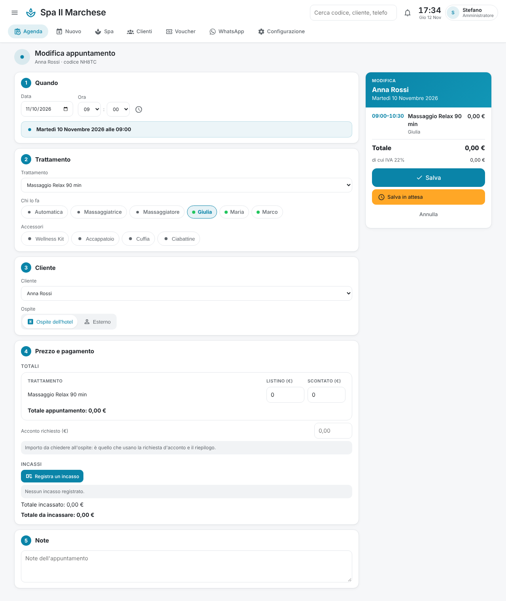 | 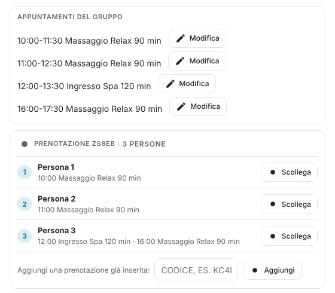 |

---

## 7. Spa

I comandi della spa da Home Assistant, divisi in sezioni (luci, clima,
servizi e sensori) con un riepilogo per sezione. La sotto-scheda
**Telecamere** (non per le massaggiatrici) mostra le immagini dal vivo. Con
la matita si aggiungono, spostano e nascondono i riquadri.

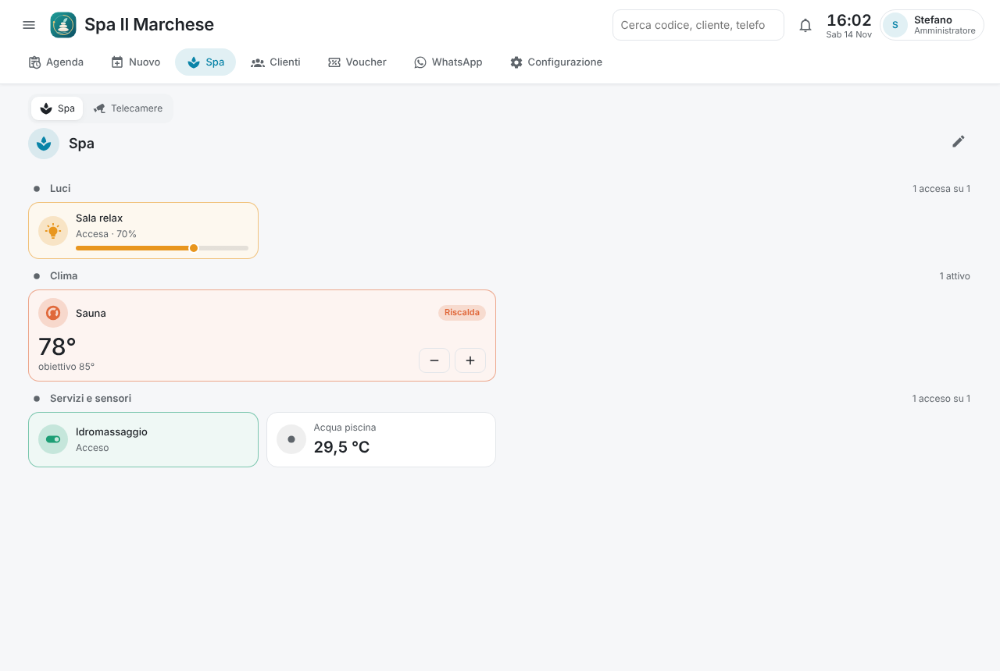

---

## 8. Clienti

L'elenco dei clienti con telefono, email, ultima visita e numero di visite;
i pulsanti chiamano, scrivono su WhatsApp o aprono una prenotazione. Il
cliente viene riconosciuto dal telefono (anche numeri esteri), quindi non si
creano doppioni. Manager e Amministratore possono creare e unire i clienti.

| | |
|---|---|
| 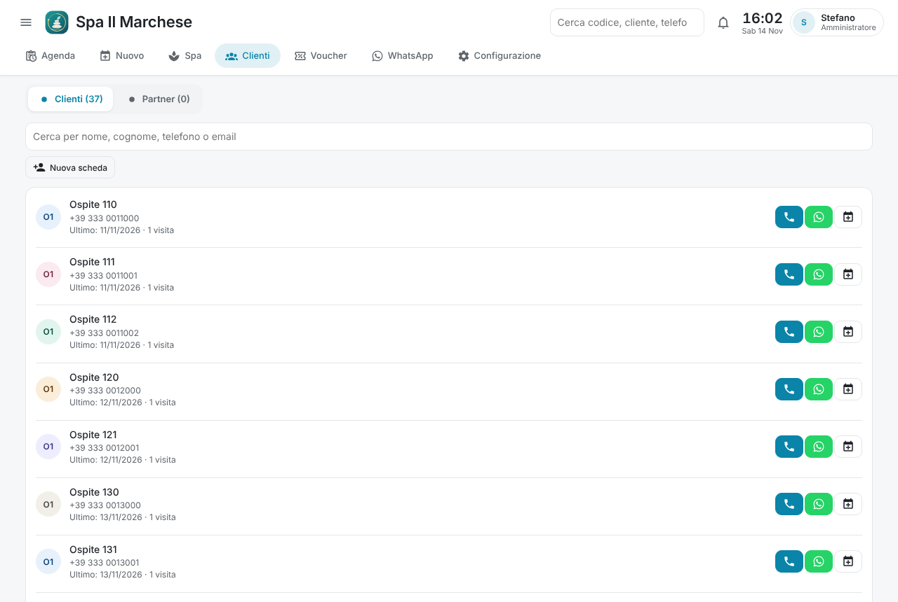 | 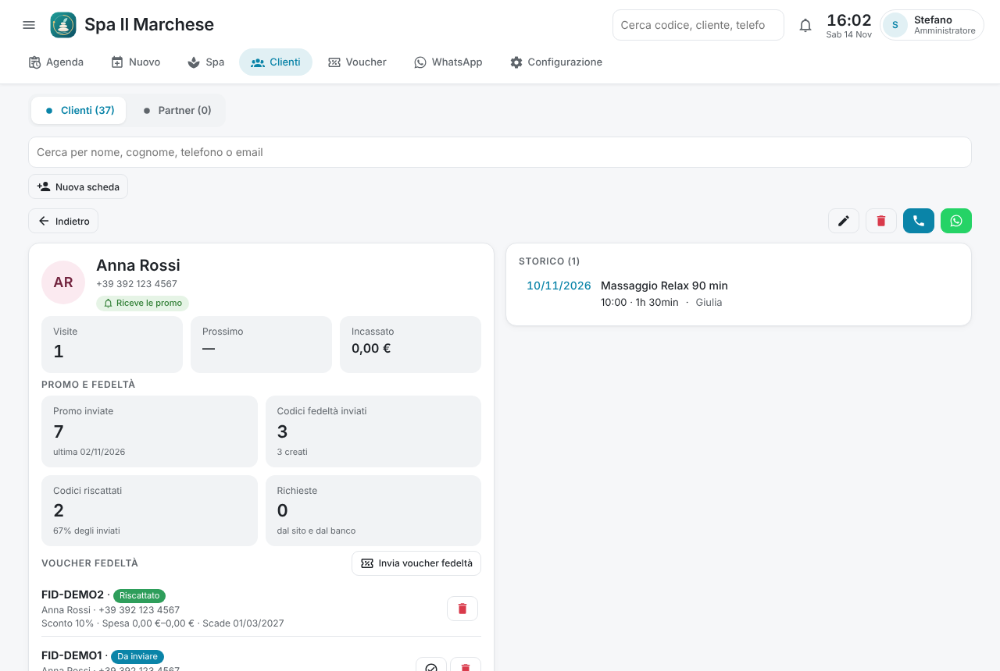 |

**Scheda del cliente**: contatti, «Cliente abituale» (da 3 visite),
iscrizione alle promo, visite e prossimo appuntamento, speso (Manager e
Amministratore), note, **Promo e fedeltà** (promo ricevute, voucher fedeltà
inviati e riscattati, richieste), **punti fedeltà** con la barra verso il
premio, e lo storico degli appuntamenti.

- **Invia voucher fedeltà**: crea un voucher anche senza una visita (sconto,
  validità, spesa minima) e lo invia subito su WhatsApp o per email.
- **Crea buono** quando ha raggiunto la soglia dei punti; **Rettifica punti**.

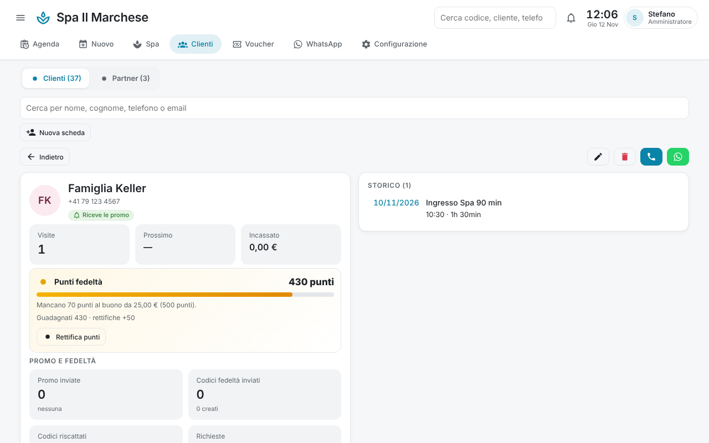

### Clienti del sito

Clienti › **Sito** (3.3) riunisce le persone che arrivano dal sito, una
sola volta ciascuna: chi si è **iscritto alla newsletter**, chi ha
**acquistato nello shop** e chi ha **prenotato dal modulo del sito**.
Accanto al nome compaiono da dove arriva, gli acquisti, il **codice sconto
della newsletter** con la scadenza (barrato se usato o scaduto) e se può
ricevere offerte. I filtri in alto mostrano un gruppo alla volta; ⋮ apre la
scheda cliente, chiama, scrive su WhatsApp, copia l'email o ferma le
offerte a quella persona.

L'elenco si aggiorna da solo ogni ora (o con **Aggiorna dal sito**) e
richiede il plugin WordPress **Spa Booking Connector 1.2.0** (vedi Shop
online).

**Nuova campagna**: si scelgono i gruppi (iscritti alla newsletter, chi ha
acquistato, chi ha prenotato dal sito accettando le offerte, chi ha un
codice sconto ancora valido), oggetto e testo con i segnaposto `{nome}`,
`{cognome}`, `{codice_sconto}`, `{sconto}`, `{scadenza_sconto}` e
`{link_prenota}`. *Anteprima*, *Invia prova*, poi **Invia**: le email
partono in sottofondo, una al secondo, e la barra mostra l'avanzamento.
Ognuno riceve una sola email anche se è in più gruppi, e in fondo c'è il
link per cancellarsi. Il tasto ✉ sulla riga manda un'email a quella sola
persona.

> Ricevono offerte solo gli iscritti alla newsletter, chi ha acquistato
> (offerte su servizi simili) e chi ha messo la spunta nel modulo; mai chi
> ha cancellato l'iscrizione. Gmail invia circa 500 email al giorno: per
> liste più lunghe conviene un account SMTP.

| | |
|---|---|
| 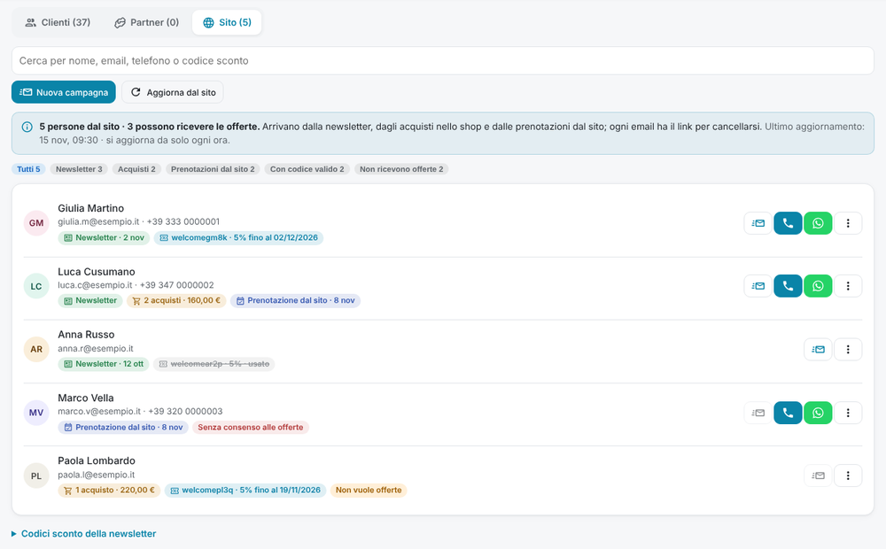 | 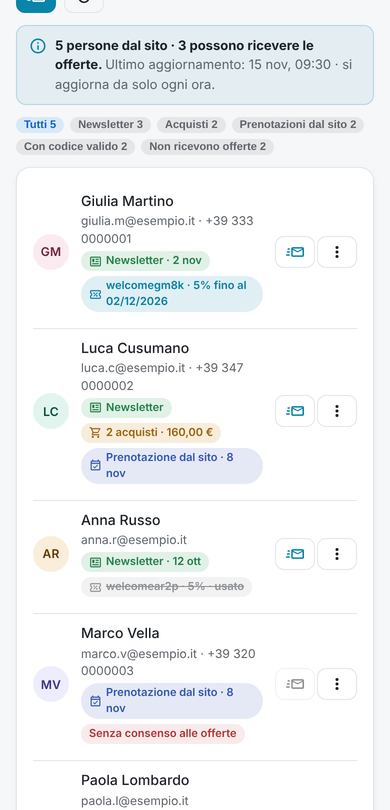 |

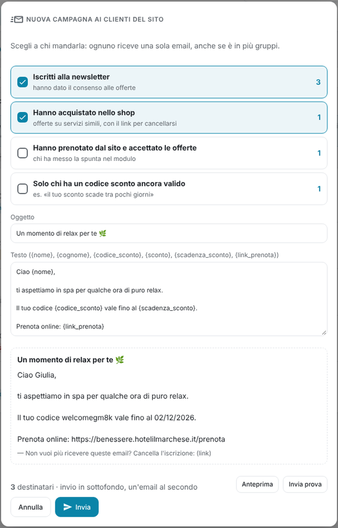

---

## 9. Partner

In Clienti › **Partner** ci sono le strutture e le persone che portano
ospiti (hotel, agenzie, B&B…). *Nuovo partner* o **Importa file** (CSV da
Excel; *Modello* scarica un esempio; chi ha la stessa email non viene
duplicato). La lista mostra 40 partner alla volta (*Mostra altri 100*,
*Mostra tutti*): con centinaia di partner la scheda si apre subito; la
ricerca e i filtri cercano sempre in tutti.

Toccando un partner si apre la sua **scheda**: link da copiare, punti con la
barra verso il premio, **Genera voucher e invia** (crea una gift card del
valore del premio, toglie i punti e la manda su WhatsApp o per email),
**Invia voucher fedeltà**, rettifiche, iscrizione alle email, e le
prenotazioni dei suoi ospiti con importo e punti.

| | |
|---|---|
| 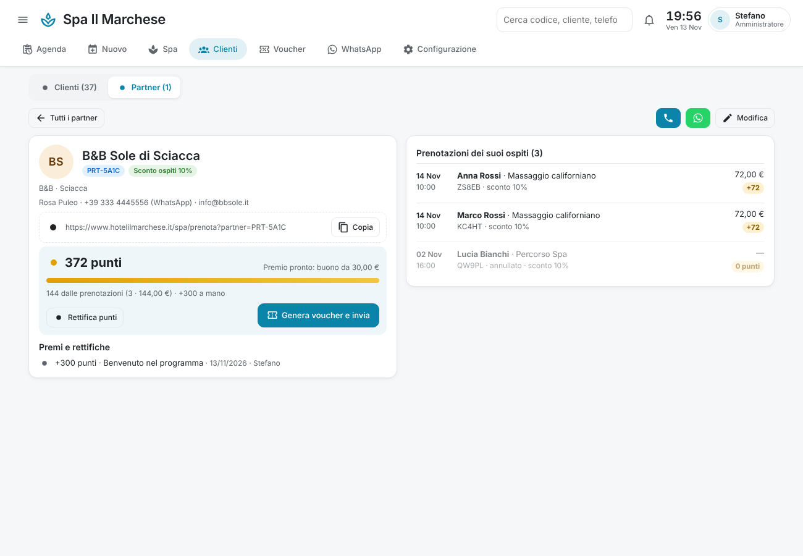 | 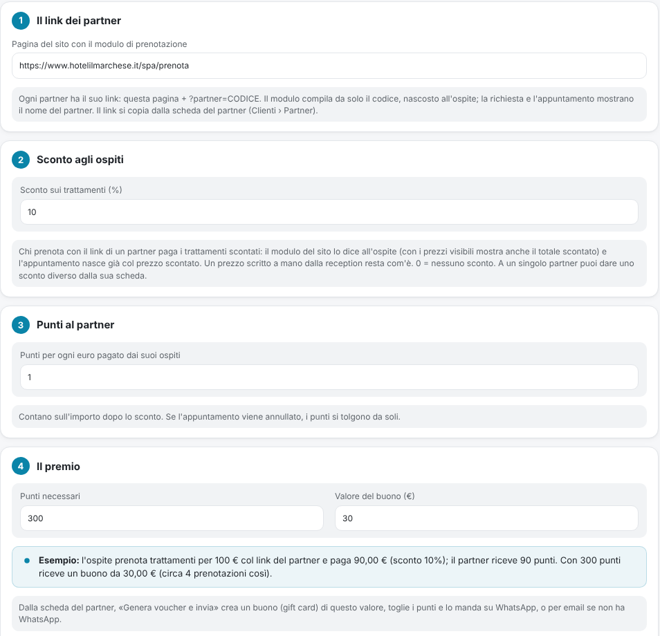 |

**Sul telefono** (3.2) ogni partner è una riga compatta: nome, codice,
città e punti, il tasto **Invia email** e **⋮** con le altre azioni (scheda,
Chiama, WhatsApp, Locandina A5, Copia il link, Modifica, Elimina). Importa,
Modello e Svuota lista sono nel menu **⋯** accanto a *Nuovo partner*.

**Invia email** (dalla riga, dal ⋮ o dalla scheda) manda a quel solo
partner:

- la **locandina A5 per i suoi ospiti**, oppure
- una delle **campagne partner** (solo a lui; la campagna resta da inviare
  agli altri).

La locandina ha il titolo **Spa Sciacca**, cosa offre la spa, i prezzi, lo
sconto riservato agli ospiti del partner e il **codice QR**: inquadrandolo,
l'ospite arriva alla pagina di prenotazione con il codice del partner già
inserito. Nell'email la locandina è un'immagine: toccandola si apre la
pagina per **stamparla in A5 o salvarla in PDF**. *Locandina A5* nel menu
apre la stessa pagina per stamparla subito alla reception.

| | |
|---|---|
| 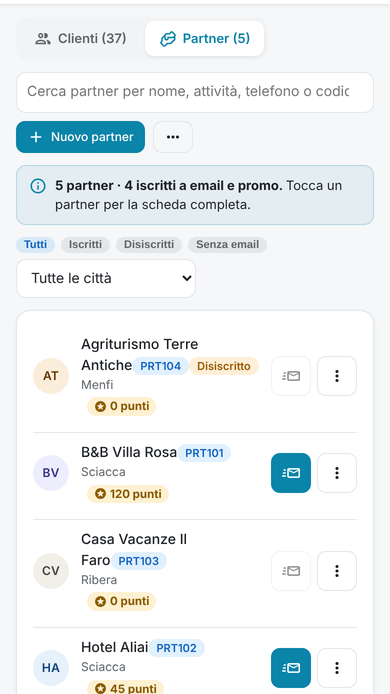 | 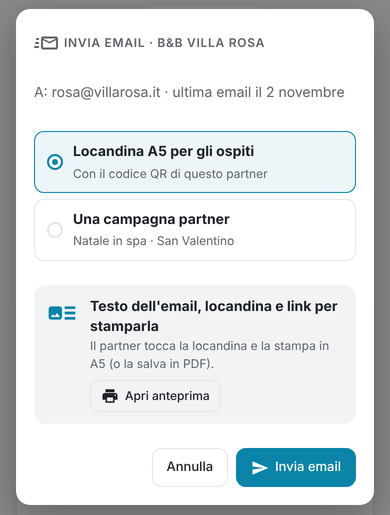 |
| 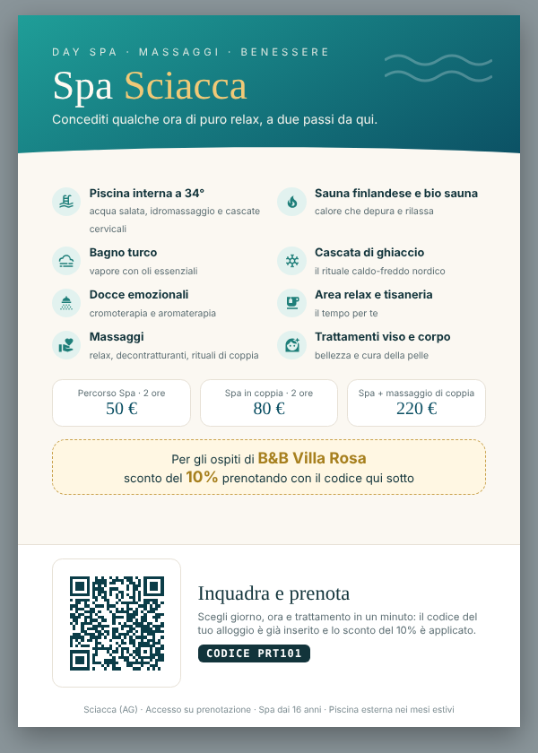 | 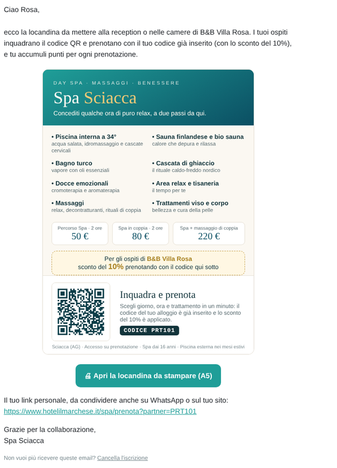 |

Per l'invio servono: Configurazione › Email attiva, la pagina di
prenotazione dei partner (Programma partner, passo 1) e l'indirizzo
pubblico in Impostazioni › Sito web (il QR e il link della locandina devono
aprirsi da fuori). Ai partner disiscritti o senza email il tasto è spento.

**Programma partner** (Configurazione › Promo › Programma partner):

1. **Il link dei partner**: la pagina del sito con il modulo; ogni partner
   ha il suo link (`?partner=CODICE`) e il modulo compila da solo il codice,
   che l'ospite non vede. Il sito lo ricorda per 30 giorni.
2. **Sconto agli ospiti** (es. 10%, anche diverso per partner): il modulo lo
   annuncia, l'appuntamento nasce col prezzo scontato e la conferma mostra
   lo sconto.
3. **Punti al partner** per ogni euro pagato dai suoi ospiti; un
   appuntamento annullato toglie i suoi punti.
4. **Il premio**: punti necessari, valore del buono e messaggio.
5. **La locandina**: titolo, sopratitolo e sottotitolo, le voci di cosa
   offre la spa (icona, titolo e descrizione, fino a 10), i prezzi (fino a
   4), l'invito sotto al QR, «come funziona» (`{sconto}` diventa lo sconto
   del partner), il piè di pagina e il testo dell'email. **Anteprima
   locandina** la mostra con i testi non ancora salvati; **Invia prova** la
   manda a un tuo indirizzo.

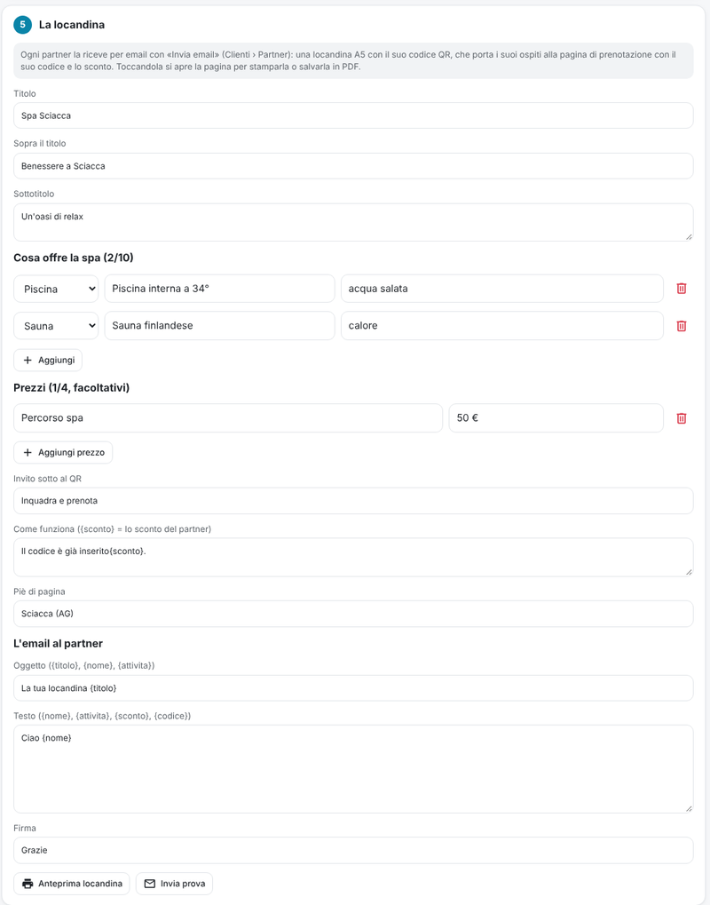

**Campagne partner**: email ai partner già pronte (oggetto e testo con i
segnaposto), con anteprima, *Invia prova* e invio in un giorno preciso o a
mano. Ogni email ha il link «Cancella l'iscrizione».

> In Italia le email promozionali richiedono il consenso preventivo del
> destinatario (art. 130 Codice Privacy), anche verso le aziende.

---

## 10. Voucher

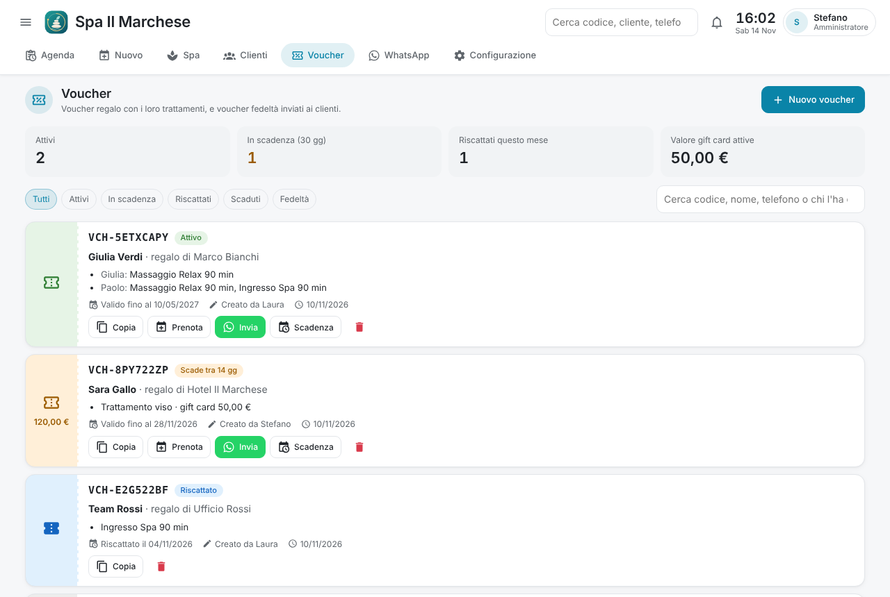

- **Riepilogo**: attivi, in scadenza nei prossimi 30 giorni, riscattati nel
  mese e (Manager) valore delle gift card attive. Toccando un numero si filtra.
- **Filtri**: Tutti, Attivi, In scadenza, Riscattati, Scaduti, Fedeltà,
  **Newsletter**; la ricerca trova anche chi ha creato il voucher.
- **Newsletter** (3.3): i codici sconto che il sito regala a chi si iscrive
  alla newsletter, con cliente, email, sconto, spesa minima, scadenza e
  stato (Valido, Scade tra N giorni, Usato, Scaduto). ✓ lo segna usato in
  spa e lo segna usato anche sullo shop; un codice usato sullo shop risulta
  usato anche qui.

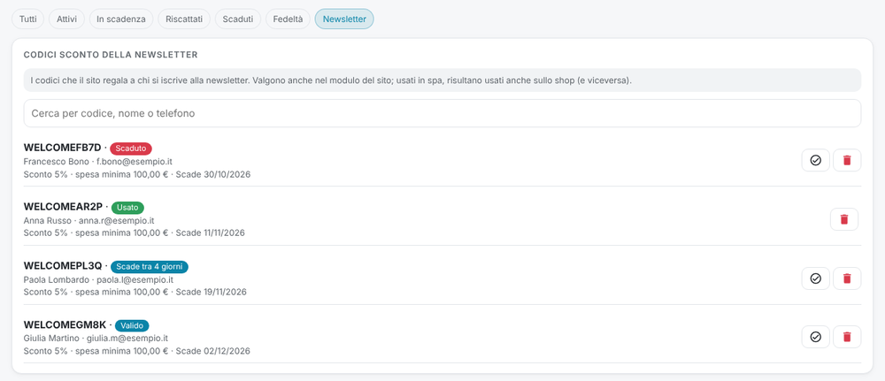
- **Ogni voucher è un biglietto** colorato secondo lo stato, con codice,
  destinatario, chi l'ha regalato, trattamenti per persona, scadenza e
  **Creato da**. Azioni: *Copia*, *Prenota* (apre la prenotazione già
  compilata), *Invia* su WhatsApp, *Scadenza* ed *Elimina* (Manager).
  Per un voucher venduto sul sito *Scadenza* salva la nuova data anche in
  WordPress (Buoni PDF), anche se è già scaduto, e lascia una nota
  nell'ordine (3.13, plugin 1.7.0); i voucher del sito già scaduti compaiono
  tra gli *Scaduti* proprio per poterli prorogare.

**Nuovo voucher in tre passi**: acquirente e destinatario; persone,
trattamenti, accessori e gift card in euro; riepilogo. *Crea voucher* chiede
il **PIN** di chi lo vende, che resta firmato sul voucher.

| | |
|---|---|
| 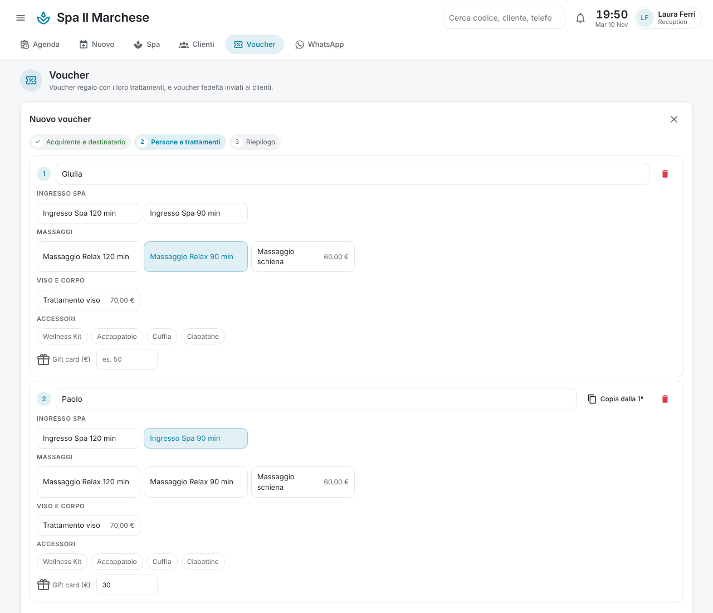 | 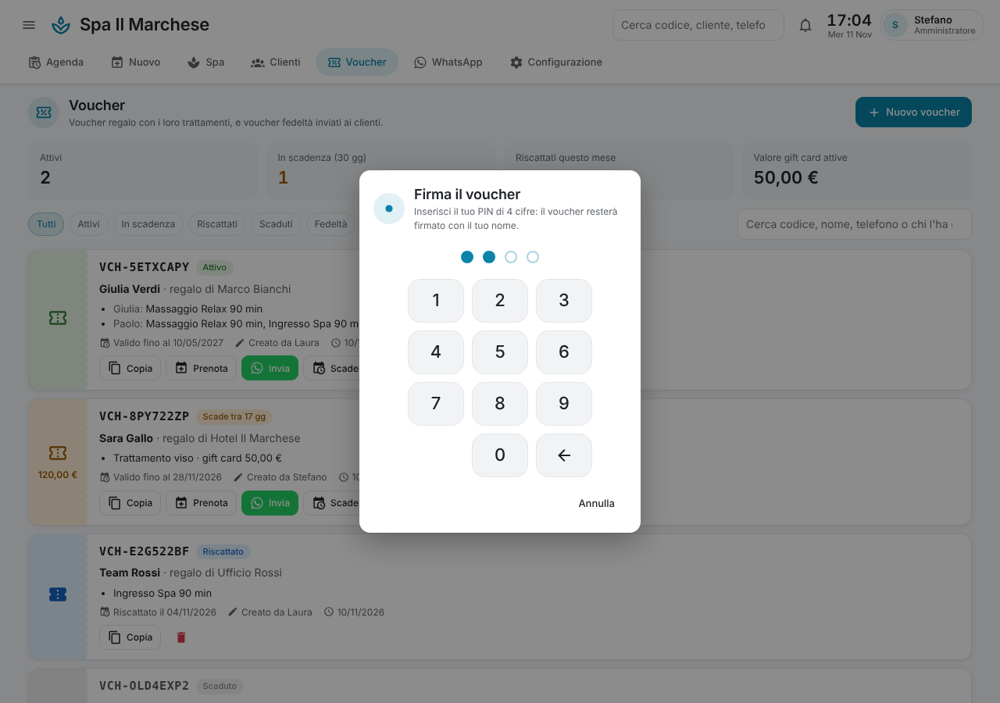 |

I voucher venduti sullo **shop online** arrivano da soli con l'etichetta
«Sito» (vedi [Shop online](#14-shop-online-woocommerce)). I **voucher
fedeltà** nascono all'uscita, a mano dalla scheda cliente o come premio punti.

---

## 11. WhatsApp e Telegram

La scheda **WhatsApp** mostra tutto quello che passa da Spa Booking: i
messaggi degli ospiti, conferme, promemoria e richieste d'acconto inviati,
le offerte agli operatori e le loro risposte, i report. Sotto ogni messaggio
c'è chi l'ha mandato («Automatico» se è partito da solo). Filtri *Ospiti* /
*Operatori* e ricerca; *Crea richiesta* e *Salva cliente* dalla chat. Ogni
pulsante WhatsApp della card (agenda, scheda, clienti) apre qui la chat di
quel numero, anche se non avete mai scritto prima.

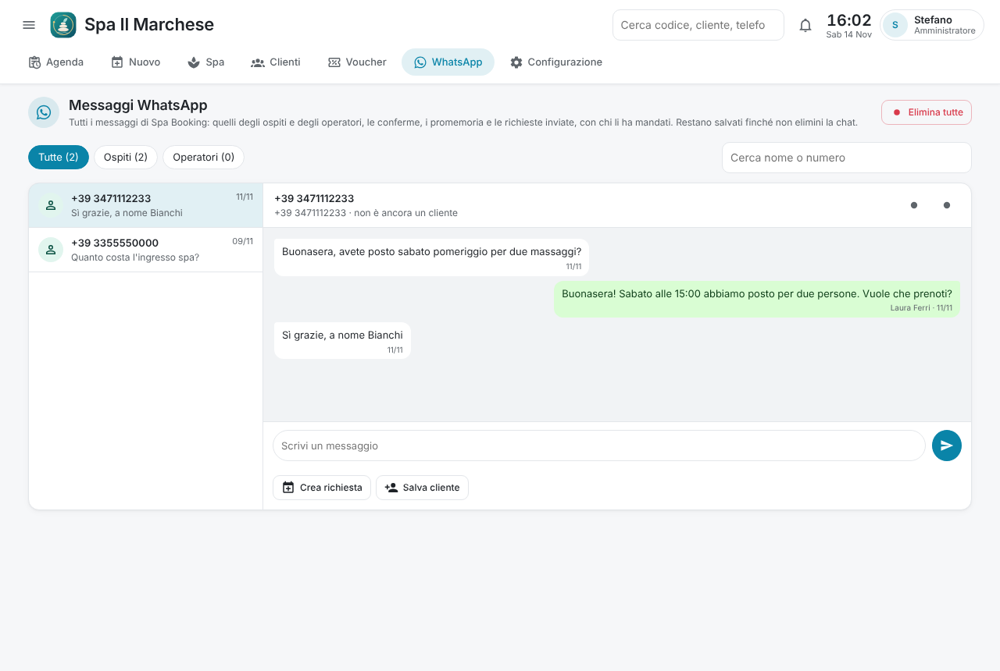

**La chat nelle schede** (3.5): la stessa conversazione si legge e si
continua senza cambiare pagina:

- nella **scheda dell'appuntamento**, sezione *Chat WhatsApp*, con due
  linguette: il **cliente** e l'**operatrice** dell'appuntamento (offerte,
  conferme e risposte);
- nella **scheda del cliente** (Clienti) e nella **scheda dell'operatrice**
  (Configurazione › Operatori).

Quando un cliente scrive, accanto al suo nome in agenda (timeline, schede ed
elenco) compare un **pallino verde** finché qualcuno non apre la sua chat.
Il riquadro della chat ha il bordo verde WhatsApp e il pulsante d'invio è
tondo e verde (3.10).

**Risposte dal telefono** (3.11): quello che scrivi dal cellulare (o da
WhatsApp Web) sul numero della SPA compare anche nella chat di Spa Booking,
con la scritta *Dal telefono*, foto comprese; e la chat risulta letta. Con
WhatsApp integrato funziona da sé; con un server WAHA va aggiunto l'evento
`message.any` al webhook della sessione in WAHA. I messaggi scritti prima dell'aggiornamento
non vengono recuperati.

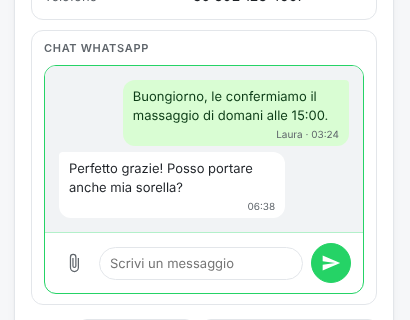

**Avvisi, la campanella** (3.10): la campanella in alto conta tutti i nuovi
avvisi e, toccata, apre l'elenco **Avvisi**, il più recente in cima:

- le **richieste dal sito** non ancora aperte (chi, cosa, per che giorno);
- le **chat WhatsApp** con messaggi non letti (ospiti, operatrici e gruppi),
  con l'ultimo messaggio e quanti ne sono arrivati.

Le linguette *Tutti · Richieste dal sito · WhatsApp* filtrano; toccando un
avviso si apre la richiesta o la chat, e l'avviso sparisce. **Segna tutto
come letto** svuota l'elenco. Chi non vede le richieste o la chat non ne
riceve gli avvisi.

| | |
|---|---|
| 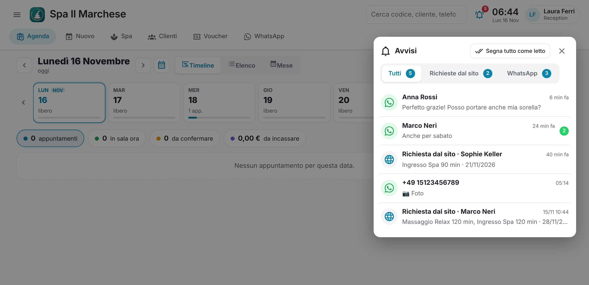 | 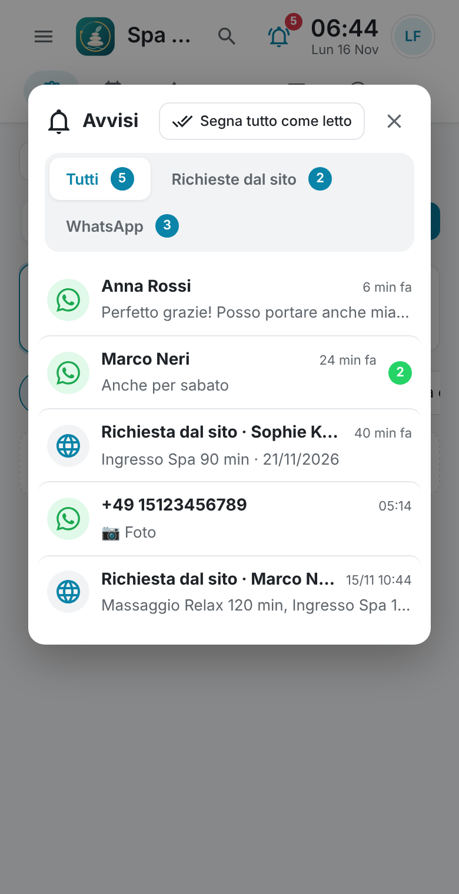 |

**Foto e file**: con 📎 si allega un'immagine o qualsiasi file (PDF,
listino, ricevuta… fino a 12 MB; le foto grandi vengono ridotte); il testo
scritto diventa la didascalia. Le foto, i documenti, i video e i vocali
ricevuti restano nella chat: la foto si apre grande toccandola, il file si
scarica. Serve **WhatsApp integrato** o **WAHA** (con il collegamento
tramite rest_command si inviano solo testi).

In **Impostazioni › Generale › Chat WhatsApp** si sceglie se mostrare la
scheda WhatsApp nel menu in alto e la chat nelle schede.

| | |
|---|---|
|  |  |
|  |  |

**Collegamento WhatsApp** (Configurazione › Notifiche › Collegamenti): Spa
Booking si collega da solo al numero dell'hotel, come WhatsApp Web. Premi
**Collega WhatsApp** e dal telefono dell'hotel: WhatsApp › Dispositivi
collegati › Collega un dispositivo, inquadra il QR (oppure *Ottieni codice*
con il numero). *Prova WhatsApp* manda un messaggio di prova.

**Bot Telegram integrato**, senza l'integrazione Telegram di Home Assistant:

1. su Telegram scrivi a **@BotFather** › `/newbot` e copia il token;
2. incollalo in Collegamenti e premi **Salva e collega**;
3. ogni operatore cerca il bot e scrive **/start**: il bot risponde con il
   codice della sua chat, che compare anche nella card con *Copia codice*;
4. incolla il codice nel campo Telegram della scheda dell'operatore.

Le offerte arrivano con i pulsanti Accetto / Rifiuto. Un bot si legge da un
solo programma: se era usato dall'integrazione Telegram di Home Assistant,
rimuovila (la card lo segnala). Dalla 3.15.1 lo stato si aggiorna da solo
ogni 30 secondi, un rallentamento della rete non viene più mostrato come
errore, e l'errore dice cosa fare: *un altro programma legge lo stesso bot*
(integrazione Telegram di Home Assistant o una seconda copia di Spa Booking,
come Spa Booking Web), *token non valido*, *Telegram chiede di rallentare*.

---

## 12. Configurazione

Solo per l'Amministratore. Su schermo largo il menu è una colonna a
sinistra, sul telefono una striscia di icone. In ogni pagina la barra
**Salva** compare solo quando cambi qualcosa.

### Categorie

Ogni categoria ha un colore, se richiede un'operatrice, la **pausa** dopo i
trattamenti, i **giorni** e le **fasce** di mattina e pomeriggio in cui
accetta prenotazioni, e **Non sovrapporre con**: le categorie con cui non
deve mai condividere l'orario (vale nei due sensi e non si può forzare).

**Capienza** (3.4), in fondo alla scheda della categoria:

- **Massimo N persone insieme nello stesso orario**: conta tutti i
  trattamenti della categoria, una persona per appuntamento, in ogni
  momento dell'appuntamento (es. Massaggi: 3; se alle 17 ci sono già tre
  massaggi, il quarto non entra finché uno non finisce).
- **Ingressi: massimo N persone ogni 5, 10, 15… minuti**: in qualsiasi
  intervallo di quella durata possono iniziare al massimo N persone (es.
  Spa: 6 ogni 15 minuti, quindi 16:00 sei persone, 16:15 altre sei, 16:30
  le ultime quattro fino a 16 insieme).
- **Vale per gli inizi dalle … alle …**: facoltativo; vuoto = tutto il giorno.
- **La reception può forzare**: senza la spunta il limite è rigido e
  l'orario pieno mostra subito il popup «Fascia oraria già occupata»; con la
  spunta il popup «Capienza al massimo» offre **Prenota comunque**, per far
  entrare un gruppo intero alla stessa ora (anche più di 16 persone).

Il modulo del sito non mostra mai gli orari pieni. Spostare o modificare
un appuntamento senza cambiare orario non rifà il controllo.

| | |
|---|---|
|  |  |
|  |  |

### Trattamenti

Divisi per categoria: durata, prezzo, **aliquota IVA** (22, 10, 5, 4, 0% o
predefinita), persone insieme (minimo e massimo), attivo, visibile sul sito,
operatrici abilitate. Con la **matita** si cambia l'ordine: trascina le
categorie e i trattamenti dalla maniglia ⋮⋮ (le categorie si possono
chiudere). L'ordine vale per il sito e per tutti i menu.

| | |
|---|---|
|  |  |

### Pacchetti

I pacchetti dello shop abbinati ai trattamenti: persone, trattamenti per
persona, accessori e prezzo. Due spunte decidono dove si vedono (**Modulo
web**, **Nuovo appuntamento e richiesta**) e si trascinano per cambiare
l'ordine. Gli abbinamenti si cambiano in Shop online. Per togliere dal
modulo del sito l'intera sezione Pacchetti c'è «Mostra la sezione
Pacchetti» in Impostazioni › Sito web.

### Accessori

Kit, accappatoio, cuffia, ciabattine… con simbolo, prezzo e aliquota IVA.

### Operatori

Nome, telefono con prefisso, WhatsApp e/o Telegram, **genere** (per la
preferenza dell'ospite), **priorità** per le offerte automatiche, trattamenti
che fa, attivo.

### Fasce bloccate

Chiusure della spa intera, di una categoria o di un'operatrice, a giornata o
con orario. Per i periodi lunghi, **Escludi i giorni** lascia aperti alcuni
giorni (es. tutto novembre chiuso tranne i sabati).

### Notifiche

- **Messaggi agli ospiti**: ricezione richiesta, proposta di un'altra data,
  conferma, **modifica della prenotazione** (3.16), richiesta d'acconto,
  annullamento, promemoria, recensione. Per
  ognuno: invio automatico e quando, testo con anteprima e segnaposto,
  *Ripristina testo base*, *Prova su WhatsApp*.
- **Operatrici** (3.15): i messaggi che ricevono le operatrici, modificabili
  come quelli degli ospiti (testo, segnaposto, anteprima, *Ripristina testo
  base*, *Prova su WhatsApp*):
  - *Turni da confermare*: **Proposta di turno**, **Appuntamento spostato**
    (con *Prima: …*), **Promemoria di risposta**;
  - *Avvisi*: **Nuovo appuntamento**, **Appuntamento assegnato**,
    **Appuntamento modificato**, **Non più assegnato**, **Appuntamento
    annullato**.

  Segnaposto: `{operatrice}`, `{cliente}`, `{codice}`, `{trattamento}`,
  `{durata}`, `{data}` (14-11-2026), `{giorno}` (sabato 14 novembre),
  `{ora}`, `{fine}`, `{note}`, `{note_cliente}`, `{prima}`, `{motivo}`,
  `{riepilogo}`. Una riga i cui segnaposto restano vuoti (per esempio
  *Note:* senza note) non viene inviata. Il **tempo per rispondere** e i
  passi della proposta sono in *Proposta di turno*, le ore del promemoria
  in *Promemoria di risposta* (3.15.1).

  | | |
  |---|---|
  |  |  |
- **Report**: destinatari del report mensile, invio immediato e anteprima;
  **Pochi ingressi alla SPA** (3.16): se in un giorno entrano meno persone
  del minimo (es. meno di 3), il numero di ore scelto prima del primo arrivo
  (24 = il giorno prima) la reception riceve un WhatsApp sui numeri
  «WhatsApp avvisi dal sito» e una notifica in Home Assistant, con l'elenco
  delle prenotazioni, per spostarle per tempo. Si sceglie cosa conta come
  ingresso (di base le categorie chiamate Spa o Ingresso) e si vedono i
  prossimi giorni.

  

**Prenotazione modificata** (3.16): dopo **Salva** di una prenotazione
spostata (giorno, ora o trattamento) la card chiede *Avvisare l'ospite della
modifica?*: l'ospite riceve «la Sua prenotazione è stata modificata ed è
confermata» con la prenotazione com'è adesso, non una nuova conferma. Anche
il pulsante dell'appuntamento diventa *Invia modifica* finché l'ospite non è
stato avvisato. Cambiare solo note o pagamenti non conta come modifica.

- **Collegamenti**: WhatsApp integrato e bot Telegram.

### Promo

- **Campagna promo**: le tue promo (programmata, ogni giorno, inviata,
  scaduta, bozza) e **Crea da un modello** (Natale, San Valentino, Pasqua,
  Black Friday, Weekend relax…): testo, codice e date già pronti. Si sceglie
  a chi va e quando (*Adesso*, *Un giorno preciso*, *Ogni giorno*). Si può
  allegare un **pacchetto dello shop** con prezzo in promo e link d'acquisto.
- **Voucher fedeltà**: regola dopo l'uscita (ore, sconto, spesa minima e
  massima, validità) e messaggio.
- **Punti fedeltà**: punti per euro, soglia e valore del buono premio, invio
  automatico, classifica.
- **Programma partner** e **Campagne partner**: vedi [Partner](#9-partner).

| | |
|---|---|
|  |  |

### Email

La casella da cui partono le email (voucher, campagne, avvisi):
**Accedi con Google** (senza password, solo permesso di invio) oppure SMTP
con password (Gmail con password per le app, Outlook / Microsoft 365, Aruba,
Libero, altro). Mittente, indirizzo per le risposte, *Invia email di prova*.

### Shop online

Vedi [Shop online](#14-shop-online-woocommerce).

### Accessi

Ogni utente con il suo ruolo; nella scheda dell'utente: **È in agenda come**
(collega l'utente alla sua operatrice), **PIN per il tablet**, **Tablet
condiviso**, nuova password, disattiva/riattiva. **Nuovo utente** crea
l'accesso di Home Assistant direttamente da qui (non amministratore, vede
solo questa dashboard). **Esci da solo dopo** imposta i minuti di
inattività del tablet.

### Impostazioni

- **Generale**: aspetto (Segui Home Assistant, Chiaro, Scuro), titolo della
  card, **sottomenu sul telefono**, chat WhatsApp, versione.

  **Sottomenu sul telefono** (3.12): per *Nuovo appuntamento*, *Spa* e
  *Configurazione* si sceglie come appare il menu interno sugli schermi
  stretti: **Verticale** (le icone in colonna a sinistra, come prima),
  **Pillole** (una riga in alto con icona e nome, che si scorre col dito) o
  **Barra** (tutte le voci in alto, larghe uguali, il nome sotto l'icona).
  Vale per tutti i dispositivi; si salva con *Salva* in basso. Sul computer
  il menu resta come sempre.

  

  
- **Dati fatturazione**: aliquota IVA predefinita e dati dell'azienda per la
  ricevuta.
- **Sito web**: richieste dal sito, orari proposti, numeri della reception
  avvisati (*Prova avviso*), indirizzo pubblico, colore, prezzi, codice da
  incollare in WordPress.
- **Dati e backup**: esporta/importa i clienti in CSV, scarica o ripristina
  il backup completo, **backup automatico su Google Drive** ogni giorno
  (restano gli ultimi 3, con *Ripristina*).

| | |
|---|---|
|  |  |

---

## 13. Modulo del sito

Il modulo che gli ospiti compilano sul sito dell'hotel. Su WordPress ci sono
solo due righe (Impostazioni › Sito web › *Copia codice per il sito*): il
modulo vero arriva da Home Assistant, quindi ogni aggiornamento compare sul
sito da solo, ed è isolato dal tema del sito.

1. **Quando**: data, persone e voucher (un voucher valido sceglie già i suoi
   trattamenti). Vale anche il **codice sconto della newsletter** (3.3): il
   modulo mostra lo sconto e la spesa minima, il totale lo toglie e la
   prenotazione confermata nasce con il prezzo scontato.
2. **Cosa scegliete**: per ogni persona trattamento e orario (solo quelli
   liberi, rispettando chiusure, regole e categorie che non si accavallano),
   preferenza massaggiatrice/massaggiatore; con 2 o più persone i
   **pacchetti dello shop** (si nasconde tutta la sezione togliendo
   «Mostra la sezione Pacchetti» in Impostazioni › Sito web).
3. **I tuoi dati**: nome, cognome, telefono con prefisso, email, note e la
   spunta facoltativa «Voglio ricevere offerte e novità» (3.3).
4. **Controlla e invia**: riepilogo e, se attivo, totale indicativo (con lo
   sconto partner).

La richiesta arriva in Nuovo › Lista richieste con la campanella. Lingue:
italiano, inglese e tedesco (dal browser o con IT, EN, DE).

| | |
|---|---|
|  |  |
|  |  |
|  |  |

---

## 14. Shop online (WooCommerce)

I voucher venduti sullo shop WooCommerce (con «Buoni PDF») arrivano in Spa
Booking da soli.

1. Carica il plugin `wordpress/spa-booking-connector.zip` in WordPress e
   attivalo (per aggiornarlo: Plugin › Aggiungi nuovo › Carica plugin ›
   «Sostituisci la versione installata»). La versione **1.2.0** passa anche
   iscritti alla newsletter, clienti dello shop e codici sconto della
   newsletter (Clienti › Sito); la **1.3.0** permette di modificare i
   prodotti da Spa Booking; la **1.4.0** aggiunge stato e disponibilità dei
   prodotti e gli ordini; la **1.5.0** lo *Stile shop* (vedi sotto); la **1.6.0** le varianti attive o
   disattivate.
2. In Configurazione › Shop online scrivi l'indirizzo del sito, premi
   **Nuova chiave** e copia chiave e indirizzo di notifica in WordPress ›
   WooCommerce › Spa Booking.
3. *Leggi i voucher dal sito*, **Salva**, **Prova collegamento**.
4. **Abbina i prodotti**: ogni prodotto mostra in una riga cosa include;
   **Abbina** (o *Modifica*) apre quel prodotto: i trattamenti, le persone,
   gli accessori inclusi; per le gift card *Valore fisso* o *Prezzo pagato*;
   **Fatto** lo richiude. Un prodotto aperto alla volta tiene la pagina
   veloce anche con molti prodotti e trattamenti (3.10.1).

   

Ogni 15 minuti (e subito a ogni ordine pagato) i nuovi codici diventano
voucher «Sito»; all'**Entrata** del cliente il voucher risulta riscattato
anche su WordPress. I prodotti abbinati diventano i **pacchetti** usati in
prenotazioni, modulo del sito e promo.

| | |
|---|---|
|  |  |

**Categorie e scheda del prodotto** (3.6): accanto a ogni prodotto ci sono
le sue categorie del sito, e i bottoni sopra la lista la filtrano per
categoria (la ricerca trova anche il nome della categoria). Toccando il nome
del prodotto (✏️) si apre la sua scheda, letta dal sito in quel momento:

- **Nome** e **Categorie** (si toccano per aggiungerle o toglierle);
- **Prezzo** e **In offerta** (vuoto = nessuna offerta); per i prodotti con
  varianti, i due prezzi di ogni variante;
- **Descrizione breve** e **Descrizione** (possono contenere tag HTML: si
  lasciano come sono).

**Salva sul sito** cambia il prodotto su WordPress e rilegge la lista;
*Vedi sul sito* apre la pagina del prodotto, *Apri in WordPress* l'editor
completo (foto, varianti, scorte). Serve il plugin 1.3.0 e il livello
Amministratore.

| | |
|---|---|
|  |  |

**Stato e disponibilità** (3.7): ogni prodotto mostra se è *Pubblicato*,
*Bozza*, *In revisione* o *Privato*, e se è *Esaurito* o *Su ordinazione*;
i bottoni sopra la lista filtrano per stato. Nella scheda si sceglie lo
**Stato sul sito** (pubblicarlo o rimetterlo in bozza) e la
**Disponibilità** (o i pezzi in magazzino, se il prodotto li conta).

**Ordini** (3.7): la linguetta *Ordini* di Shop online elenca gli ordini del
sito, i più recenti prima, con filtri per stato (In lavorazione,
Completato, In sospeso…), ricerca per numero, nome o email e pagine da 30.
Toccando un ordine si apre la sua scheda:

- **Cliente**: nome, email, telefono (chiama o WhatsApp), indirizzo, nota;
- **Articoli** con le opzioni scelte e i **codici voucher** (verde = già in
  Spa Booking, «da leggere» = arriva con la prossima sincronizzazione);
- **Pagamento**: subtotale, sconti e codici sconto, IVA, totale, metodo,
  data e transazione;
- **Verifica**: cambia lo stato (In attesa di pagamento, In lavorazione,
  In sospeso, Completato, Annullato) e aggiungi una nota, anche visibile al
  cliente. I **rimborsi** muovono denaro e si fanno da WordPress (*Apri in
  WordPress*).

| | |
|---|---|
|  |  |

**Varianti attive e disattivate** (3.9, plugin 1.6.0): molti prodotti sono
varianti (es. Relax 30′ / Relax 60′). Nella lista ogni variante dice se è
*Variante attiva* o *Variante disattivata* (in WooCommerce: «Abilitata») e
se è esaurita; il filtro **Varianti disattivate** le raccoglie. Nella scheda
del prodotto ogni variante ha l'interruttore **Attiva** accanto ai prezzi:
una variante disattivata non si vede e non si compra sul sito.

**Stile shop** (3.8, plugin 1.5.0): rifà lo shop e le schede prodotto del
sito nello stile del tema, senza toccare il tema né i prodotti. Si attiva in
WordPress › WooCommerce › Spa Booking › *Stile shop* › **Nuovo stile**;
togliendo la spunta tutto torna come prima.

- **Titolo** e **Sottotitolo** in cima allo shop.
- **Categorie in alto**: una per riga, `slug-categoria|Etichetta` (per
  esempio `rituali-romantici|Rituali di coppia`); diventano le linguette
  sopra i prodotti e il «tipo» scritto sopra ogni nome.
- **Prezzi «da»**: per i prodotti con varianti «da 80,00 €» invece di
  «80,00 € – 100,00 €».
- **Nota sotto il prezzo** per tutti i prodotti, e **Rassicurazioni** (una
  per riga) sotto il pulsante del carrello.

In ogni prodotto (Dati prodotto › Generale) ci sono tre campi facoltativi:
**Riga nello shop** («2 persone · 2 ore»), **In breve** (una voce per riga:
«2 ore», «Telo piscina incluso»…) e **Nota sotto il prezzo** (vince su
quella generale).

Nella scheda l'acquisto è in passi numerati: **1. Scegli la formula** (le
varianti diventano riquadri con il prezzo), **2. Come vuoi pagare** (acconto
o intero, con l'importo), **3. Il voucher** (i campi di Buoni PDF, uno sotto l'altro); il
pulsante dice quanto si paga ora («Aggiungi al carrello · 40,00 €»). Sotto
ci sono sempre i moduli originali di WooCommerce, acconti e Buoni PDF: il
carrello e i voucher funzionano come prima.

| | |
|---|---|
|  |  |

---

## 15. Aggiornamenti

Se Spa Booking è installato da HACS, l'Amministratore vede in alto **Nuova
versione di Spa Booking** con *Novità*, *Installa* e *Più tardi*. Finita
l'installazione la card dice se basta **ricaricare la pagina** (solo card o
modulo) o se serve **riavviare Home Assistant** (*Riavvia ora*). Le beta
compaiono se in HACS è attivo «Mostra le versioni beta».

---

## 16. Telefono, tablet e tema scuro

Sul telefono le schede diventano icone, l'agenda mostra le schede del giorno
con un solo pulsante (quello che serve adesso), Nuovo appuntamento ha la
barra del totale in basso e WhatsApp mostra prima le conversazioni e poi la
chat.

| | |
|---|---|
|  |  |

