# Spa Booking — guida alle schede (2.2)

Aggiornata alla 2.8.1: [conto e voucher come pagamento](#conto-e-voucher-come-pagamento-281); [backup su Google Drive](#backup-su-google-drive-280); [Shop online](#shop-online-270); [importa partner e disiscrizione](#importa-partner-e-disiscrizione-260); [vista Mese](#vista-mese-255); [Dati fatturazione e Modifica appuntamento](#dati-fatturazione-e-modifica-appuntamento-252); [IVA](#iva-251); [campagne e punti partner](#campagne-e-punti-partner-250); [Email e Accedi con Google](#email-241); [dettaglio, punti e partner](#dettaglio-punti-fedelta-e-partner-240); [Agenda](#agenda-2312); [Nuovo appuntamento a passi](#nuovo-appuntamento-a-passi-2310); [promo salvate e modelli](#promo-salvate-e-modelli-239); [Promo e Impostazioni](#promo-e-impostazioni-238); [Notifiche](#notifiche-236); [messaggi e chat](#messaggi-e-chat-235); [preferenza massaggiatrice/massaggiatore](#preferenza-massaggiatrice-o-massaggiatore); [promo e fedeltà del cliente](#promo-e-fedeltà-del-cliente); [conferme e promemoria WhatsApp](#conferme-e-promemoria-whatsapp); [firme e storico](#firme-e-storico); [chiusure con giorni esclusi](#chiusure-con-giorni-esclusi); [Proponi data](#proponi-data) nelle richieste, con trattamenti alternativi e prezzo; [aggiornamenti dalla card](#aggiornamenti), nuove schede di richieste, cliente e configurazione; [modulo del sito](#modulo-del-sito) a passi e in tre lingue, [avviso delle regole di categoria](#avviso-regole-della-categoria).

Questa guida mostra ogni scheda della dashboard **Spa Booking** e spiega a
cosa serve ogni funzione. Le immagini sono state fatte con dati di prova.
Dalla 2.2 tutte le schede hanno lo stesso stile:
- riquadri chiari con gli angoli arrotondati;
- una riga di numeri in alto per vedere la situazione a colpo d'occhio;
- pulsanti colorati per lo stato di ogni elemento;
- l'azione principale sempre in alto a destra.

Il tema chiaro e quello scuro seguono Home Assistant (oppure la scelta fatta
in Impostazioni › Aspetto).

- [Accesso e ruoli](#accesso-e-ruoli)
- [Agenda](#agenda)
- [Nuovo: appuntamento, richiesta, lista richieste](#nuovo)
- [Spa](#spa)
- [Clienti](#clienti)
- [Voucher](#voucher)
- [WhatsApp](#whatsapp)
- [Configurazione](#configurazione)
- [Modulo del sito](#modulo-del-sito)
- [Aggiornamenti](#aggiornamenti)
- [Telefono e tablet](#telefono-e-tablet)

---


## Conto e voucher come pagamento (2.8.1)

Ogni prenotazione ha il riquadro **Conto**: Totale, Pagato, Da saldare e gli
incassi uno per uno. Per incassare il saldo basta un tocco su **Contante**,
**Carta** o **Bonifico**; **Altro importo** serve per una parte del saldo o
per un altro metodo.

**Con un voucher** gli incassi si registrano da soli quando salvi la
prenotazione:

- i trattamenti compresi nel voucher risultano pagati («Voucher»);
- la **gift card** paga il resto fino al suo valore («Gift card»). Esempio:
  gift card da 50 €, prenotazione da 100 € → pagato 50 €, da saldare 50 €;
- se la gift card vale più del conto, il **credito residuo** resta sul
  voucher e si usa la volta successiva;
- se annulli l'appuntamento, il voucher torna disponibile.

Il voucher non deve più coincidere alla perfezione: una persona o un
trattamento in più si pagano come saldo.

| | |
|---|---|
| 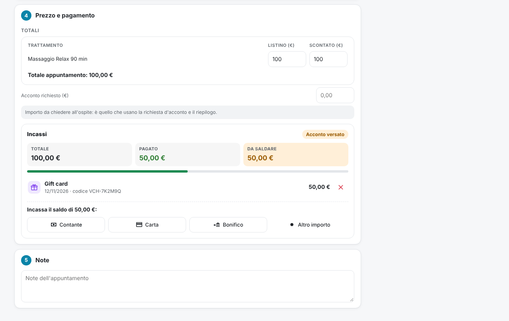 | 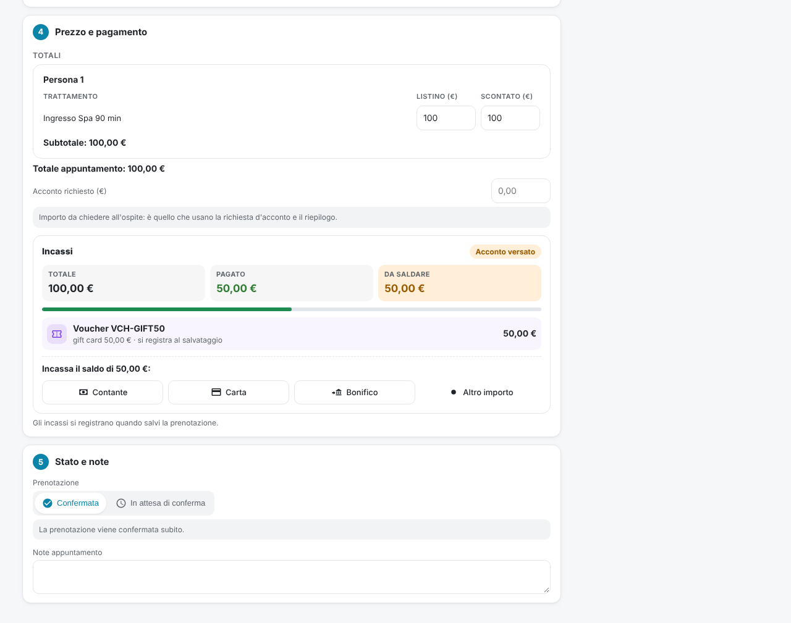 |

## Backup su Google Drive (2.8.0)

In **Configurazione › Impostazioni › Dati e backup**:

1. Una volta sola, nel progetto Google Cloud già usato per l'email: API e
   servizi › Libreria › **Google Drive API** › Abilita.
2. Premi **Collega Google Drive** e spunta il permesso. Spa Booking vede solo
   i file che crea lui, nient'altro del tuo Drive; l'invio delle email non
   cambia.
3. Attiva **Backup automatico ogni giorno** e scegli l'ora (03:30 di
   default).

Ogni giorno il backup completo (lo stesso di «Scarica backup») va nella
cartella **Spa Booking backup** del Drive, con il nome
`spa-booking-backup-AAAA-MM-GG.json`. Restano gli ultimi 3: quando arriva il
nuovo, il più vecchio viene cancellato. Se Home Assistant era spento all'ora
scelta, il backup parte appena si riaccende, nello stesso giorno; se Google
non risponde riprova dopo un'ora. **Fai il backup ora** salva subito (lo
stesso giorno sostituisce il file di oggi); **Backup su Drive** mostra
l'elenco con **Ripristina**.

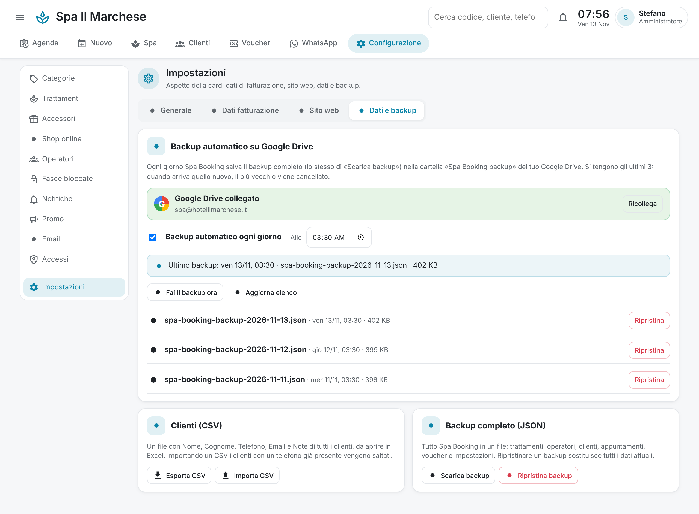

## Shop online (2.7.0)

I voucher venduti su **benessere.hotelilmarchese.it** (WooCommerce con
«Buoni PDF») arrivano in Spa Booking da soli.

**Collegamento (una volta sola)**

1. Scarica il plugin `wordpress/spa-booking-connector.zip` (anche dalla
   pagina Shop online) e caricalo in WordPress › Plugin › Aggiungi nuovo ›
   Carica plugin; attivalo.
2. In Spa Booking › Configurazione › Shop online scrivi l'indirizzo del sito,
   premi **Nuova chiave** e copia chiave e indirizzo di notifica in
   WordPress › WooCommerce › Spa Booking.
3. Attiva «Leggi i voucher dal sito», **Salva**, poi **Prova collegamento**:
   legge i prodotti del sito.

**Abbinare i prodotti** – per ogni prodotto o variante scegli uno o più
trattamenti (un pacchetto ne ha più di uno) e per quante persone vale (es.
You&Me = 2). Nei pacchetti scegli anche gli **accessori inclusi** e, se c'è
qualcosa che non esiste in Spa Booking, scrivilo nella nota «altro incluso».
Se manca un trattamento o un accessorio, crealo con «Nuovo trattamento» /
«Nuovo accessorio» e torna: l'abbinamento non salvato resta lì. Puoi rifare
l'abbinamento quando vuoi: al salvataggio i voucher non ancora usati si
aggiornano. Per le **gift card** scegli «Valore fisso» (con l'importo in €) oppure
«Prezzo pagato», per quelle a importo libero: il credito compare sul voucher.
Un voucher di un prodotto non abbinato si può comunque usare:
prenoti quello che il cliente ha acquistato.

**Come funziona** – ogni 15 minuti (e subito quando il sito avvisa di un
ordine pagato) i nuovi codici diventano voucher con l'etichetta «Sito»,
con acquirente, destinatario, dedica, valore e scadenza. Al primo
collegamento arrivano anche quelli degli ultimi 6 mesi non ancora usati. Si
prenota con il codice come gli altri voucher; quando registri l'**Entrata**
del cliente il voucher risulta riscattato anche su WordPress (con una nota
nell'ordine). Se il sito non risponde, Spa Booking riprova da solo; in Shop
online trovi i voucher «da segnare sul sito» con **Riprova**.

| | |
|---|---|
| 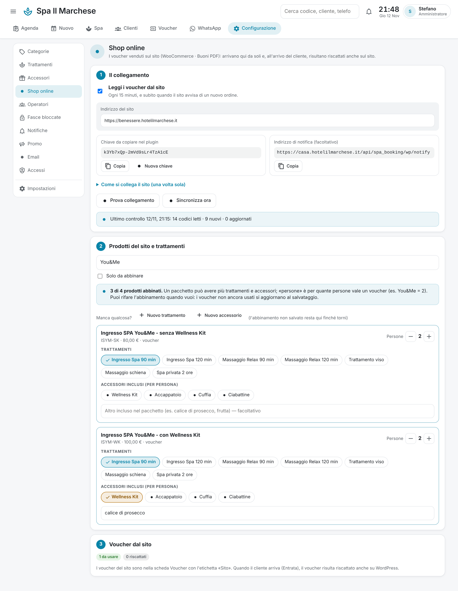 | 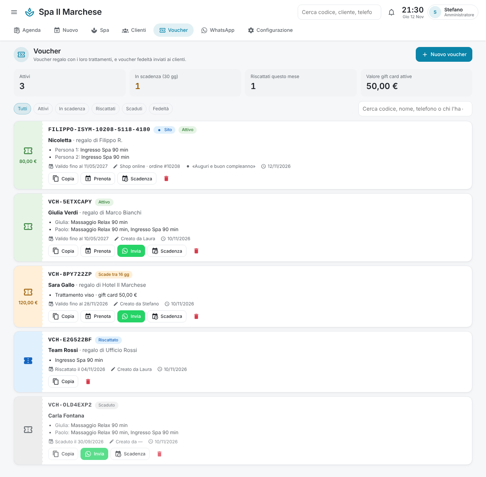 |
| 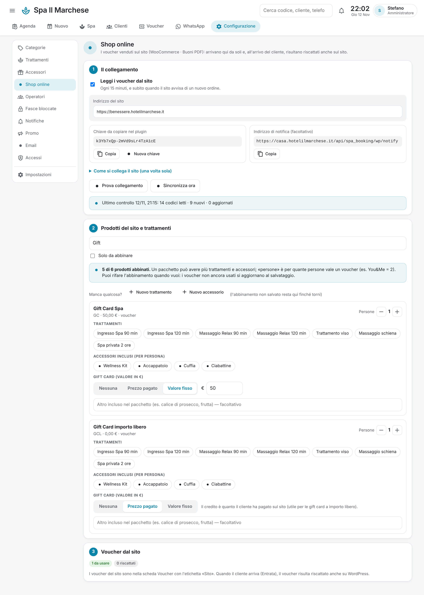 | |

## Importa partner e disiscrizione (2.6.0)

In **Clienti › Partner** premi **Importa file** e scegli un file CSV (da
Excel: File › Salva con nome › CSV). Le colonne riconosciute sono Nome
struttura, Tipo, Nome, Cognome (oppure Titolare), Città, Telefono, WhatsApp
(sì/no), Email; **Modello** scarica un file d'esempio. Chi ha la stessa email
di un partner già presente non viene duplicato: si completano solo i dati
mancanti.

Ogni partner è **iscritto** a email e promo, salvo che tolga l'iscrizione.
In fondo a ogni email delle campagne c'è il link «Cancella l'iscrizione»
(serve l'indirizzo pubblico di Home Assistant, Configurazione › Impostazioni
› Sito web): chi conferma non riceve più nulla. Puoi anche togliere o
rimettere l'iscrizione dalla scheda del partner. Ogni scheda si può
eliminare con il cestino.

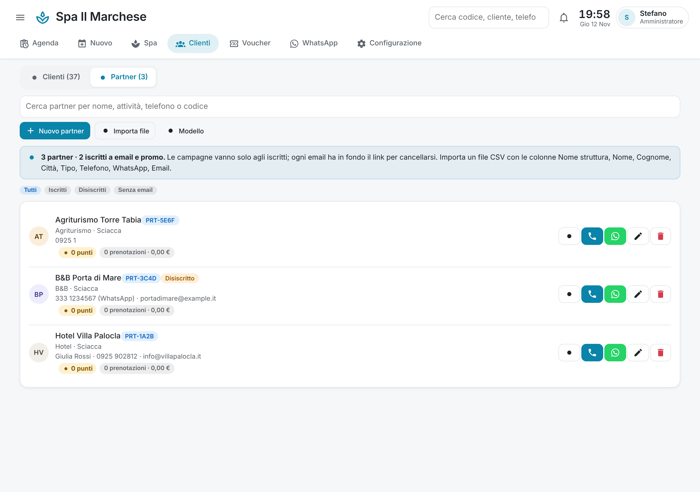

> Attenzione: in Italia le email promozionali richiedono il consenso
> preventivo del destinatario (art. 130 Codice Privacy), anche verso le
> aziende. Usa il primo contatto per presentarti e chiedere se vogliono
> ricevere le promo.

## Vista Mese (2.5.5)

In Agenda › **Mese** ogni giorno mostra i primi tre appuntamenti (ora e
nome, col colore della categoria; in arancione quelli da confermare), «+N
altri» e una barretta di quanto è pieno. I giorni chiusi sono tratteggiati con
«Chiuso». In alto le pillole del mese: appuntamenti, incasso, da confermare,
giorno più pieno, giorni chiusi.

Tocca un giorno: a destra (sul telefono sotto il calendario) vedi il carico di
ogni operatore e gli appuntamenti; tocca una riga per aprire la scheda, oppure
**Apri la giornata** per passare alla timeline. Un doppio clic sul giorno lo
apre direttamente.

| | |
|---|---|
| 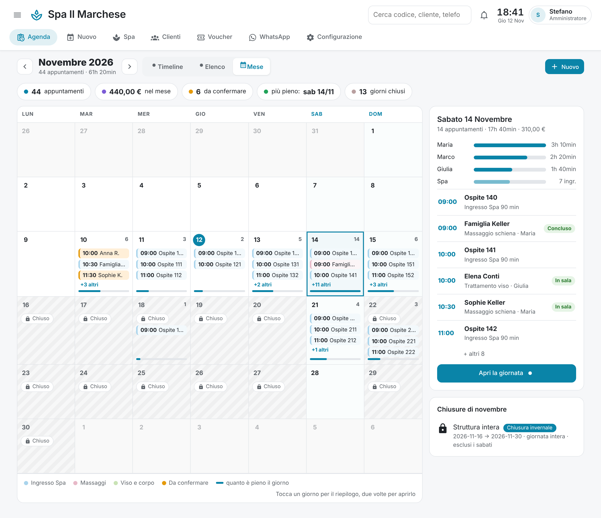 | 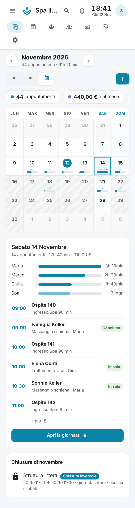 |

## Dati fatturazione e Modifica appuntamento (2.5.2)

In **Configurazione › Impostazioni › Dati fatturazione** trovi l'aliquota IVA
predefinita (non più in Generale) e i dati dell'azienda: ragione sociale,
partita IVA, codice fiscale, codice destinatario SDI, sede, telefono, email,
PEC e una nota in fondo alla ricevuta. Anche gli **accessori** hanno la loro
aliquota (Configurazione › Accessori), come i trattamenti.

**Modifica appuntamento** ha lo stesso aspetto di Nuovo appuntamento: passi
Quando, Trattamento, Cliente, Prezzo e pagamento, Note, con il riepilogo a
lato (o la barra in basso sul telefono). Se cambi scheda senza salvare, la
modifica si chiude e non viene salvata.

| | |
|---|---|
| 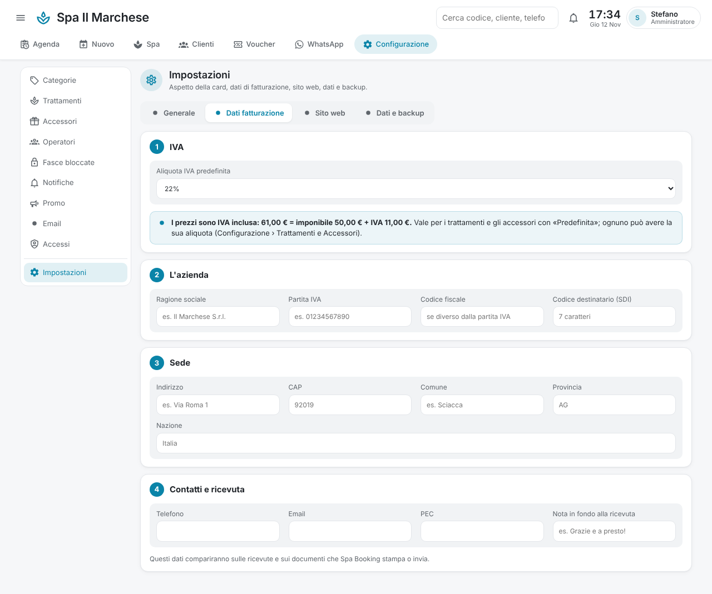 | 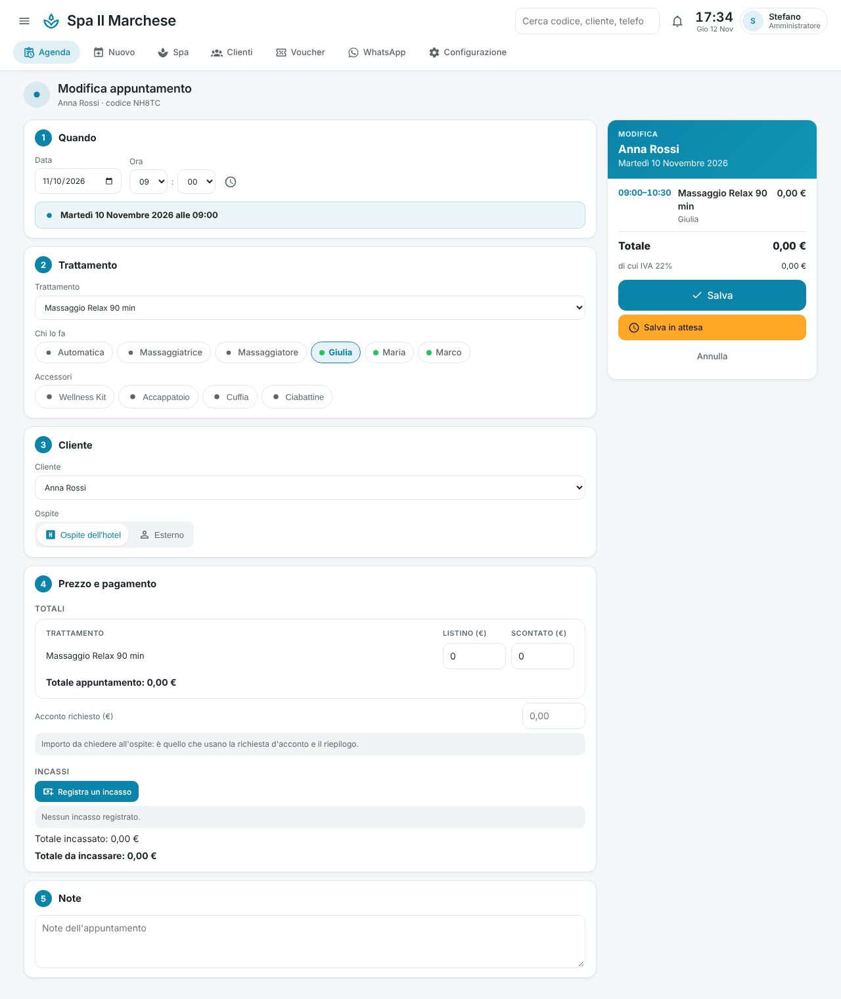 |

## IVA (2.5.1)

I prezzi sono **IVA inclusa**. In Configurazione › Impostazioni › Dati fatturazione
scegli l'**aliquota predefinita** (22%); in Configurazione › Trattamenti ogni
trattamento può avere la sua (22, 10, 5, 4 o 0% esente) oppure «Predefinita».
Sotto il prezzo la card mostra imponibile e IVA. Ogni appuntamento conserva
l'aliquota del giorno in cui è stato prenotato; il riepilogo di Nuovo
appuntamento mostra «di cui IVA» e il dettaglio la riga IVA con l'imponibile.

| | |
|---|---|
| 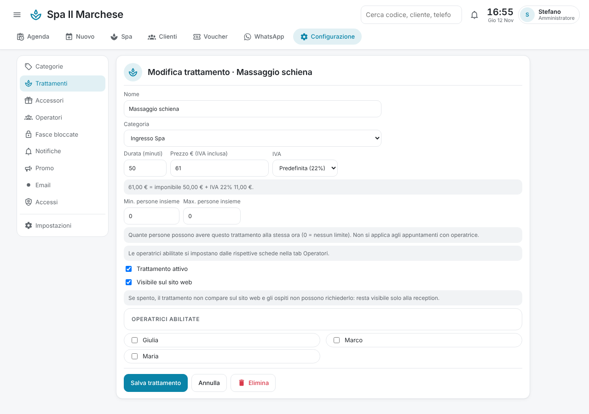 | 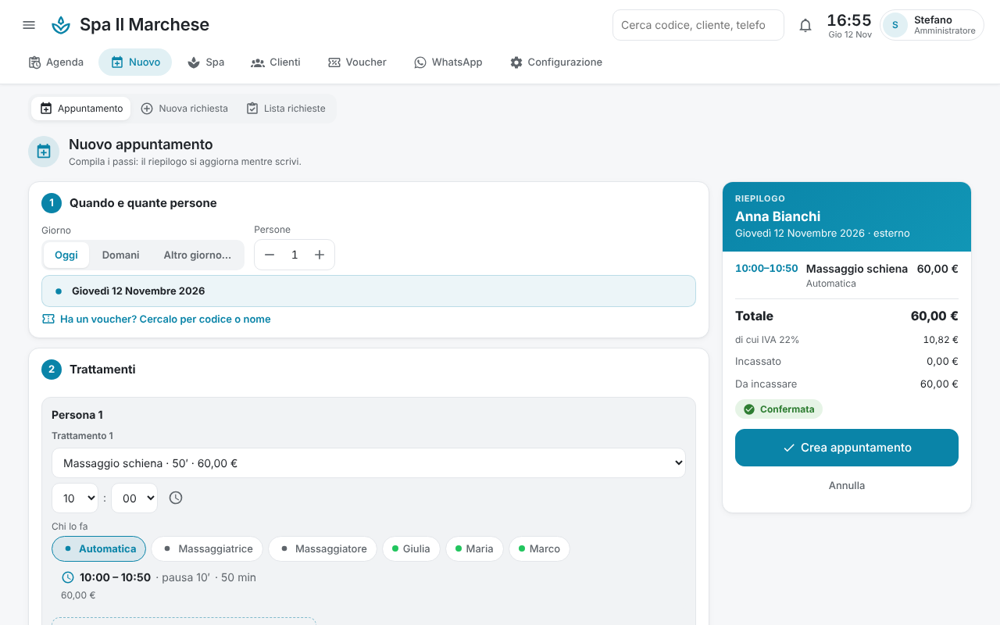 |

## Campagne e punti partner (2.5.0)

**Il link del partner.** In Configurazione › Promo › **Campagne partner**
indica la **pagina del sito con il modulo di prenotazione** (es.
`https://www.ilmarchese.it/spa/prenota`). Ogni partner ha il suo link: quella
pagina + `?partner=CODICE` (lo copi anche da Clienti › Partner con il pulsante
link). Chi prenota da quel link porta il partner nella richiesta e negli
appuntamenti; il sito lo ricorda per 30 giorni.

**I punti.** Scegli quanti punti per ogni euro prenotato. I punti si calcolano
sugli appuntamenti non annullati (prezzo concordato o di listino): se un
appuntamento viene annullato, i suoi punti si tolgono da soli. In Clienti ›
Partner vedi punti, prenotazioni portate ed email ricevute; «Rettifica punti»
per aggiungerne o toglierne (es. un premio consegnato). Il partner si può
anche scegliere a mano in Nuovo appuntamento / Nuova richiesta (passo Cliente)
o cambiare nel dettaglio dell'appuntamento.

**Le campagne email.** «Nuova campagna» crea l'email già pronta (oggetto e
testo con {nome}, {attivita}, {link_prenotazione}, {codice_partner},
{punti_per_euro}, {punti}); a destra l'anteprima per un partner vero. Scegli
**Un giorno preciso** (data e ora di inizio invio) o **A mano**, fai
**Invia prova** al tuo indirizzo e salva. Parte una sola volta, un'email al
secondo, a tutti i partner attivi con email. Serve l'invio email attivo
(Configurazione › Email).

| | |
|---|---|
| 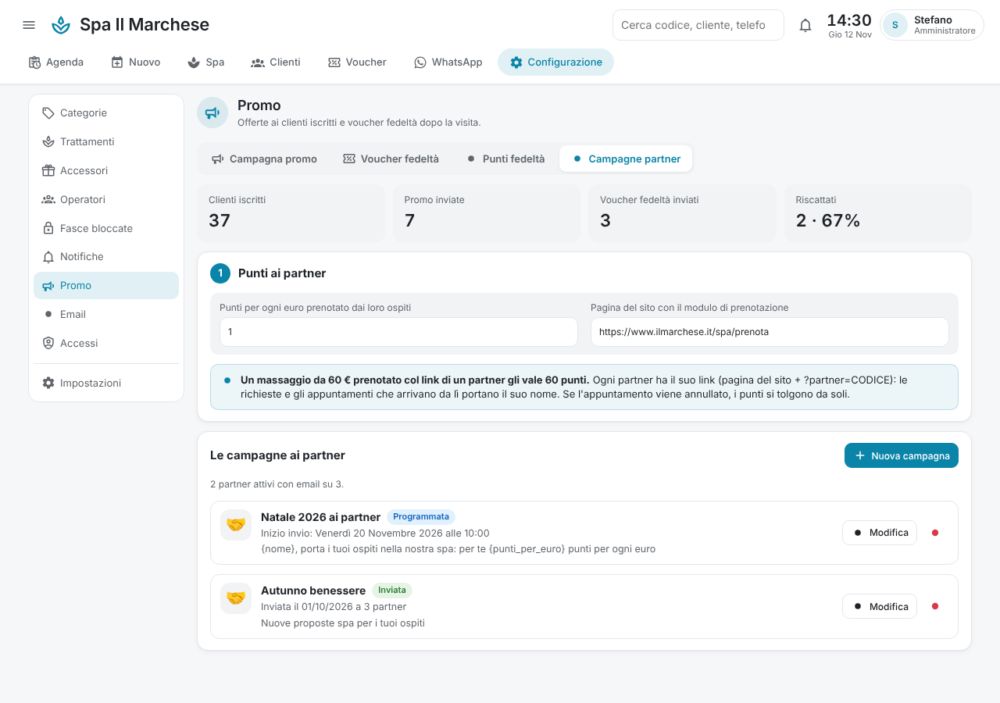 | 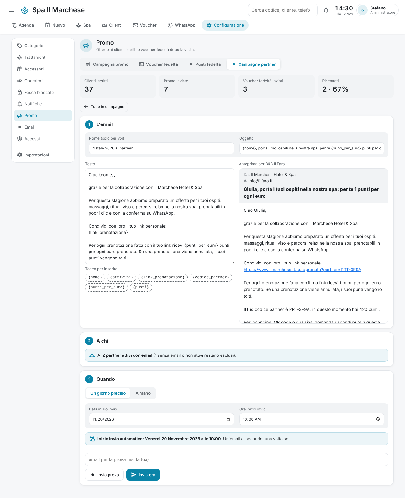 |

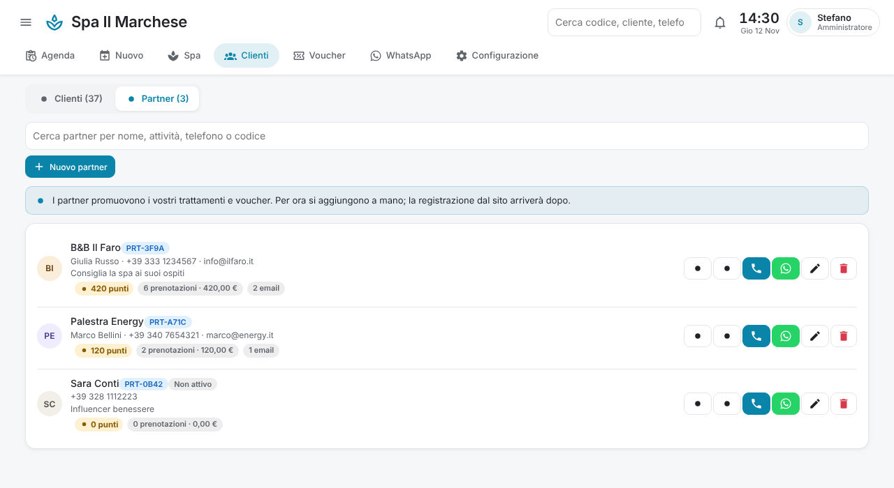

## Email (2.4.1)

**Dalla 2.4.2: «Accedi con Google».** In «La casella» scegli **Accedi con
Google**: niente password, accetti su Google e Spa Booking riceve solo il
permesso di inviare email (non può leggere la posta).

La prima volta servono le chiavi del vostro progetto Google (circa 10 minuti,
una volta sola; la card mostra i passi con i link):
1. Google Cloud: crea un progetto (es. «Spa Booking») con l'account della spa.
2. API e servizi › Libreria › **Gmail API** › Abilita.
3. Google Auth Platform: Branding (nome e email), Pubblico «Esterno», poi
   **Pubblica app** (se resta «In test» l'accesso scade ogni 7 giorni).
4. Client › Crea client › Applicazione web; in «URI di reindirizzamento
   autorizzati» incolla l'indirizzo che la card mostra (pulsante «Copia»).
5. Copia Client ID e Client secret nella card e premi **Accedi con Google**.
   Google avvisa «app non verificata»: è la vostra, premi «Avanzate › Vai a Spa
   Booking» e spunta «Inviare email per tuo conto».
Home Assistant va aperto dal suo indirizzo **https** esterno (Nabu Casa o il
vostro dominio): Google non accetta indirizzi locali http.

**Mittente:** in «Invia da» scegli l'account o uno degli **altri indirizzi**
(prima aggiungili in Gmail › Impostazioni › Account e importazione › «Invia
messaggi come» e confermali, poi scrivili in «Altri indirizzi della casella»).

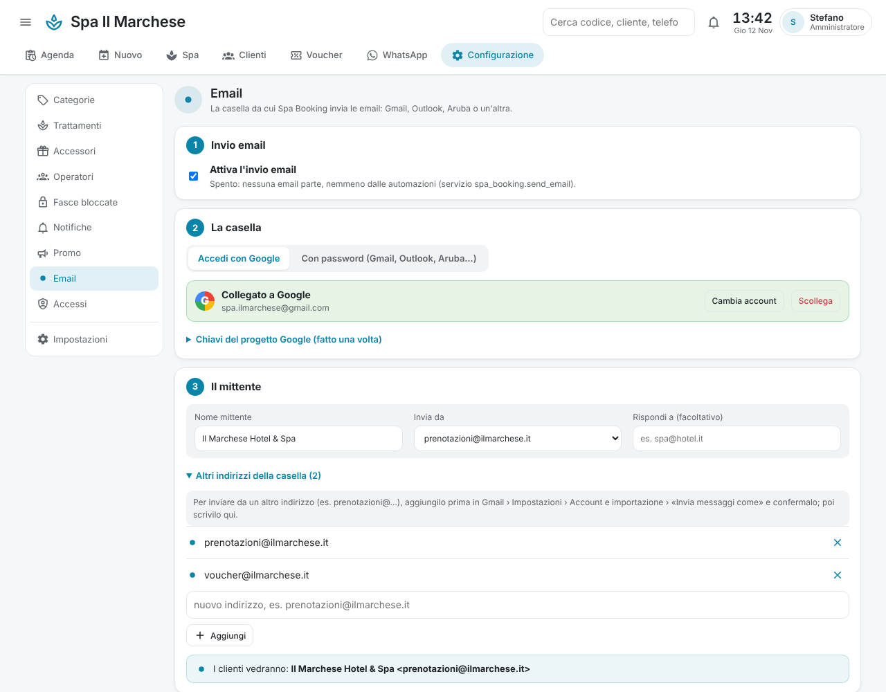

**Con password (SMTP)**, come nella 2.4.1:

Configurazione › **Email** imposta la casella da cui partono le email.

1. **Invio email**: attivalo.
2. **La casella**: scegli Gmail, Outlook / Microsoft 365, Aruba, Libero o Altro,
   poi indirizzo e password.
   - **Gmail** vuole una *password per le app*: Account Google › Sicurezza ›
     Verifica in due passaggi (deve essere attiva) › Password per le app; crea
     una password (es. «Spa Booking») e incolla le 16 lettere.
   - **Outlook / Microsoft 365**: con la verifica in due passaggi serve una
     password per le app; su Microsoft 365 l'amministratore deve consentire lo
     «SMTP autenticato» per la casella.
   - **Aruba / Libero**: indirizzo completo e password della casella.
   - **Altro**: server, porta e sicurezza (di solito 587 + STARTTLS o 465 + SSL).
   La password salvata non viene mai rimostrata: lascia il campo vuoto per
   tenerla.
3. **Il mittente**: nome (es. «Il Marchese Hotel & Spa»), indirizzo (vuoto =
   la casella) e, se vuoi, un indirizzo per le risposte.
4. **Prova**: «Invia email di prova» (alla casella stessa o a un indirizzo che
   scrivi). Se non parte, il messaggio dice cosa correggere.

Dalle automazioni si può usare il servizio `spa_booking.send_email` (a, oggetto,
testo).

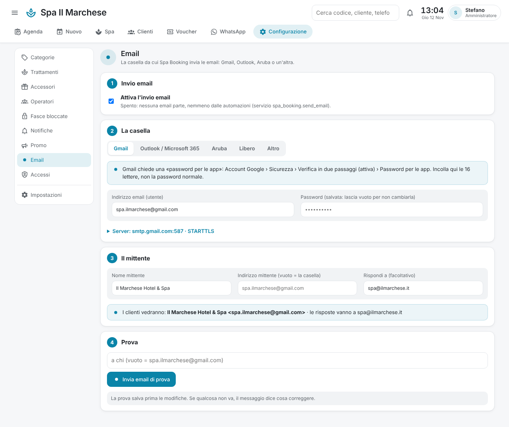

## Dettaglio, punti fedeltà e partner (2.4.0)

**Dettaglio appuntamento.** Su computer tocca un appuntamento nell'Agenda
(Timeline o Elenco): la scheda si apre a destra, senza coprire la giornata. In
alto lo stato (colore della testata), il nome, il trattamento e l'orario; sotto
i riquadri (operatrice, ospite, codice, accessori, totale, da incassare), il
pulsante grande per l'azione del momento (Conferma, Registra entrata, Registra
uscita) e i pulsanti tondi Modifica, Chiama, WhatsApp, Recensione. Per un gruppo
scegli «Singolo» o «Gruppo» in alto. In fondo: Annulla appuntamento. La X la
chiude. Sul telefono la stessa scheda sale dal basso.

**Punti fedeltà.** In Configurazione › Promo › **Punti fedeltà**:
1. attiva la raccolta;
2. scegli quanti punti per ogni euro (contano gli incassi registrati sugli
   appuntamenti, non quelli pagati con voucher o gift card, e i voucher che il
   cliente compra, riconosciuto dal telefono; un appuntamento annullato perde i
   suoi punti);
3. scegli la soglia e il valore del buono premio, e se inviarlo in automatico;
4. scrivi il messaggio WhatsApp ({nome}, {codice}, {valore}, {punti},
   {scadenza}).
Sotto c'è la classifica. Nella scheda cliente trovi il saldo, la barra verso il
premio, «Crea buono» (quando ha raggiunto la soglia), «Rettifica punti» e le
ultime operazioni. Il buono premio è un voucher in euro (scheda Voucher) che il
cliente usa come gli altri.

**Partner.** In Clienti › **Partner**: «Nuovo partner» (nome, attività,
telefono, email, codice, note, attivo). Il codice PRT-XXXX si crea da solo se
lo lasci vuoto. La registrazione dei partner dal sito arriverà in seguito.

| | |
|---|---|
| 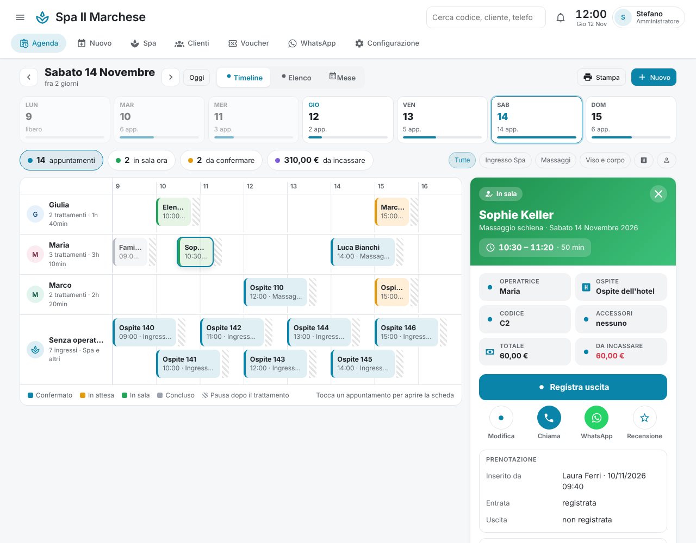 | 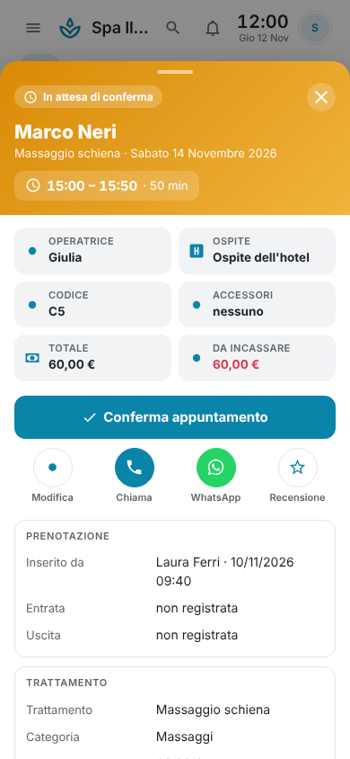 |
| 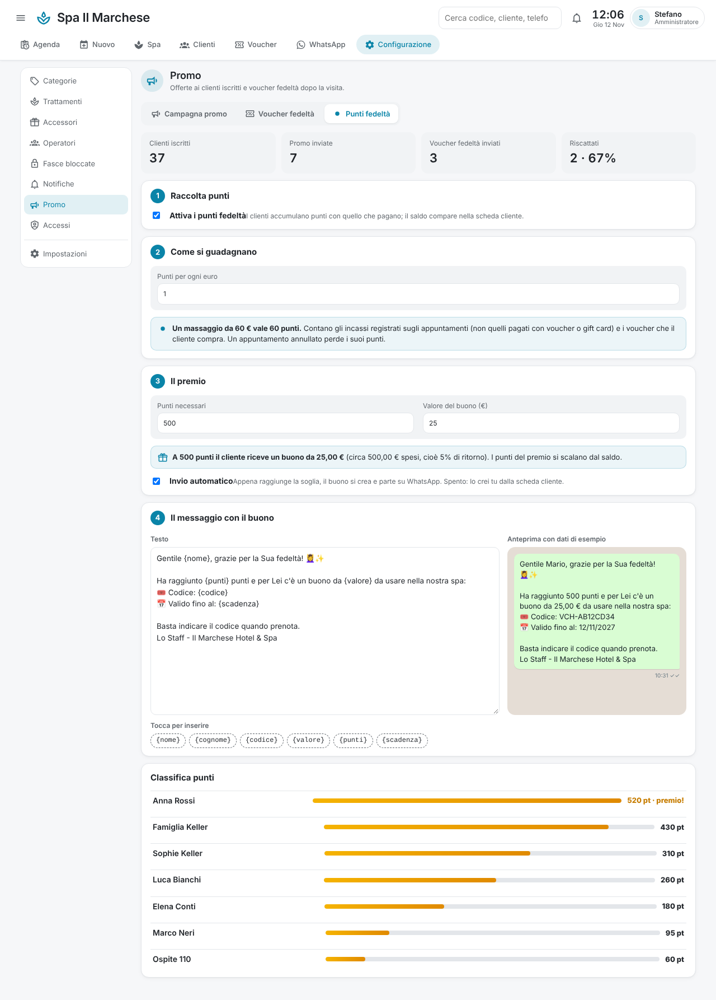 | 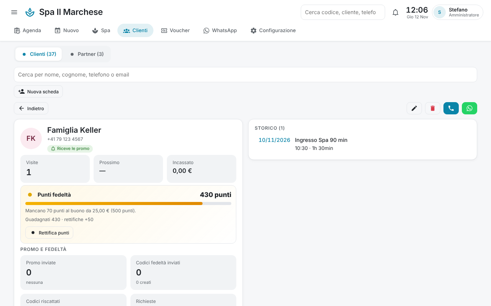 |

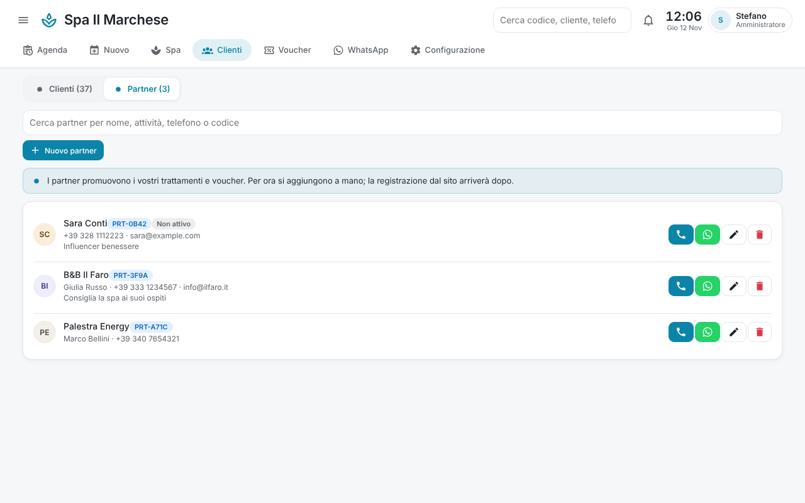

## Agenda (2.3.12)

- **In alto**: il giorno per esteso (toccalo per scegliere una data), le
  frecce, «Oggi», le viste **Timeline**, **Elenco** (quella di prima, per
  operatrice) e **Mese**, poi Stampa e Nuovo.
- **La settimana**: sette riquadri con il numero di appuntamenti e una barretta
  di quanto è pieno il giorno. Tocca un giorno per aprirlo.
- **Le pillole** (appuntamenti, in sala ora, da confermare, da incassare):
  toccane una per vedere solo quelli; ritoccala per tornare a tutti. Accanto, i
  filtri per categoria e ospite.
- **Timeline** (computer e tablet): una riga per operatrice e una per i
  trattamenti senza operatrice (Spa). Colori: blu confermato, arancione in
  attesa, verde in sala, grigio concluso; il tratteggio è la pausa dopo il
  trattamento, la linea rossa è l'ora attuale. Tocca un appuntamento per aprire
  la scheda con Entrata, Uscita, Modifica, Incassa, Chiama, WhatsApp, Annulla.
  A lato: le uscite del momento, i prossimi arrivi con «Entrata» e quelli da
  confermare.
- **Sul telefono**: le schede del giorno divise in mattina, pomeriggio e sera.
  Ogni scheda ha un solo pulsante, quello che serve adesso (Conferma, Entrata o
  Uscita), e «⋯» per aprire la scheda completa.

| | |
|---|---|
| 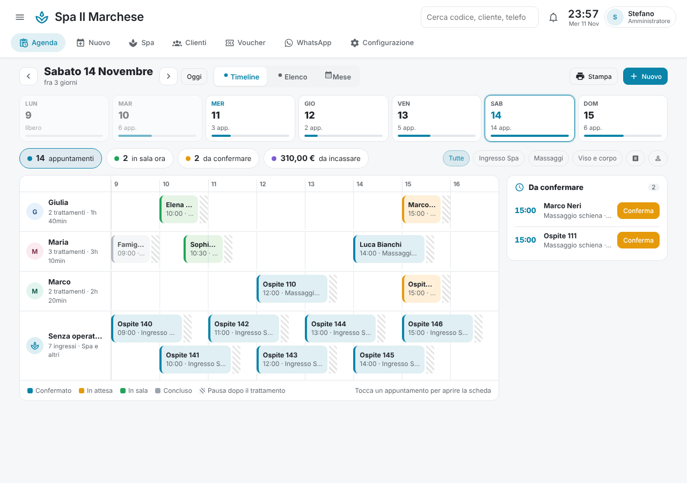 | 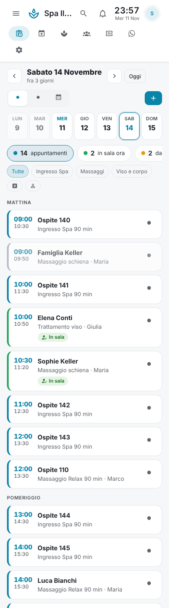 |

## Nuovo appuntamento a passi (2.3.10)

Nuovo › **Appuntamento** si compila in cinque passi:

1. **Quando e quante persone**: Oggi, Domani o «Altro giorno…» (apre il
   calendario), il numero di persone con − e +, «Uguale per tutti» per copiare
   trattamenti e orari della persona 1. «Ha un voucher?» apre la ricerca.
2. **Trattamenti**: per ogni persona trattamento, ora e **Chi lo fa**.
   Automatica sceglie in ordine di priorità; Massaggiatrice o Massaggiatore
   sceglie la prima libera di quel genere; un nome sceglie lei. Il pallino verde
   vuol dire libera a quell'ora, l'arancione già impegnata.
3. **Cliente**: nuovo o scheda cliente, ospite dell'hotel o esterno.
4. **Prezzo e pagamento**: prezzi (listino e scontato), acconto da chiedere,
   incassi.
5. **Stato e note**: confermata o in attesa, note dell'appuntamento.

Il **riepilogo** a destra si aggiorna mentre scrivi e ha il pulsante «Crea».
Sul telefono è una barra in basso con il totale.

Con più persone, «Una scheda cliente per ogni persona» (passo Cliente) è spenta
di default: spuntala solo quando due persone hanno lo stesso nome (dalla
2.3.11).

Nuovo › **Nuova richiesta** (dalla 2.3.11) ha gli stessi passi, senza la scelta
dell'operatrice: Quando e quante persone (con «Ha un voucher regalo?»),
Trattamenti, Cliente (con ospite e preferenza massaggiatrice o massaggiatore),
Note. Il riepilogo ha «Salva richiesta».

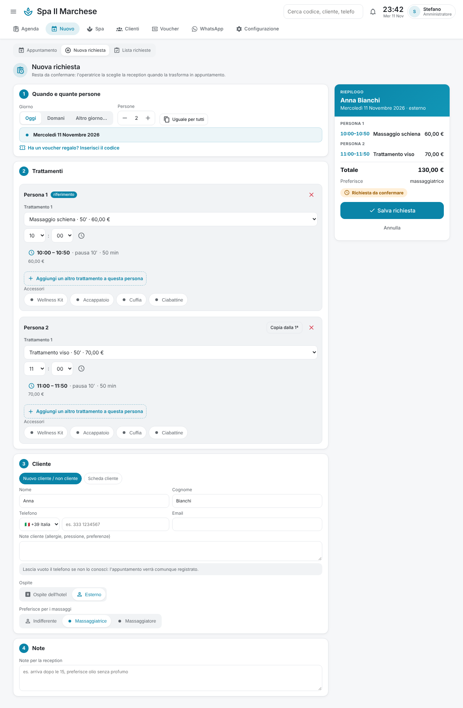

| | |
|---|---|
| 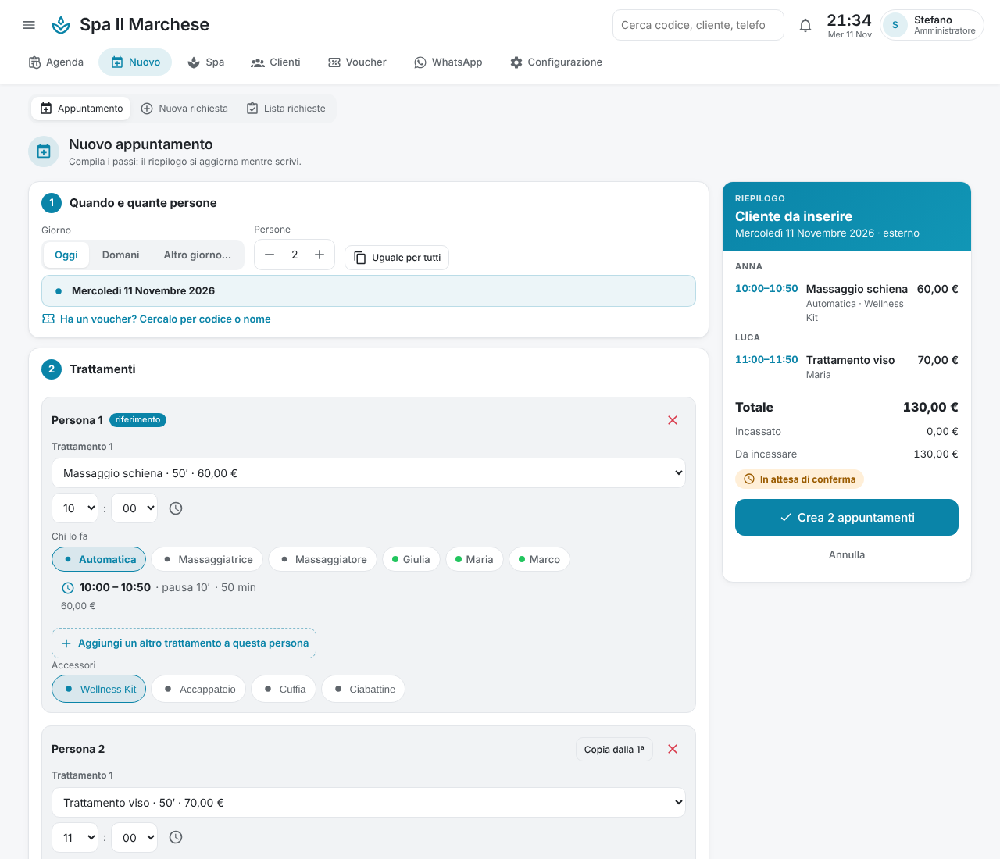 | 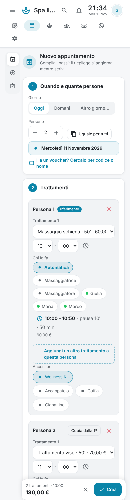 |

## Promo salvate e modelli (2.3.9)

In Configurazione › Promo › **Campagna promo**:

- **Le tue promo** elenca le campagne salvate, con lo stato (Programmata, Ogni
  giorno, Inviata, Scaduta, Bozza) e quando parte l'invio automatico. «Modifica»
  la apre, il cestino la elimina (chiede conferma). «Nuova promo» ne crea una
  vuota.
- **Crea da un modello**: tocca un tema (Natale, San Valentino, Pasqua, Black
  Friday, Weekend relax, Compleanno…) e la promo nasce con testo sul benessere
  in spa, codice con l'anno (es. NATALE26), giorno e ora di invio e scadenza
  già pronti per la prossima ricorrenza. Modifica quello che vuoi e premi
  «Salva».
- Nella promo, il passo **Tema e nome** cambia tema: testo, codice e date si
  aggiornano (se avevi già cambiato il testo chiede prima conferma).
- Il passo **Quando** sceglie **A mano** (con «Invia»), **Un giorno preciso**
  (giorno e ora di inizio, una volta sola) o **Ogni giorno** (dal giorno, all'ora
  indicata, fino alla scadenza). La frase sotto dice esattamente quando inizia
  l'invio automatico e avvisa se l'orario è già passato o è dopo la scadenza.
- Più promo possono essere programmate insieme: ognuna parte all'ora sua, una
  volta al giorno al massimo.

Il tema «Compleanno» è un'offerta per tutti i clienti (festeggiare o regalare
un compleanno): Spa Booking non conosce le date di nascita dei clienti.

| | |
|---|---|
| 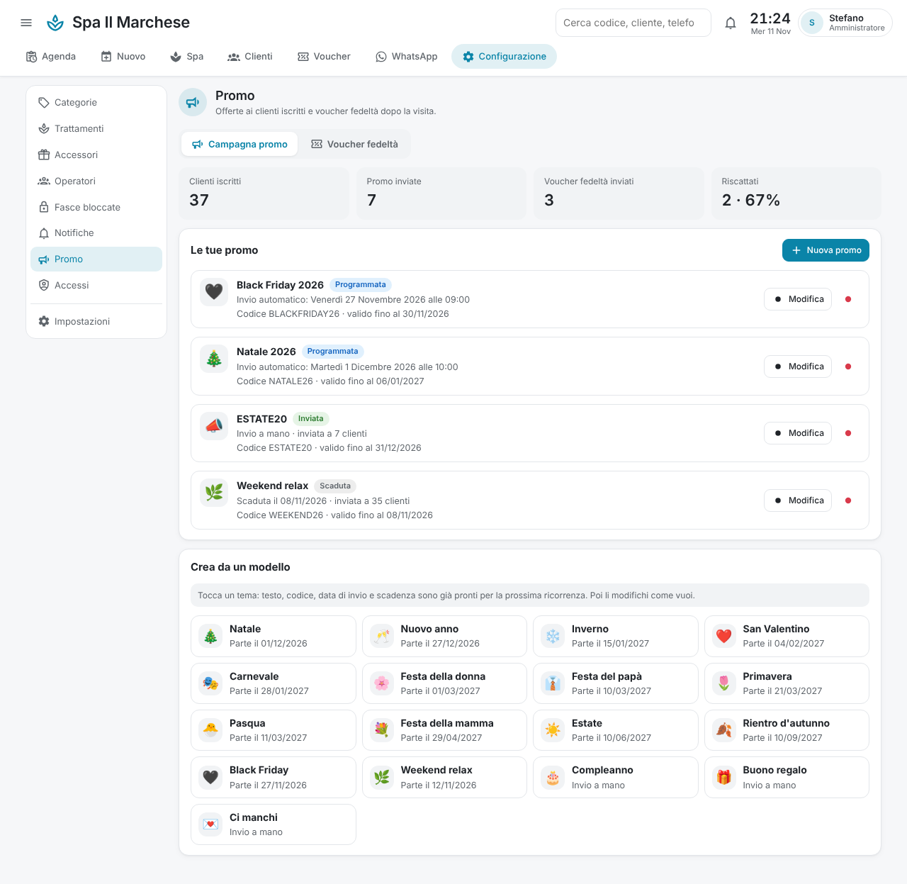 | 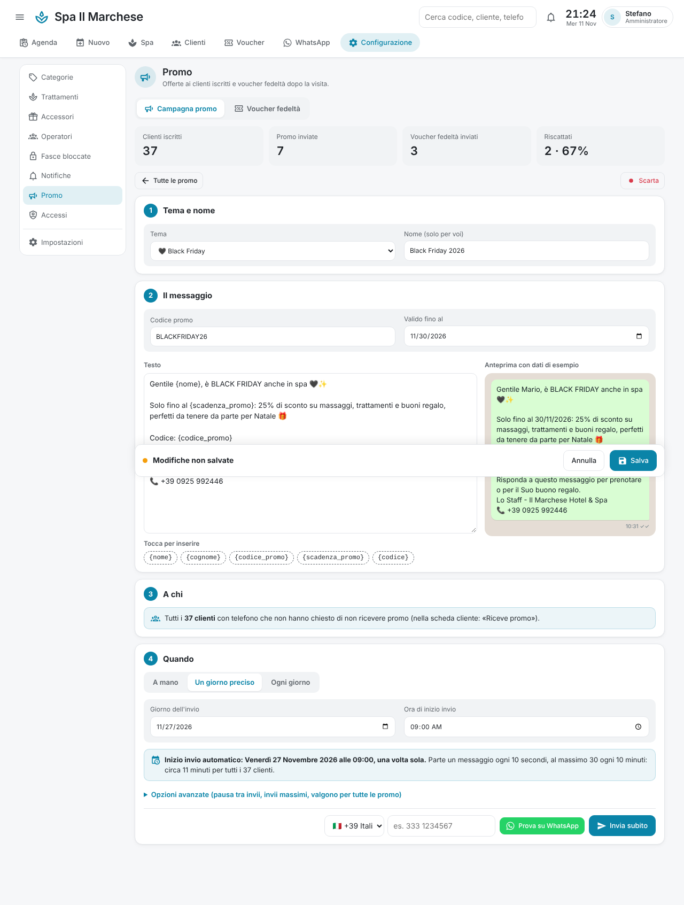 |

## Promo e Impostazioni (2.3.8)

Configurazione › **Promo** ha due sotto-schede, con i numeri in alto:

- **Campagna promo**, in tre passi: 1) il messaggio (codice promo, scadenza,
  testo con anteprima WhatsApp e segnaposto da toccare); 2) a chi va (i clienti
  con telefono che ricevono promo); 3) quando: **Adesso**, **Un giorno
  preciso** o **Ogni giorno**. Una frase dice quanto dura l'invio; pausa e
  invii massimi sono in «Opzioni avanzate». «Invia a N clienti» salva prima le
  modifiche.
- **Voucher fedeltà**: la regola (ore dopo il check-out, sconto, spesa minima e
  massima, validità) riassunta in una frase, e il messaggio con anteprima.

Configurazione › **Impostazioni** ha tre sotto-schede:

- **Generale**: aspetto (Segui Home Assistant, Chiaro, Scuro), titolo della
  card, versione.
- **Sito web**, in quattro passi: richieste dal sito attive o no; orari che il
  sito propone (mattina e pomeriggio, ogni quanto, fino a quanti giorni) con
  la frase di riepilogo; numeri della reception avvisati, con «Prova avviso»;
  il modulo (indirizzo pubblico, colore, prezzi) e il codice da incollare in
  WordPress con «Copia». Token e indirizzi API sono in «Dettagli tecnici».
- **Dati e backup**: esporta e importa i clienti in CSV, scarica o ripristina il
  backup completo (il ripristino chiede conferma e sostituisce tutti i dati).

In ogni pagina la barra «Salva» compare solo quando cambi qualcosa.

| | |
|---|---|
| 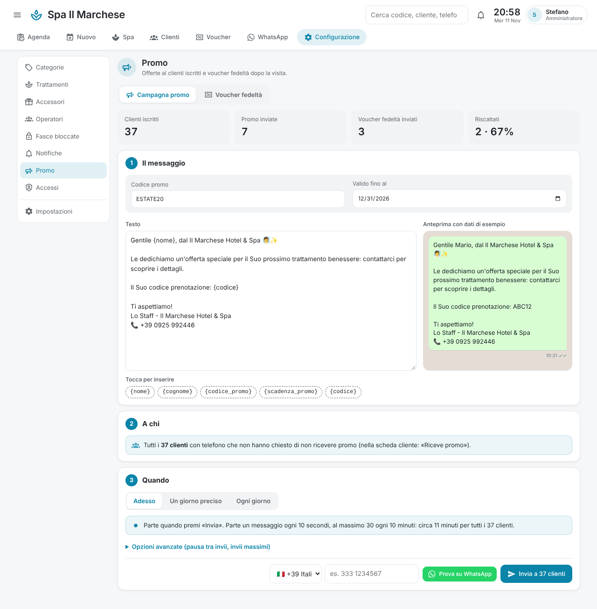 | 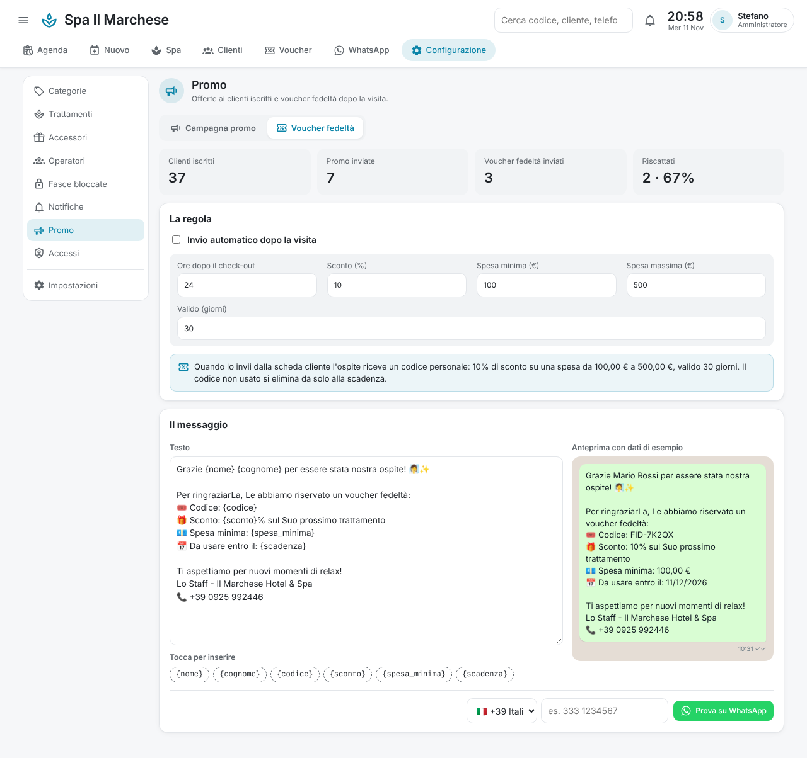 |
| 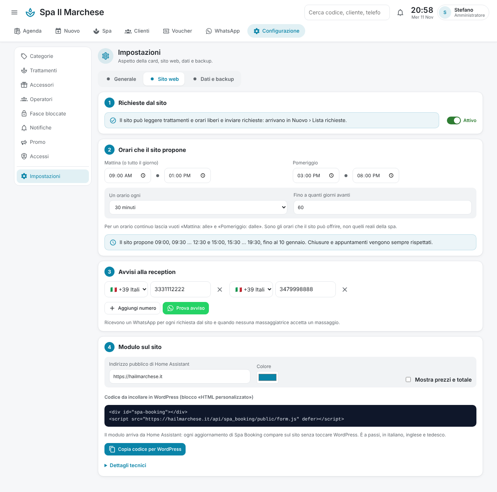 | 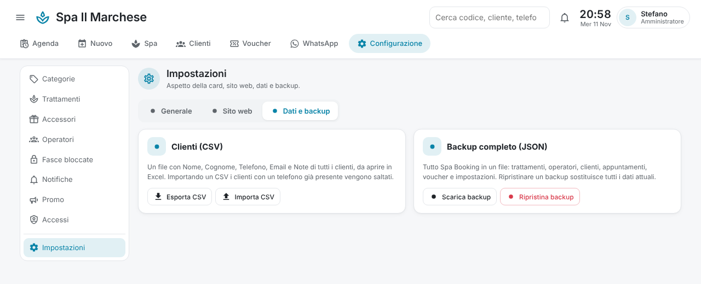 |

## Notifiche (2.3.6)

Configurazione › Notifiche ha quattro sotto-schede:

- **Messaggi agli ospiti**: a sinistra i sei messaggi, in ordine di percorso
  dell'ospite, con l'etichetta Automatico o Manuale e quando partono. Toccane
  uno per modificarlo: in alto le sue opzioni (invio automatico e ore,
  intestazione, IBAN…), poi il testo con l'anteprima accanto e i segnaposto
  da toccare per inserirli dove c'è il cursore. «Ripristina testo base»
  rimette il testo proposto da Spa Booking. «Prova su WhatsApp» manda
  l'anteprima al numero di prova (uno solo per tutti i messaggi).
- **Operatrici**: come funzionano le offerte, il tempo per rispondere e il
  promemoria.
- **Report**: destinatari del report mensile, invio immediato e anteprima.
- **Collegamenti**: WhatsApp integrato o WAHA, e il bot Telegram.

Quando cambi qualcosa compare in basso la barra «Modifiche non salvate» con
Salva e Annulla. (Il gateway WAHA ha ancora il suo «Salva gateway».)

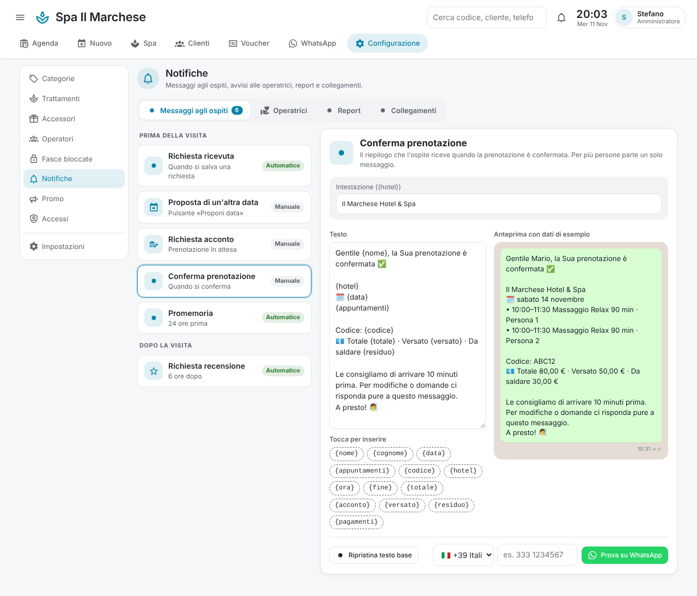

## Messaggi e chat (2.3.5)

- **Chat WhatsApp**: restano salvate anche dopo un riavvio di Home Assistant.
  Il cestino in alto nella chat aperta la elimina; «Elimina tutte» le
  cancella tutte (Manager e Amministratore). Le risposte mostrano chi le ha
  scritte.
- **Riepilogo (conferma)**: un solo messaggio per tutta la prenotazione, con
  un appuntamento per riga. Segnaposto nuovo: `{appuntamenti}`.
- **Promemoria**: uno per ospite e giorno, con tutti i suoi appuntamenti.
- **Richiesta d'acconto**: parte dal dettaglio dell'appuntamento in attesa
  («Richiedi acconto», poi «Reinvia richiesta»), oppure dalla domanda che
  compare subito dopo aver salvato una prenotazione in attesa con l'acconto
  impostato nei Totali.
- **Nessuna massaggiatrice accetta**: la reception riceve un WhatsApp sui
  numeri di «WhatsApp avvisi dal sito» e una notifica in Home Assistant.

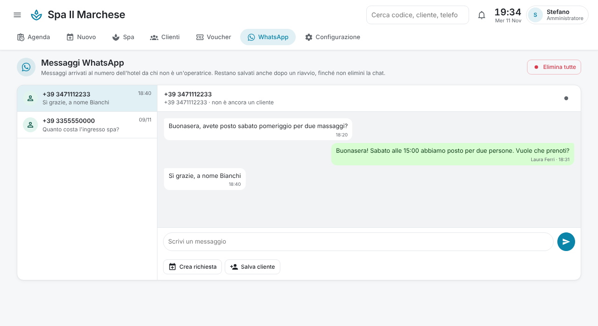

## Preferenza massaggiatrice o massaggiatore

Dalla 2.3.3:

- **Genere dell'operatore.** Configurazione › Operatori › scheda: «Genere»
  (Donna / Uomo / Non indicato), accanto alla priorità.
- **Ordine automatico.** Con «Automatica» il massaggio viene proposto prima a
  chi ha il numero di priorità più basso; chi è disattivata, chiusa in Fasce
  bloccate o ha rifiutato quella fascia viene saltata.
- **Preferenza dell'ospite.**
  - Sul sito: nel riquadro di ogni persona, se il massaggio che ha scelto lo
    fanno sia donne sia uomini, compare «Per il massaggio preferisci…
    Indifferente / Una massaggiatrice / Un massaggiatore». Ogni persona sceglie
    per sé (dalla 2.3.4).
  - In Nuova richiesta: «Preferisce per i massaggi», nel riquadro Ospite.
  - In Nuovo appuntamento: nella scelta della massaggiatrice, «Automatica:
    massaggiatrice» o «Automatica: massaggiatore».
- **Cosa succede.** La proposta va solo a chi è del genere chiesto, in ordine
  di priorità. Se nessuno è libero a quell'ora, la reception vede un avviso
  («L'ospite preferisce un massaggiatore, ma nessun massaggiatore è libero…»)
  e sceglie a mano o toglie la preferenza. Un'operatrice scelta a mano non
  viene mai cambiata. La preferenza resta scritta sulla richiesta e
  sull'appuntamento («Preferisce …»).

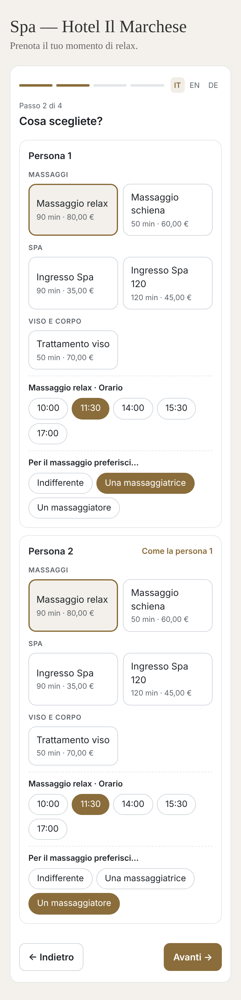

## Promo e fedeltà del cliente

Dalla 2.3.2 la scheda del cliente mostra «Promo e fedeltà»: quante promo ha
ricevuto (e l'ultima), quanti codici fedeltà le sono stati inviati, quanti ne
ha riscattati e quante richieste ha fatto. Le promo si contano dalla 2.3.2 in
poi; i codici fedeltà anche prima.

Ogni richiesta salva la scheda del cliente (se il telefono è già registrato
usa quella esistente): dalla richiesta, **Scheda cliente** la apre.

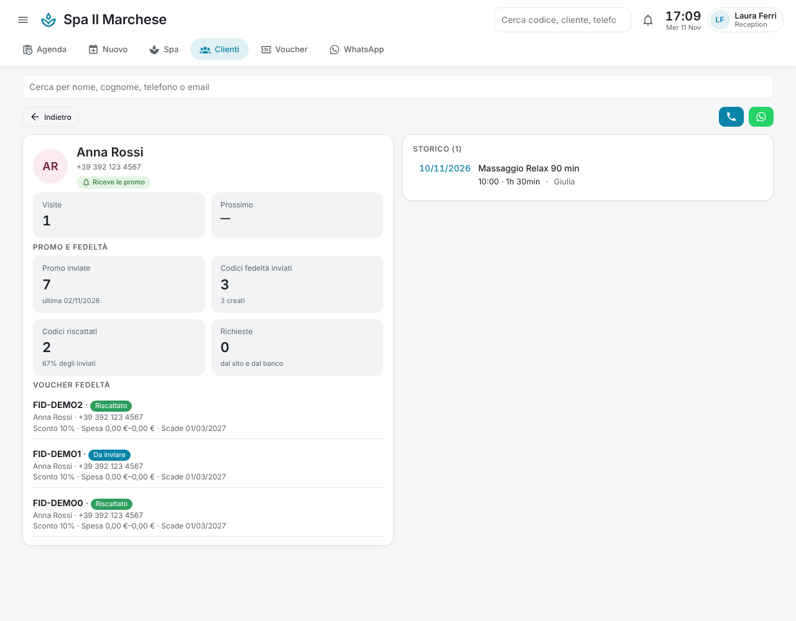

## Conferme e promemoria WhatsApp

Dalla 2.3.1, nel dettaglio di un appuntamento (sezione «Quando»):

- **Conferma WhatsApp**: «non inviata» oppure «inviata 09/11 16:41», con il
  pulsante **Invia conferma** (verde) o **Reinvia conferma**. Il messaggio è
  il riepilogo della prenotazione.
- **Promemoria** (solo appuntamenti confermati): «non inviato» o la data
  dell'invio, con **Invia promemoria** / **Reinvia promemoria**. Il testo è
  quello di Notifiche › Promemoria appuntamento.

In Configurazione › Impostazioni › Sito web, **WhatsApp avvisi dal sito**
accetta più numeri: «Aggiungi numero» per aggiungerne, la × per toglierne,
**Prova avviso** salva e manda un messaggio di prova a ognuno.

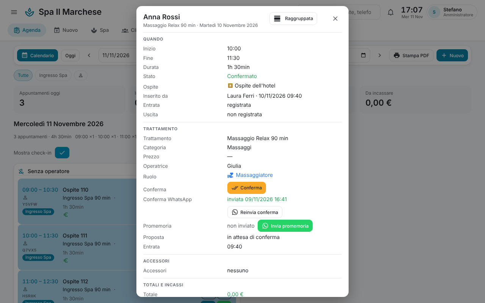

## Firme e storico

Dalla 2.3.0:

- **Voucher firmati con il PIN.** All'ultimo passo, «Crea voucher» apre il
  tastierino: chi vende il voucher inserisce il proprio PIN e il voucher
  resta firmato con il suo nome, anche se il dispositivo è collegato con un
  altro utente. Il PIN si assegna in Configurazione › Accessi; ognuno deve
  avere il proprio, diverso da quello degli altri. Cinque PIN sbagliati di
  fila bloccano la firma per un minuto.
- **Chi ha inserito.** Nel dettaglio dell'appuntamento la riga «Inserito da»
  mostra chi l'ha inserito e quando; sulla scheda della richiesta «Inserita
  da …» (o «Sito web»). Le prenotazioni inserite prima della 2.3.0 mostrano
  «non registrato» quando il nome non era stato salvato.
- **Storico modifiche** (solo Amministratore). In fondo al dettaglio
  dell'appuntamento: ogni modifica con data, ora, chi l'ha fatta e cosa è
  cambiato, dal più recente. Le risposte delle operatrici su WhatsApp
  compaiono come «Giulia (WhatsApp)», i timer automatici come «Sistema».
  Lo storico parte dalla 2.3.0: le modifiche precedenti non sono note.

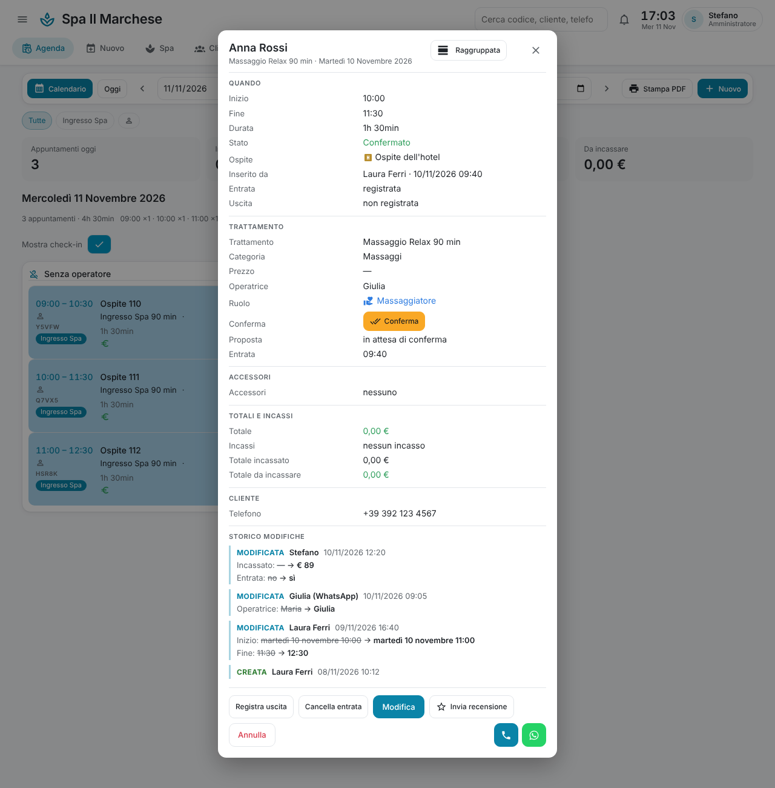

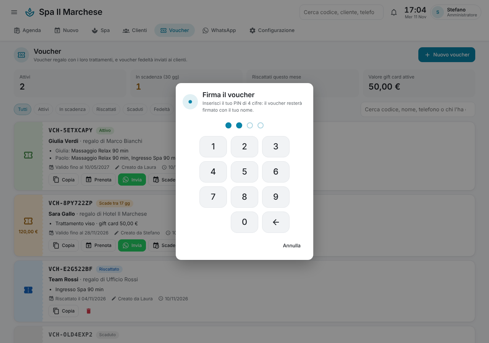

## Accesso e ruoli

In alto a destra c'è sempre **chi è collegato** e il suo ruolo.

Ognuno entra in Home Assistant con **il proprio nome utente e la propria
password**. Il ruolo decide cosa vede e cosa può fare, e lo stesso controllo
è fatto anche dal server: un pulsante nascosto non basta per fare
un'operazione non permessa.

| | Massaggiatrice | Reception | Manager | Amministratore |
|---|---|---|---|---|
| Agenda e calendario | ✓ | ✓ | ✓ | ✓ |
| Prenotare e modificare | solo i suoi | ✓ | ✓ | ✓ |
| Incassi | — | ✓ | ✓ | ✓ |
| Creare voucher | — | ✓ | ✓ | ✓ |
| Estendere o eliminare voucher | — | — | ✓ | ✓ |
| Scheda Spa | ✓ | ✓ | ✓ | ✓ |
| Report e totali | — | — | ✓ | ✓ |
| Configurazione e utenti | — | — | — | ✓ |

### Tablet della reception con PIN

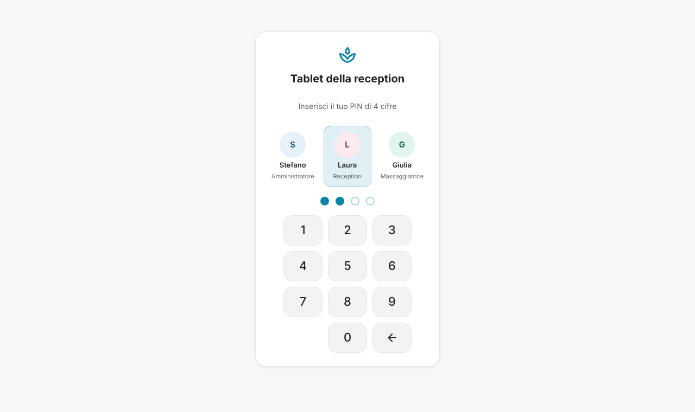

Il tablet al banco resta collegato con un utente **condiviso**. Chi lo usa:
1. tocca il proprio nome;
2. inserisce il suo **PIN di 4 cifre**.

Da quel momento ogni prenotazione, incasso e voucher porta il suo nome.

**Cambia utente** (in alto a destra) lascia il tablet al collega. Dopo
qualche minuto senza tocchi il tablet torna da solo alla scelta della
persona: i minuti si impostano in Configurazione › Accessi.

Cinque PIN sbagliati di fila bloccano il tablet per un minuto.

### Cosa vede una massaggiatrice

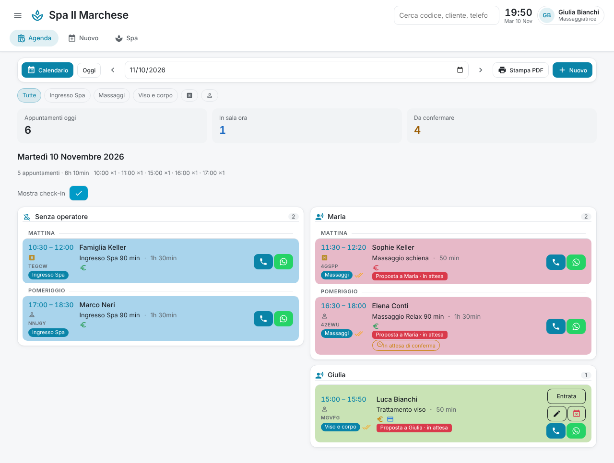

Una massaggiatrice vede tutta l'agenda della giornata, ma modifica solo gli
appuntamenti dell'operatrice a cui è collegata (le altre righe hanno solo
telefono e WhatsApp). Non vede incassi e totali. Quando prenota, l'operatrice
è già impostata su di lei.

---

## Agenda

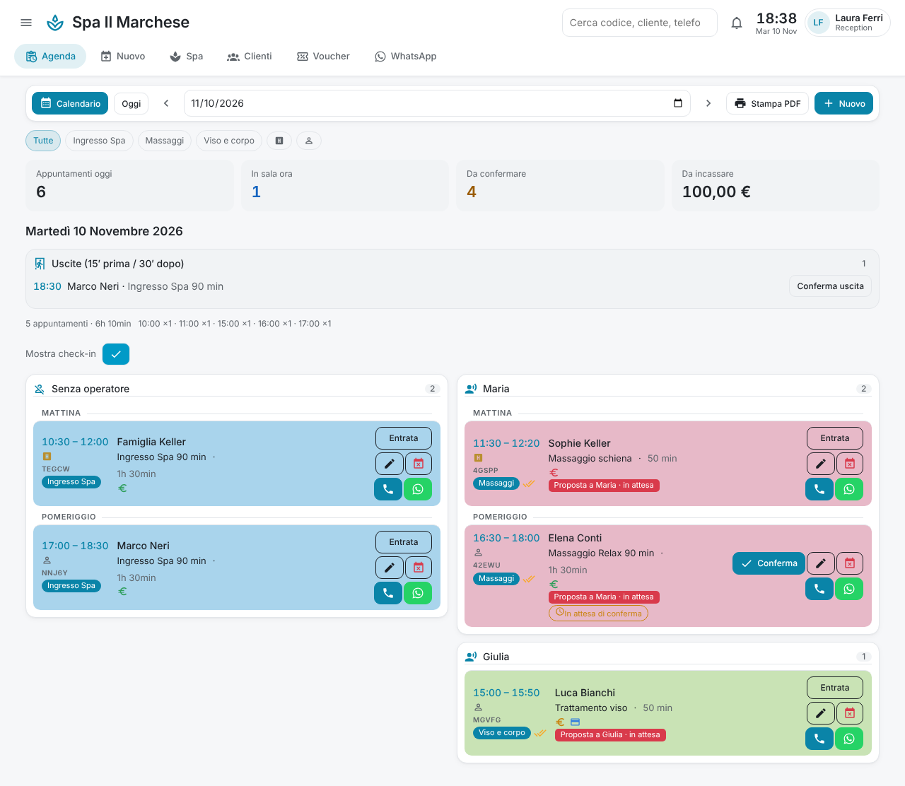

- **Barra della giornata**:
  - *Calendario* passa alla vista del mese;
  - *Oggi* e le frecce cambiano giorno;
  - *Stampa PDF* apre il foglio della giornata da stampare (prezzi e
    pagamenti solo per Manager e Amministratore);
  - *Nuovo* apre il modulo di prenotazione su quel giorno.
- **Filtri**: per categoria (Ingresso Spa, Massaggi, …) e per tipo di ospite
  (hotel o esterno). Compaiono solo le categorie presenti quel giorno.
- **Riepilogo del giorno**:
  - quanti appuntamenti ci sono;
  - quanti clienti sono **in sala ora** (entrati e non ancora usciti);
  - quanti sono **da confermare** (in attesa, oppure proposti a
    un'operatrice che non ha ancora risposto);
  - per chi registra gli incassi, quanto resta **da incassare**.
- **Uscite**: i clienti che escono adesso (da 15′ prima a 30′ dopo la fine),
  con *Conferma uscita*.
- **Appuntamenti per operatrice**, divisi in *Mattina*, *Pomeriggio* e
  *Sera*. Ogni riga riporta:
  - orario, cliente, trattamento e codice;
  - lo stato dell'offerta all'operatrice.

  I pulsanti della riga:
  - *Entrata* fa il check-in;
  - la matita apre la modifica;
  - il calendario rosso annulla;
  - telefono e WhatsApp contattano il cliente.

  Toccando la riga si apre il dettaglio con incassi, gruppo e messaggi.
- **Mostra check-in** fa vedere anche chi è già entrato. *Usciti* e
  *Annullati* restano in fondo, chiusi.

### Calendario

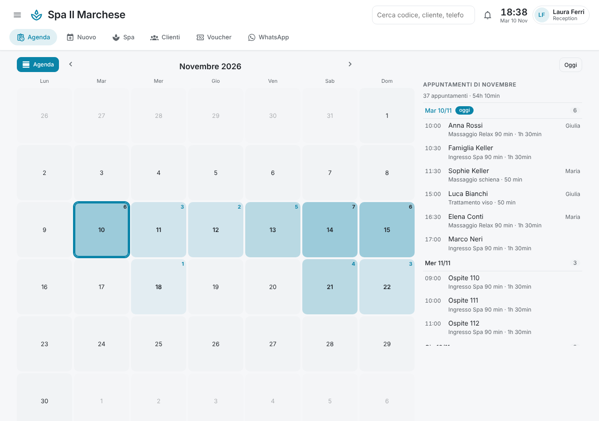

Ogni giorno è colorato in base a quanto è pieno, rispetto al giorno più
pieno del mese: si trovano subito i giorni liberi. Oggi ha il bordo. Il
numero in alto è il totale degli appuntamenti. Le chiusure hanno il
lucchetto.

A destra c'è l'elenco del mese, giorno per giorno. Toccando un giorno si
torna all'agenda su quella data.

---

## Nuovo

### Appuntamento

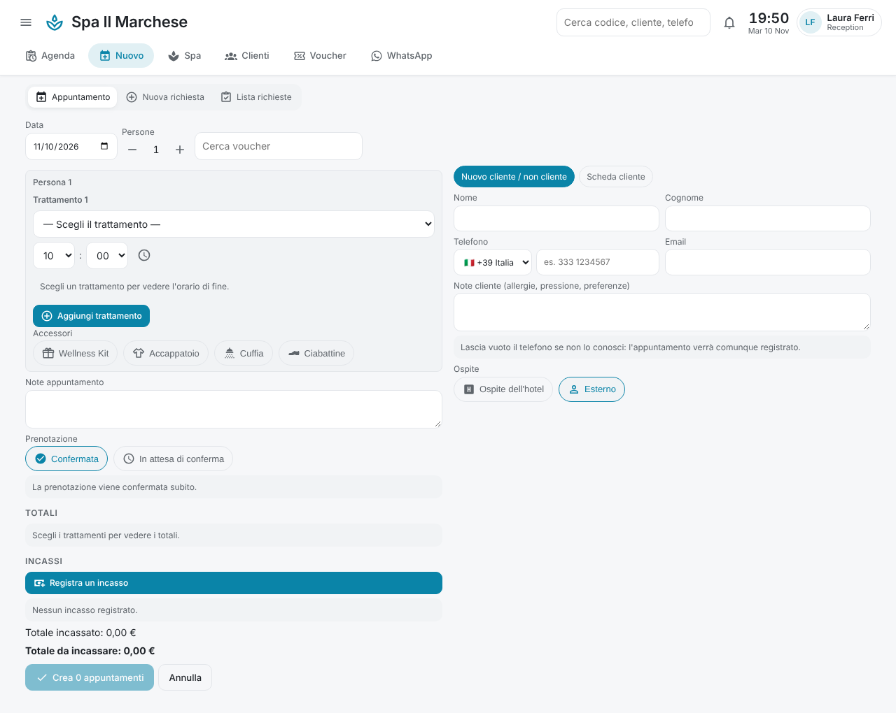

Prenotazione di una o più persone, ognuna con i suoi trattamenti, orari,
operatrice e accessori. Il modulo controlla:
- sovrapposizioni e pause delle operatrici;
- fasce bloccate e chiusure.

Sotto ci sono i totali (listino e prezzo applicato) e gli **incassi**, per
chi li registra.

Il **telefono ha il prefisso internazionale accanto** (+39 già scelto, i
Paesi più frequenti in cima). Se si scrive un numero che inizia con +41 o
0049, il prefisso si sistema da solo.

### Avviso: regole della categoria

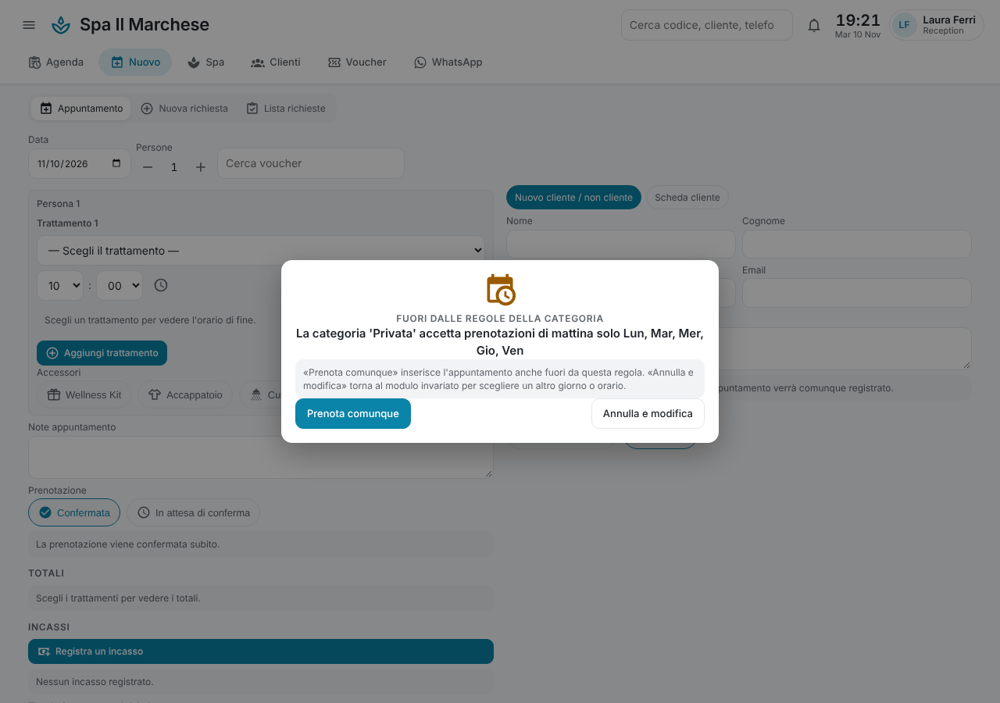

Se una prenotazione è fuori dalle regole di una categoria, compare un avviso
invece di un errore. Le regole sono:
- i giorni (per esempio: «La categoria 'Privata' accetta prenotazioni di
  mattina solo Lun, Mar, Mer, Gio, Ven»);
- le fasce di mattina e pomeriggio;
- le categorie che non possono sovrapporsi.

**Prenota comunque** inserisce l'appuntamento lo stesso.
**Annulla e modifica** torna al modulo così com'era, per scegliere un altro
giorno o orario.

L'avviso compare anche quando si modifica un appuntamento o un gruppo.
Forzare è permesso alla Reception, al Manager e all'Amministratore: una
massaggiatrice vede l'avviso senza il pulsante. Restano sempre bloccanti:
- le chiusure (Fasce bloccate);
- un'operatrice già occupata.

### Nuova richiesta

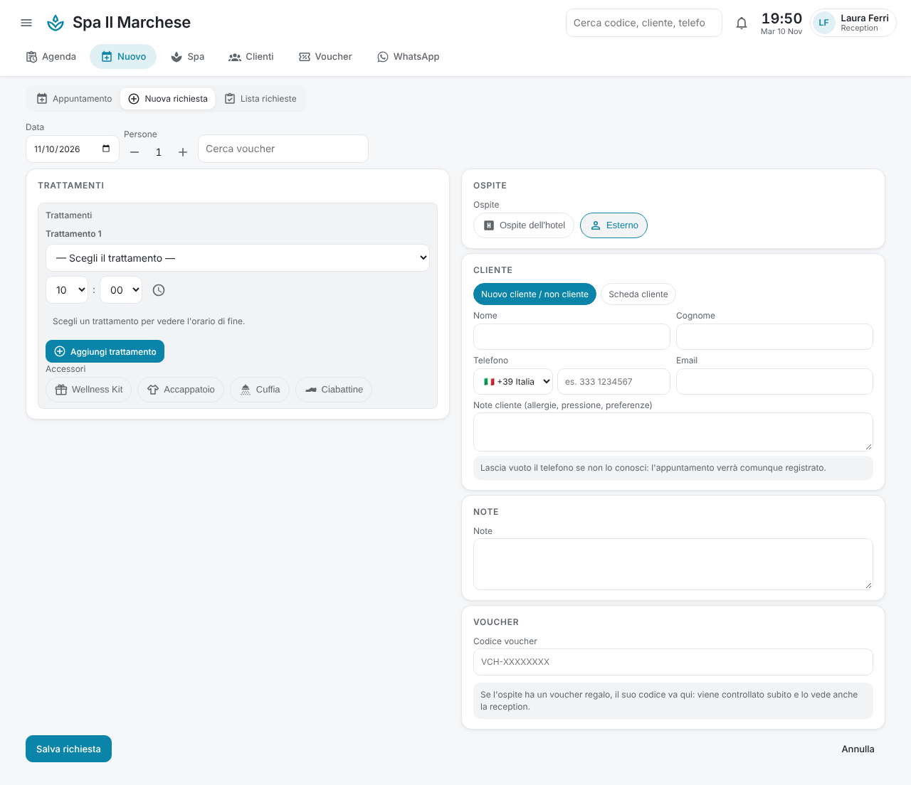

Una richiesta non occupa ancora l'agenda: si usa quando l'ospite chiede ma
l'orario va confermato. Con 2 o più persone c'è un riquadro per persona
(*Copia dalla 1ª* ripete i trattamenti). Al salvataggio l'ospite riceve
il messaggio di conferma ricezione su WhatsApp.

### Lista richieste

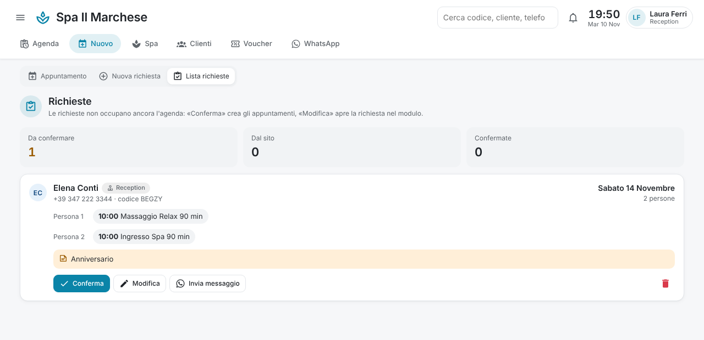

In alto ci sono i numeri: richieste da confermare, arrivate dal sito,
confermate. Ogni richiesta è un riquadro con:
- iniziali e nome dell'ospite;
- provenienza (Sito o Reception) ed etichetta «Nuova» se non è ancora stata
  aperta;
- telefono, voucher e codice;
- data e numero di persone;
- per ogni persona, i trattamenti con l'orario;
- le note in evidenza.

I pulsanti:
- **Conferma** crea gli appuntamenti;
- **Modifica** apre la richiesta nel modulo;
- **Invia messaggio** rimanda all'ospite il messaggio WhatsApp;
- il cestino la elimina.

### Proponi data

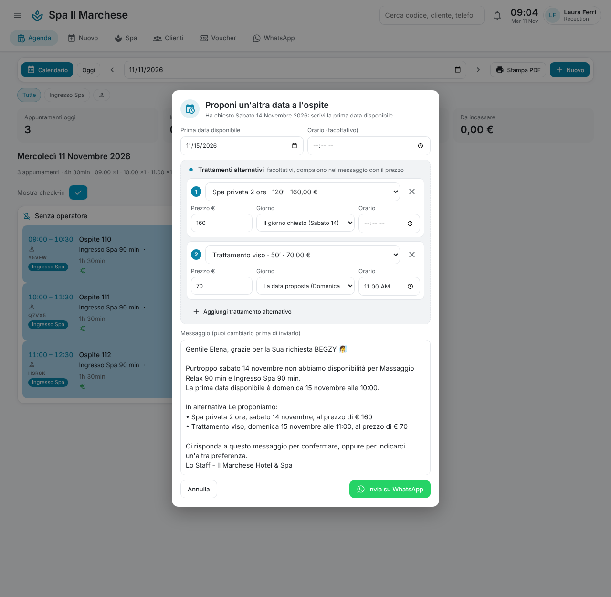

Se la data chiesta è piena, **Proponi data** (accanto a Conferma) apre un
riquadro dove si scelgono:
- la **prima data disponibile**;
- l'orario, se vuoi;
- uno o più **trattamenti alternativi** (dalla 2.2.2), con **Aggiungi
  trattamento alternativo**.

Ogni alternativa ha:
- il trattamento (tutti quelli attivi, anche quelli nascosti dal sito);
- il **prezzo**, già preso dal listino e modificabile;
- il **giorno**: di base quello chiesto dall'ospite, oppure la data proposta;
- l'orario, se vuoi.

Nel messaggio compaiono così, ad esempio:

```
In alternativa Le proponiamo:
• Spa privata 2 ore, sabato 14 novembre, al prezzo di € 160
```


Il messaggio WhatsApp all'ospite è già scritto con i suoi dati e la data
proposta; lo puoi cambiare prima di premere **Invia su WhatsApp**. La
richiesta mostra poi l'etichetta «Proposta: …» (e «Alternativa: …» per ogni
trattamento alternativo) e resta da confermare: quando
l'ospite accetta, «Modifica» la sposta sulla nuova data e «Conferma» la
prenota.

Il testo di base si cambia in Configurazione › Notifiche › **Proposta di
un'altra data**, con i segnaposti:
- `{nome}` e `{cognome}`;
- `{codice}`;
- `{data_richiesta}`;
- `{trattamenti}`;
- `{data_proposta}`;
- `{orario_proposto}`;
- `{alternativa}`: il blocco dei trattamenti alternativi; sparisce, senza
  lasciare righe vuote, se non ne scegli.

Sotto il testo ci sono l'**introduzione alle alternative** («In alternativa Le
proponiamo:») e la **riga di ogni trattamento alternativo**, con:
- `{trattamento_alternativo}`;
- `{prezzo_alternativo}` («€ 160»);
- `{data_alternativa}`;
- `{orario_alternativo}` (« alle 10:00» o vuoto).

Un testo personalizzato senza `{alternativa}` riceve le alternative prima di
«Ci risponda…», o in fondo.


Le richieste già confermate restano in fondo, chiuse. La campanella in alto
conta le richieste dal sito non ancora aperte.

---

## Spa


I comandi della spa, divisi in sezioni:
- **Luci**: accensione e luminosità;
- **Clima**: termostato con − e +;
- **Servizi e sensori**: idromassaggio, ventilazione, temperatura
  dell'acqua, umidità.

Ogni sezione mostra un riepilogo, per esempio "2 luci accese su 4". La
sotto-scheda *Telecamere* (non per le massaggiatrici) mostra le immagini dal
vivo. In modalità modifica si aggiungono, spostano e nascondono i riquadri.

---

## Clienti


L'elenco dei clienti. Per ognuno si vedono:
- le iniziali;
- telefono ed email;
- l'ultima visita e il numero di visite.

I pulsanti chiamano, scrivono su WhatsApp o aprono una nuova prenotazione.
Toccando un cliente si apre la sua scheda con lo storico, le note, le promo
e la modifica dei dati, con il telefono con prefisso. Manager e
Amministratore possono creare e unire i clienti.

### Scheda del cliente


A sinistra il profilo:
- iniziali, nome e contatti;
- «Cliente abituale» (da 3 visite);
- se riceve le promo;
- quante visite ha fatto e il prossimo appuntamento;
- per Manager e Amministratore, quanto ha speso;
- note e voucher fedeltà.

A destra lo storico degli appuntamenti: toccandone uno si apre il dettaglio.
In alto ci sono Indietro, Modifica, Elimina, telefono e WhatsApp.

### Nuova scheda cliente


Nome, cognome, telefono con prefisso, email, note e iscrizione alle promo,
in un unico riquadro.

---

## Voucher


- **Riepilogo**:
  - voucher attivi;
  - voucher **in scadenza** nei prossimi 30 giorni;
  - voucher riscattati nel mese;
  - per il Manager, il valore delle gift card attive.

  Toccando un numero si filtra l'elenco.
- **Filtri**: Tutti, Attivi, In scadenza, Riscattati, Scaduti, Fedeltà. La
  ricerca trova anche **chi ha creato** il voucher.
- **Ogni voucher è un biglietto**, colorato secondo lo stato (verde attivo,
  ambra in scadenza, azzurro riscattato, grigio scaduto). Riporta:
  - codice, destinatario e chi lo ha regalato;
  - trattamenti per persona;
  - scadenza;
  - **Creato da** (i voucher fatti prima della 2.2 mostrano "—").

  Le azioni:
  - *Copia* copia il codice;
  - *Prenota* apre la prenotazione già compilata;
  - *Invia* lo manda su WhatsApp;
  - *Scadenza* ed *Elimina* sono solo per il Manager.

### Nuovo voucher in tre passi


1. **Acquirente e destinatario**: nomi e telefoni con prefisso, più
   **Creato da**, obbligatorio. Il nome è già quello di chi è collegato e
   non si può cambiare: resta scritto sul voucher.
2. **Persone e trattamenti**: per ogni persona si toccano i trattamenti
   (con il prezzo), gli accessori e l'eventuale gift card in euro.
3. **Riepilogo**: si controlla tutto e si preme *Crea voucher*.

Il codice appare subito in grande, con *Copia* e *Invia*.

### Invia su WhatsApp


Si sceglie a chi mandarlo (destinatario o acquirente). Il testo è già
pronto, con codice, trattamenti e scadenza, e si può modificare prima di
inviarlo.

---

## WhatsApp


I messaggi arrivati al numero dell'hotel da chi non è un'operatrice, divisi
per **conversazione**: a sinistra l'elenco, a destra la chat.

Se il numero è già un cliente si vedono il nome, le visite e il prossimo
appuntamento. Si risponde dal campo in basso (Invio per mandare).
*Crea richiesta* apre una richiesta con il numero già scritto. *Salva
cliente* compare solo se il numero non è ancora un cliente.

---

## Configurazione

Solo per l'Amministratore. Su schermo largo il menu è una colonna a
sinistra, sul telefono una striscia di icone.

| | |
|---|---|
|  | **Categorie**: ogni categoria è un riquadro con il suo colore a lato e le etichette (numero di trattamenti, con o senza operatrice, pausa, regole di giorni e fasce). |
|  | **Nuova / modifica categoria**: nome, operatrice sì o no, colore, pausa, giorni di mattina e di pomeriggio come pulsanti, fasce orarie da–a sulla stessa riga, categorie da non sovrapporre. |
|  | **Trattamenti**: divisi per categoria, con durata, prezzo e operatrici. La matita cambia l'ordine. |
|  | **Nuovo / modifica trattamento**: nome, categoria, durata, prezzo, persone insieme, attivo, visibile sul sito, operatrici abilitate. |
|  | **Accessori**: kit, accappatoio, cuffia… con il loro simbolo. |
|  | **Operatori**: telefono con prefisso, WhatsApp/Telegram, ruolo, trattamenti, priorità per le offerte. |
|  | **Fasce bloccate**: chiusure della spa, di una categoria o di un'operatrice, a giornata o con orario. |
|  | **Notifiche**: collegamento WhatsApp (integrato o WAHA), report, offerte alle operatrici, acconto, riepilogo, promemoria, recensioni. Ogni messaggio ha la prova su un numero. |
|  | **Promo**: invio promozionale e voucher fedeltà automatici. |
|  | **Impostazioni**: titolo, aspetto, sito web (con il numero degli avvisi), ordine dei campi, backup e ripristino. |

### Chiusure con giorni esclusi

Dalla 2.2.4, quando la chiusura dura più di un giorno («Dal giorno» e «Al
giorno» diversi), compare la riga **Escludi i giorni** con i pulsanti Lun…Dom.
I giorni toccati restano aperti dentro il periodo.

Esempio: dal 1 al 30 novembre, tocca **Sab**: la spa è chiusa tutto il mese
tranne i sabati. Si combina con l'orario («chiuso la mattina 9–13, esclusi
sabato e domenica») e con l'ambito (spa intera, categoria, operatrice).

L'elenco mostra «… · giornata intera · esclusi i sabati». Agenda, calendario,
Nuovo appuntamento e modulo del sito considerano chiusi solo i giorni coperti.
Le chiusure inserite prima restano valide tutti i giorni, come prima.


### Accessi: utenti, ruoli e PIN


- **Cosa può fare ogni ruolo**: la tabella qui sopra, sempre a portata di
  mano.
- **Ogni utente** ha:
  - un ruolo, che si cambia dal menu a tendina;
  - la matita, che apre la scheda dell'utente.

  Nella scheda dell'utente:
  - **È in agenda come**: collega l'utente alla sua operatrice. Serve alle
    massaggiatrici per prenotare solo per sé.
  - **PIN per il tablet**: 4 cifre, salvate solo come impronta cifrata. Si cambia o si
    toglie.
  - **Tablet condiviso**: segna l'utente usato dal tablet della reception.
  - **Nuova password** e **Disattiva utente** (chi non lavora più qui);
    *Riattiva* lo rimette.
- **Esci da solo dopo (minuti)**: inattività prima che il tablet torni alla
  scelta della persona.

Sul telefono ogni utente è un riquadro con il ruolo sotto il nome, e la
tabella dei ruoli diventa un elenco per ruolo:


**Nuovo utente** crea l'accesso di Home Assistant direttamente da qui. Si
indicano:
- nome;
- nome utente;
- password (almeno 6 caratteri);
- ruolo;
- operatrice collegata;
- PIN, facoltativo.

L'utente creato non è amministratore di Home Assistant e vede solo questa
dashboard.

---

## Modulo del sito

Il modulo che gli ospiti compilano sul sito dell'hotel. Su WordPress ci sono
solo due righe (Configurazione › Impostazioni › Sito web › *Copia codice per
il sito*): il modulo vero arriva da Home Assistant, quindi ogni aggiornamento
compare sul sito da solo. Il modulo è isolato dal tema del sito: il tema non
lo rovina e il modulo non cambia il sito.

| | |
|---|---|
|  | **1. Quando**: data, numero di persone e voucher. Un voucher valido sceglie già i suoi trattamenti e il nome del destinatario. |
|  | **2. Cosa scegliete**: un riquadro per persona con i trattamenti divisi per categoria (durata e, se attivo, prezzo). Per ogni trattamento scelto si vedono solo gli orari ancora liberi. «Come la persona 1» copia le scelte. |
|  | **3. I tuoi dati**: nome, cognome, telefono con prefisso, email e note. Senza nome e telefono non si va avanti. Qui in tedesco. |
|  | **4. Controlla e invia**: riepilogo con data, trattamenti per persona, contatto e, se attivo, il totale indicativo. |
|  | **Inviata**: il codice della richiesta in grande. La richiesta arriva in Nuovo › Lista richieste con la campanella. Qui in inglese. |

**Lingue.** Italiano, inglese e tedesco. La lingua si sceglie da sola dal
browser dell'ospite e si cambia con IT, EN e DE in alto. I nomi dei
trattamenti restano quelli scritti in Configurazione.

**Impostazioni** (Sito web):
- indirizzo pubblico di Home Assistant;
- «Mostra prezzi e totale indicativo»;
- colore principale.

Sul telefono le schede dei trattamenti si mettono su due colonne:


---

## Aggiornamenti


Se Spa Booking è installato da HACS, l'Amministratore vede in alto il
riquadro **Nuova versione di Spa Booking**:
- *Novità* apre le note della versione;
- *Installa* la scarica e la installa;
- *Più tardi* nasconde l'avviso.

Mentre si installa si può continuare a lavorare.


Finita l'installazione, la card controlla cosa è cambiato:
- **solo la card o il modulo del sito**: basta *Ricarica la pagina*, senza
  riavviare Home Assistant;
- **il programma dell'integrazione**: serve riavviare Home Assistant. *Riavvia
  ora* lo fa subito (circa un minuto, le prenotazioni non si perdono),
  *Più tardi* rimanda.

Home Assistant carica il programma delle integrazioni una sola volta
all'avvio e non può sostituirlo mentre funziona: per questo un aggiornamento
del programma richiede sempre un riavvio.

Le beta compaiono solo se in HACS, nella pagina di Spa Booking, è attivo
«Mostra le versioni beta».

---

## Telefono e tablet

| | | |
|---|---|---|
|  |  |  |

Sul telefono le schede diventano icone e i numeri si dispongono su due
colonne. WhatsApp mostra prima l'elenco delle conversazioni e poi la chat,
con la freccia per tornare indietro.


