

# Spa Booking 3.0 — la guida completa

Questa guida spiega **tutto quello che fa Spa Booking**, scheda per scheda:
dalla prenotazione al banco al modulo del sito, dai messaggi WhatsApp ai
voucher, dalla fedeltà dei clienti al programma partner. Le immagini sono
fatte con dati di prova.

Spa Booking è un'integrazione di Home Assistant: si apre come pagina a sé
(`/spa_booking`) oppure come card in qualsiasi dashboard. Il tema chiaro o
scuro segue Home Assistant, oppure la scelta fatta in Impostazioni › Generale.

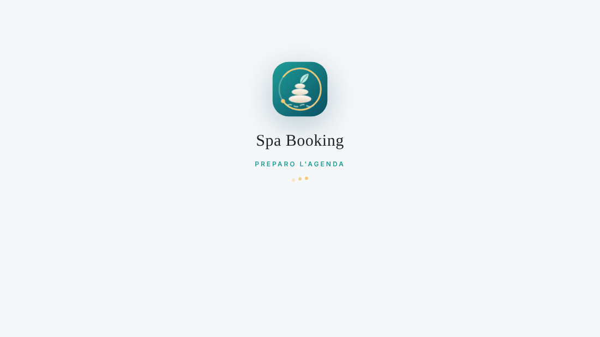

## Indice

1. [Accesso, ruoli e tablet della reception](#1-accesso-ruoli-e-tablet-della-reception)
2. [Agenda](#2-agenda)
3. [Scheda dell'appuntamento](#3-scheda-dellappuntamento)
4. [Nuovo appuntamento](#4-nuovo-appuntamento)
5. [Richieste](#5-richieste)
6. [Modifica e prenotazioni di gruppo](#6-modifica-e-prenotazioni-di-gruppo)
7. [Spa](#7-spa)
8. [Clienti](#8-clienti)
9. [Partner](#9-partner)
10. [Voucher](#10-voucher)
11. [WhatsApp e Telegram](#11-whatsapp-e-telegram)
12. [Configurazione](#12-configurazione)
13. [Modulo del sito](#13-modulo-del-sito)
14. [Shop online (WooCommerce)](#14-shop-online-woocommerce)
15. [Aggiornamenti](#15-aggiornamenti)
16. [Telefono, tablet e tema scuro](#16-telefono-tablet-e-tema-scuro)

---

## 1. Accesso, ruoli e tablet della reception

Ognuno entra in Home Assistant con **il proprio nome utente e la propria
password**; in alto a destra c'è sempre chi è collegato e il suo ruolo. Il
ruolo decide cosa si vede e cosa si può fare, e lo stesso controllo è fatto
dal server: un pulsante nascosto non basta per fare un'operazione non
permessa.

| | Massaggiatrice | Reception | Manager | Amministratore |
|---|---|---|---|---|
| Agenda e calendario | ✓ | ✓ | ✓ | ✓ |
| Prenotare e modificare | solo i suoi | ✓ | ✓ | ✓ |
| Incassi | — | ✓ | ✓ | ✓ |
| Creare voucher | — | ✓ | ✓ | ✓ |
| Estendere o eliminare voucher | — | — | ✓ | ✓ |
| Scheda Spa | ✓ | ✓ | ✓ | ✓ |
| Report e totali | — | — | ✓ | ✓ |
| Configurazione e utenti | — | — | — | ✓ |

**Tablet della reception con PIN.** Il tablet al banco resta collegato con
un utente *condiviso*: chi lo usa tocca il proprio nome e inserisce il suo
**PIN di 4 cifre**. Da quel momento prenotazioni, incassi e voucher portano
il suo nome. *Cambia utente* lascia il tablet al collega; dopo qualche minuto
senza tocchi il tablet torna da solo alla scelta della persona. Cinque PIN
sbagliati di fila bloccano il tablet per un minuto.

**Cosa vede una massaggiatrice.** Tutta l'agenda del giorno, ma modifica
solo i propri appuntamenti; non vede incassi e totali; quando prenota,
l'operatrice è già impostata su di lei.

| | |
|---|---|
|  |  |

Utenti, ruoli e PIN si gestiscono in [Configurazione › Accessi](#accessi).

---

## 2. Agenda

L'agenda ha tre viste: **Timeline**, **Elenco** e **Mese**.

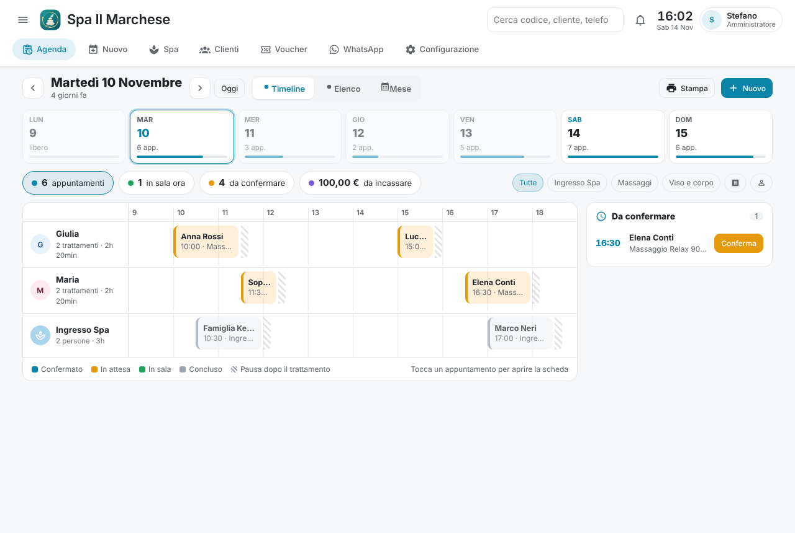

- **In alto**: il giorno per esteso (toccalo per scegliere una data), le
  frecce, *Oggi*, le tre viste, **Stampa** (il foglio della giornata in PDF;
  prezzi e incassi solo per Manager e Amministratore) e **Nuovo**.
- **La settimana**: sette riquadri con il numero di appuntamenti e una
  barretta di quanto è pieno il giorno. Tocca un giorno per aprirlo.
- **Le pillole**: appuntamenti, *in sala ora*, *da confermare*, *da
  incassare*. Toccane una per vedere solo quelli. Accanto, i filtri per
  categoria e per ospite (hotel o esterno).
- **Timeline**: una riga per operatrice; i trattamenti senza operatrice
  (Ingresso Spa, Spa privata…) hanno una riga per **categoria**, con il suo
  nome e colore. Colori: blu confermato, arancione in attesa, verde in sala,
  grigio concluso; il tratteggio è la pausa dopo il trattamento, la linea
  rossa è l'ora attuale. A lato: uscite del momento, prossimi arrivi con
  *Entrata* e quelli da confermare.
- **Elenco**: gli appuntamenti raggruppati per operatrice (o per categoria
  quando non c'è operatrice), divisi in mattina, pomeriggio e sera, con i
  pulsanti Entrata, Modifica, Annulla, Chiama e WhatsApp.

| | |
|---|---|
| 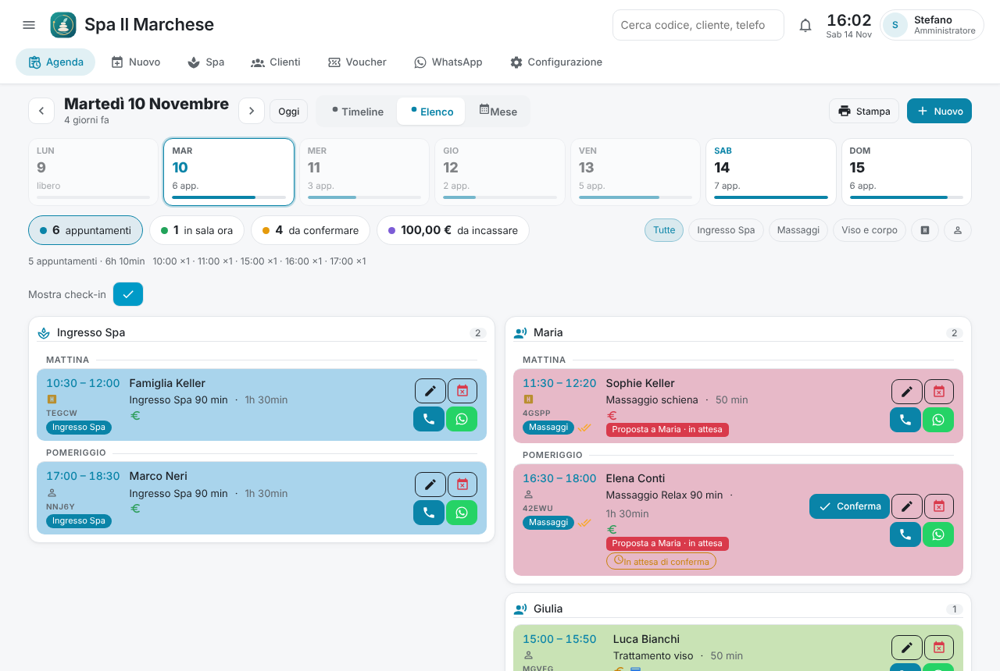 | 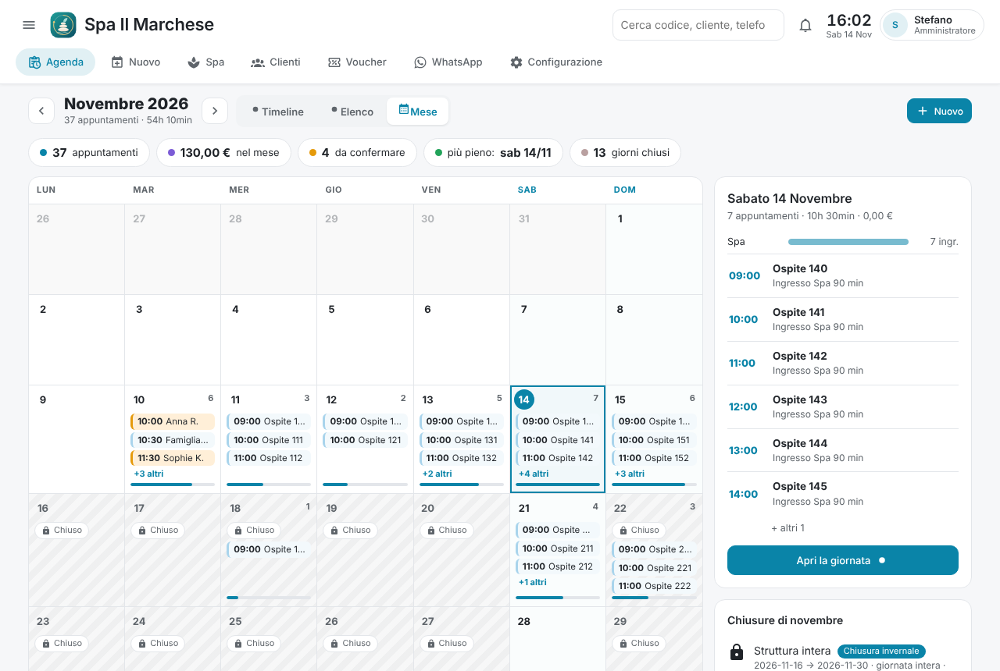 |

**Mese.** Ogni giorno mostra i primi appuntamenti (ora e nome, col colore
della categoria; in arancione quelli da confermare), «+N altri» e una
barretta di riempimento. I giorni chiusi sono tratteggiati con «Chiuso». In
alto le pillole del mese: appuntamenti, incasso, da confermare, giorno più
pieno, giorni chiusi. Tocca un giorno per vedere a lato carico e
appuntamenti; *Apri la giornata* (o il doppio clic) passa alla timeline.

---

## 3. Scheda dell'appuntamento

Tocca un appuntamento: su computer la scheda si apre a destra senza coprire
la giornata, sul telefono sale dal basso.

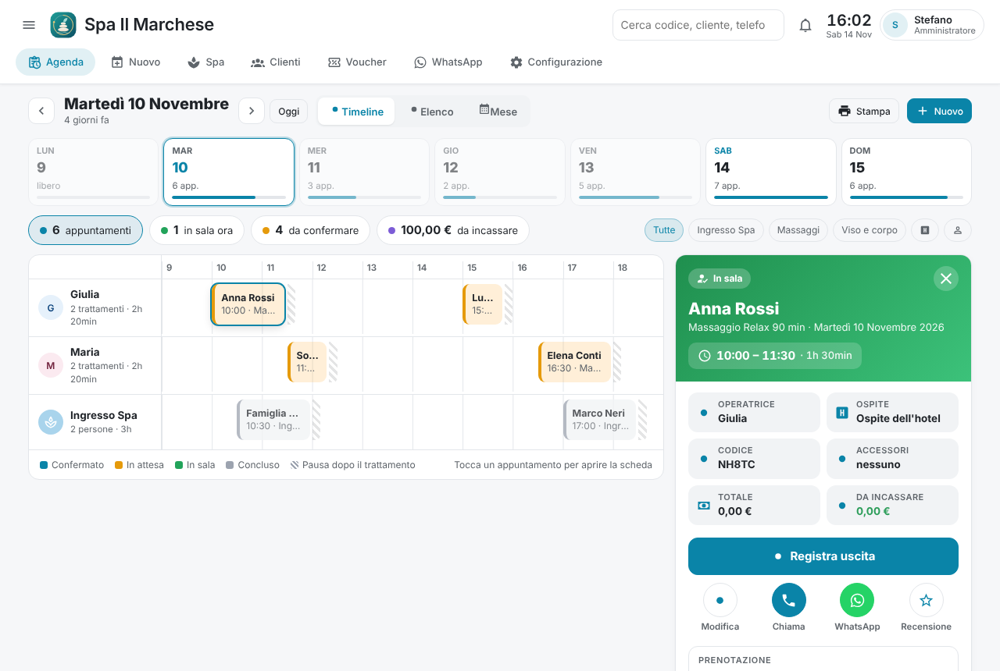

- **Testata** colorata con lo stato, nome, trattamento e orario; per un
  gruppo scegli *Singolo* o *Gruppo*.
- **Riquadri**: operatrice, ospite, codice, accessori, totale, da incassare,
  partner e sconto, pacchetto dello shop.
- **Il pulsante del momento**: *Conferma*, *Registra entrata* o *Registra
  uscita*. Su una prenotazione di più persone Entrata e Uscita aprono un
  popup: **Tutto il gruppo** oppure solo le persone spuntate.
- **Pulsanti tondi**: Modifica, Chiama, WhatsApp (apre la chat interna di
  Spa Booking), Recensione.
- **Conferma e promemoria WhatsApp**: «non inviata» o la data dell'invio,
  con *Invia* / *Reinvia*. In attesa: **Richiedi acconto**.
- **Inserito da** e, per l'Amministratore, lo **storico modifiche** (chi ha
  cambiato cosa e quando).

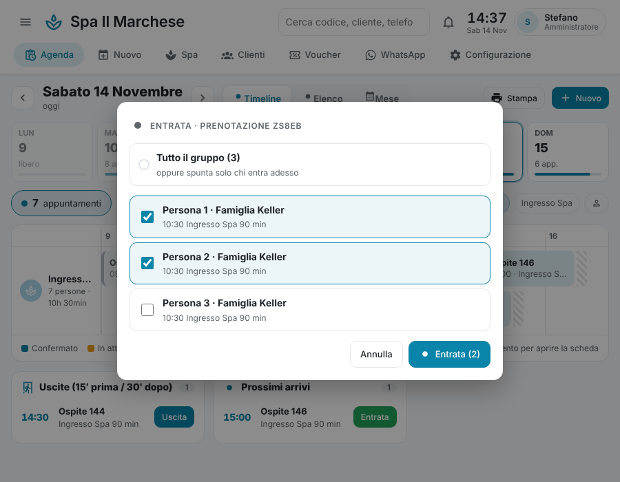

**Confermare una prenotazione di gruppo.** *Conferma* su una prenotazione
in attesa di più persone o trattamenti apre un popup: **Tutto il gruppo**,
**Una persona** (scegli quale) o **Singoli trattamenti** (spunta quali).
Subito dopo Spa Booking chiede se inviare la conferma all'ospite su WhatsApp:
il messaggio riporta **solo** quello che hai appena confermato.

| | |
|---|---|
| 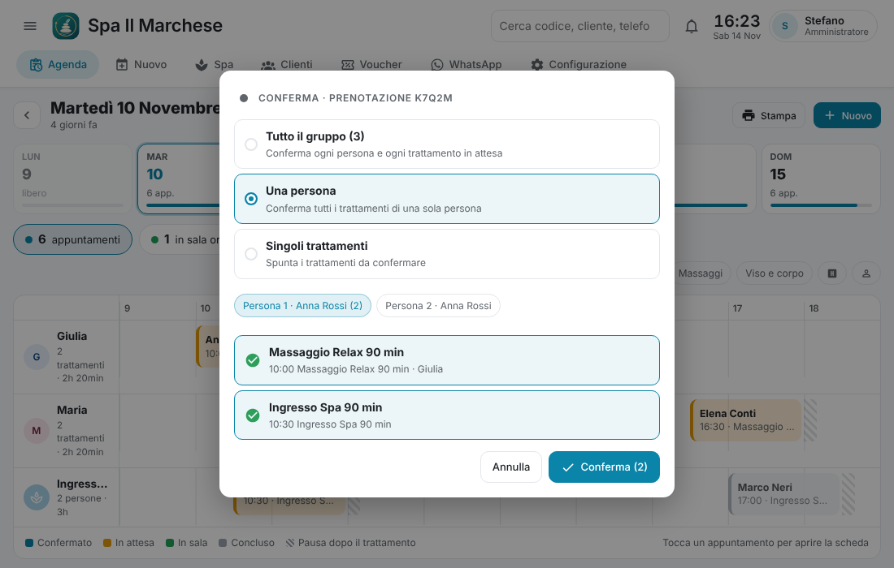 | 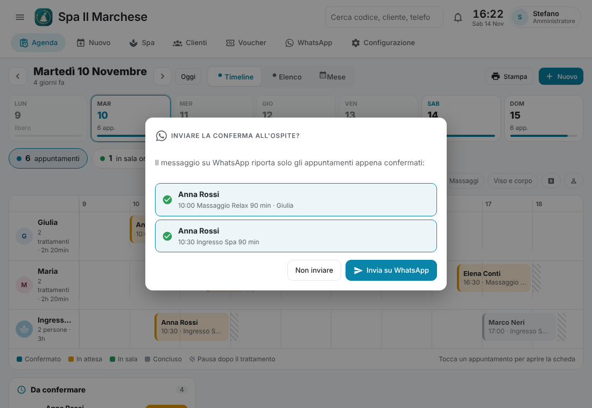 |

### Conto e incassi

Ogni prenotazione ha il riquadro **Conto**: Totale, Pagato, Da saldare e gli
incassi uno per uno. Un tocco su **Contante**, **Carta** o **Bonifico**
incassa il saldo; **Altro importo** serve per una parte o un altro metodo.

Con un **voucher** gli incassi si registrano da soli: i trattamenti compresi
risultano pagati, la **gift card** paga il resto fino al suo valore e
l'eventuale credito residuo resta sul voucher. Se annulli, il voucher torna
disponibile.

| | |
|---|---|
|  |  |

I prezzi sono **IVA inclusa**: ogni appuntamento conserva l'aliquota del
giorno in cui è stato prenotato e la scheda mostra imponibile e IVA.

### Uscita, voucher fedeltà e recensione

All'uscita il cliente può ricevere in automatico un **voucher fedeltà** (uno
solo per tutto il gruppo) e, dopo qualche ora, la **richiesta di
recensione**. Il pulsante *Recensione* la manda subito: vale per tutta la
prenotazione, un solo messaggio per numero.

### Annullare

*Annulla appuntamento* apre un popup che chiede, per un gruppo, se annullare
**solo questo** o **tutto il gruppo**, e se **avvisare l'ospite** su
WhatsApp (con il motivo, se lo scrivi). Gli operatori sono sempre avvisati.

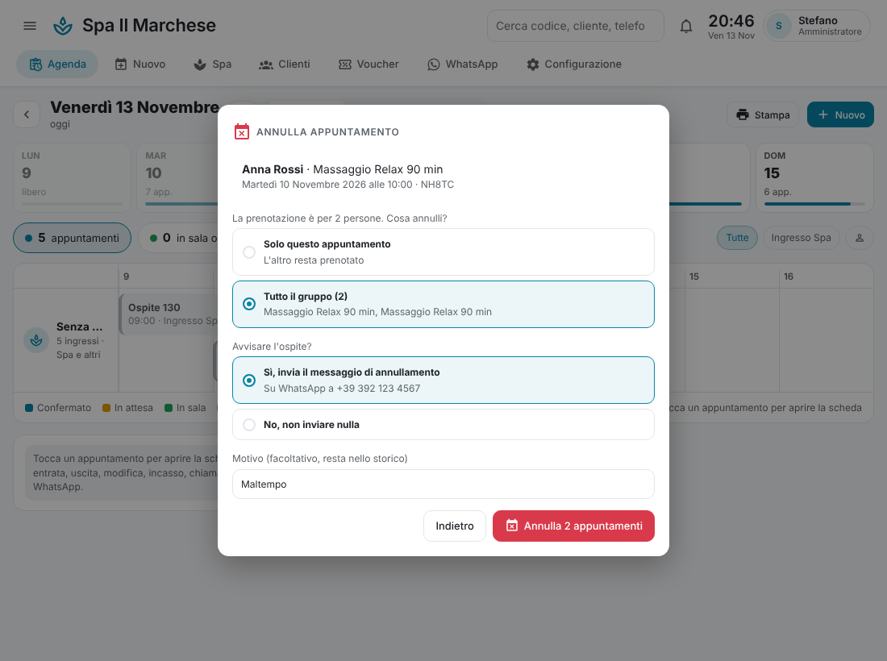

---

## 4. Nuovo appuntamento

Nuovo › **Appuntamento** si compila in cinque passi, con il **riepilogo** a
destra (sul telefono una barra in basso con il totale).

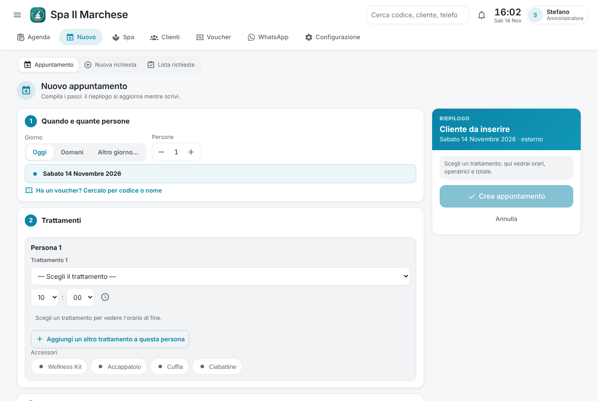

1. **Quando e quante persone**: Oggi, Domani o «Altro giorno…», persone con
   − e +, *Uguale per tutti* per copiare la persona 1. *Ha un voucher?*
   cerca il codice e compila trattamenti e destinatario.
   Con 2 o più persone compaiono i **Pacchetti dello shop**: scegline uno e
   va alle prossime persone, con trattamenti uno dopo l'altro, accessori e
   prezzo del pacchetto. La ✕ sull'etichetta toglie pacchetto e persone.
2. **Trattamenti**: per ogni persona trattamento, ora e **Chi lo fa**:
   *Automatica* (in ordine di priorità), *Massaggiatrice*, *Massaggiatore* o
   un nome. Pallino verde = libera a quell'ora, arancione = impegnata.
   Accessori per persona.
3. **Cliente**: nuovo o esistente (ricerca per nome o telefono, con
   prefisso internazionale), ospite dell'hotel o esterno, partner.
   «Una scheda cliente per ogni persona» solo per omonimi.
4. **Prezzo e pagamento**: listino e prezzo applicato per riga, acconto da
   chiedere, incassi.
5. **Stato e note**: confermata o in attesa.

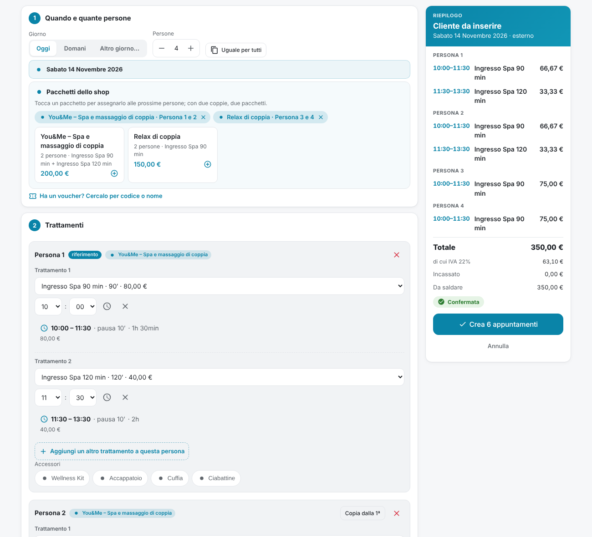

Dopo il salvataggio Spa Booking chiede cosa mandare all'ospite: il
**riepilogo** (confermata) o la **richiesta d'acconto** (in attesa). Le
massaggiatrici ricevono l'**offerta** su WhatsApp o Telegram e rispondono SI o
NO: se nessuna accetta, la reception viene avvisata. Valgono anche
«Conferma», «Confermato», «Ok», «Perfetto» e le reazioni ✅ 👍 👌; una sola
risposta conferma tutti i trattamenti della stessa prenotazione proposti a lei,
anche se la prenotazione è ancora in attesa dell'ospite.

### I controlli

- **Operatrice occupata** e pause dopo i trattamenti: sempre bloccanti.
- **Chiusure** (Fasce bloccate): sempre bloccanti.
- **Regole di giorni e fasce della categoria**: compare un avviso con
  *Prenota comunque* (Reception, Manager, Amministratore) o *Annulla e
  modifica*.
- **Categorie che non si accavallano** (es. Spa privata e Ingresso Spa):
  appena scegli una fascia occupata dall'altra categoria compare il popup
  **Fascia oraria già occupata**; il salvataggio è sempre rifiutato e la
  regola non si può forzare.

| | |
|---|---|
| 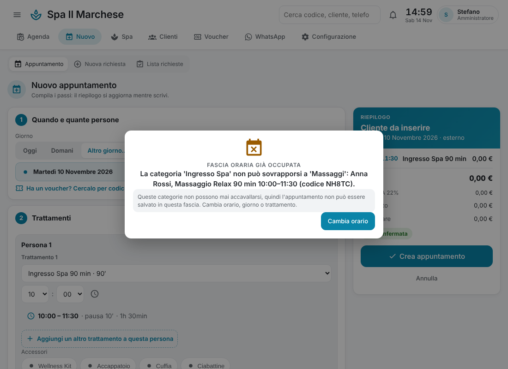 |  |

---

## 5. Richieste

Una **richiesta** non occupa ancora l'agenda: si usa quando l'ospite chiede
ma l'orario va confermato. Arrivano dal [modulo del sito](#13-modulo-del-sito)
o si inseriscono in Nuovo › **Nuova richiesta** (stessi passi, senza
l'operatrice, con la preferenza massaggiatrice/massaggiatore). Al salvataggio
l'ospite riceve la conferma di ricezione su WhatsApp.

| | |
|---|---|
|  | 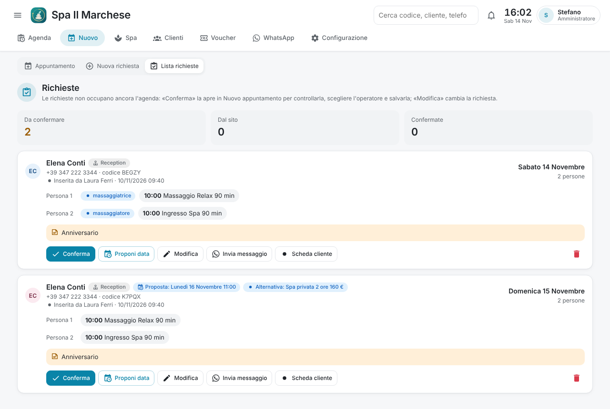 |

**Lista richieste**: numeri in alto (da confermare, dal sito, confermate),
poi una scheda per richiesta con ospite, provenienza, «Nuova», voucher,
codice, persone e trattamenti, note. La campanella in alto conta le
richieste dal sito non ancora aperte.

- **Conferma** apre la richiesta in Nuovo appuntamento già compilata: cambi
  quello che serve, scegli chi fa i massaggi (la preferenza dell'ospite è già
  selezionata) e *Conferma e crea*.
- **Proponi data**: se la data è piena proponi la prima disponibile e, se
  vuoi, **trattamenti alternativi** con prezzo e giorno. Il messaggio è già
  scritto e si può cambiare prima dell'invio.
- **Modifica**, **Invia messaggio**, **Scheda cliente**, cestino.

| | |
|---|---|
| 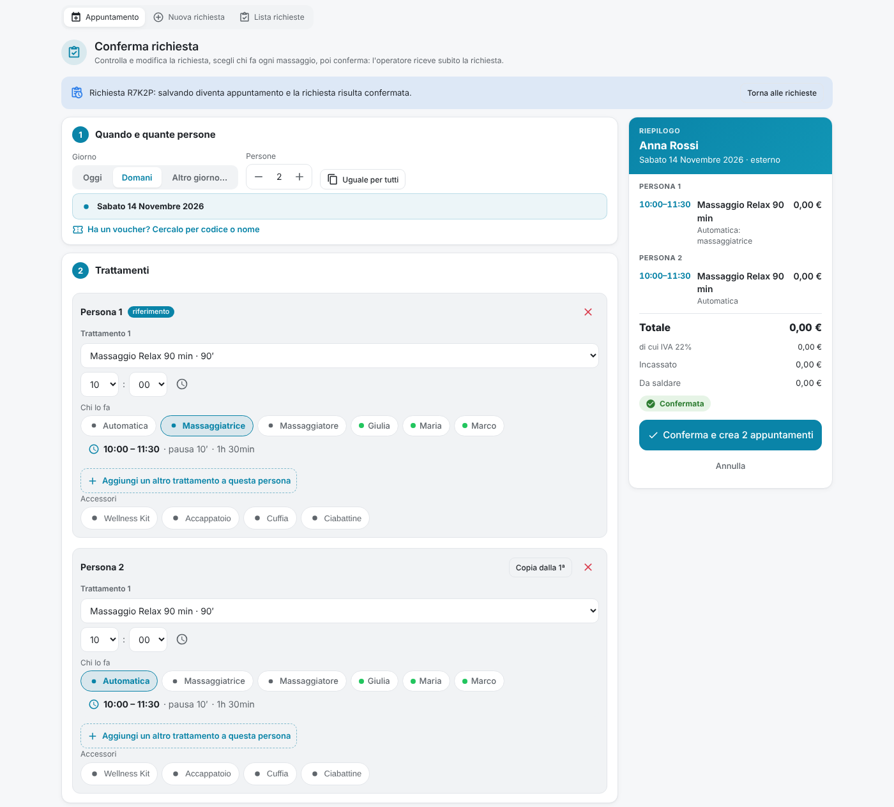 |  |

---

## 6. Modifica e prenotazioni di gruppo

**Modifica appuntamento** ha gli stessi passi di Nuovo appuntamento, con il
riepilogo a lato. Se cambi operatore (o l'orario) il nuovo operatore riceve
la richiesta da accettare e quello di prima viene avvisato. Se cambi scheda
senza salvare, la modifica si chiude.

Una prenotazione con più persone o più trattamenti ha **un solo codice**.
*Modifica* su uno qualsiasi dei suoi appuntamenti apre **Modifica gruppo**:

- **Scollega** (nel box di ogni persona): la persona diventa una
  prenotazione a parte, con un nuovo codice e i suoi incassi;
- **Aggiungi una prenotazione già inserita**: scrivi il codice di un'altra
  prenotazione e le sue persone entrano nel gruppo;
- pacchetti dello shop, persone e trattamenti si aggiungono come in Nuovo.

| | |
|---|---|
|  | 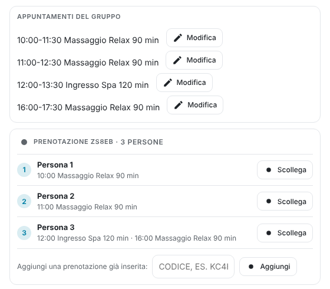 |

---

## 7. Spa

I comandi della spa da Home Assistant, divisi in sezioni (luci, clima,
servizi e sensori) con un riepilogo per sezione. La sotto-scheda
**Telecamere** (non per le massaggiatrici) mostra le immagini dal vivo. Con
la matita si aggiungono, spostano e nascondono i riquadri.

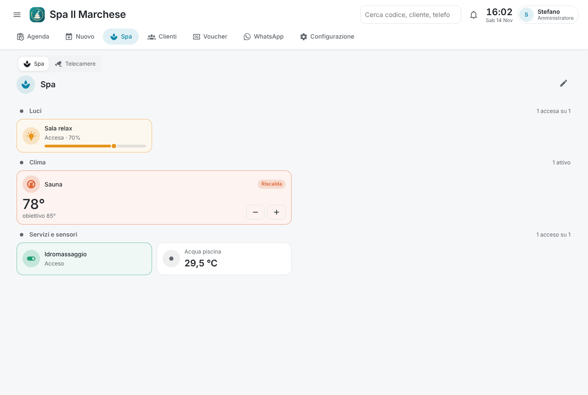

---

## 8. Clienti

L'elenco dei clienti con telefono, email, ultima visita e numero di visite;
i pulsanti chiamano, scrivono su WhatsApp o aprono una prenotazione. Il
cliente viene riconosciuto dal telefono (anche numeri esteri), quindi non si
creano doppioni. Manager e Amministratore possono creare e unire i clienti.

| | |
|---|---|
| 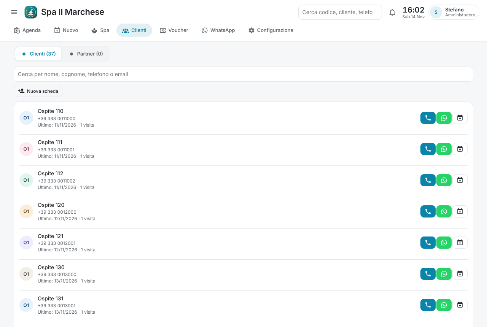 | 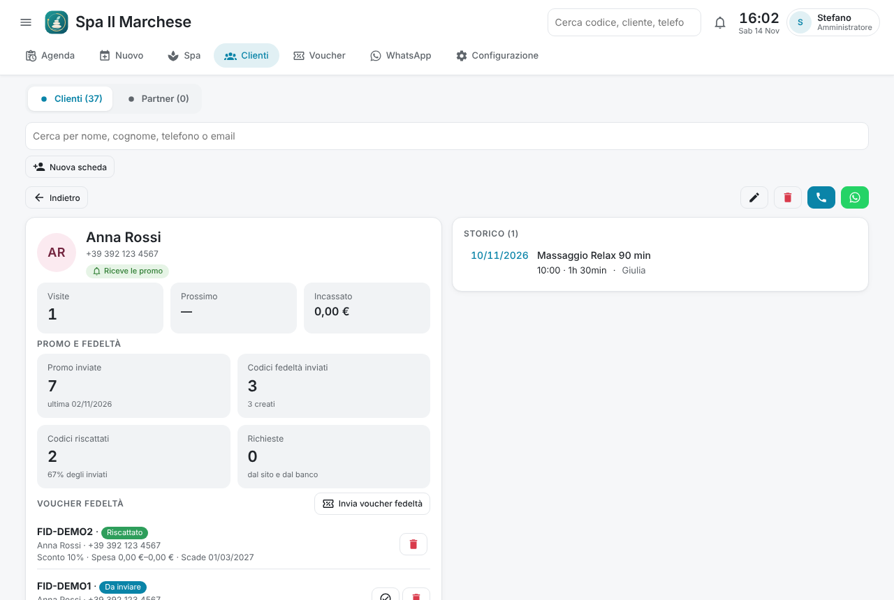 |

**Scheda del cliente**: contatti, «Cliente abituale» (da 3 visite),
iscrizione alle promo, visite e prossimo appuntamento, speso (Manager e
Amministratore), note, **Promo e fedeltà** (promo ricevute, voucher fedeltà
inviati e riscattati, richieste), **punti fedeltà** con la barra verso il
premio, e lo storico degli appuntamenti.

- **Invia voucher fedeltà**: crea un voucher anche senza una visita (sconto,
  validità, spesa minima) e lo invia subito su WhatsApp o per email.
- **Crea buono** quando ha raggiunto la soglia dei punti; **Rettifica punti**.

---

## 9. Partner

In Clienti › **Partner** ci sono le strutture e le persone che portano
ospiti (hotel, agenzie, B&B…). *Nuovo partner* o **Importa file** (CSV da
Excel; *Modello* scarica un esempio; chi ha la stessa email non viene
duplicato).

Toccando un partner si apre la sua **scheda**: link da copiare, punti con la
barra verso il premio, **Genera voucher e invia** (crea una gift card del
valore del premio, toglie i punti e la manda su WhatsApp o per email),
**Invia voucher fedeltà**, rettifiche, iscrizione alle email, e le
prenotazioni dei suoi ospiti con importo e punti.

| | |
|---|---|
| 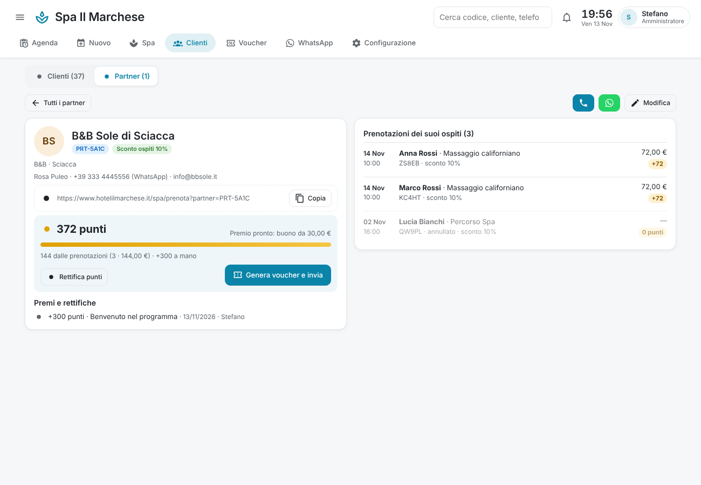 | 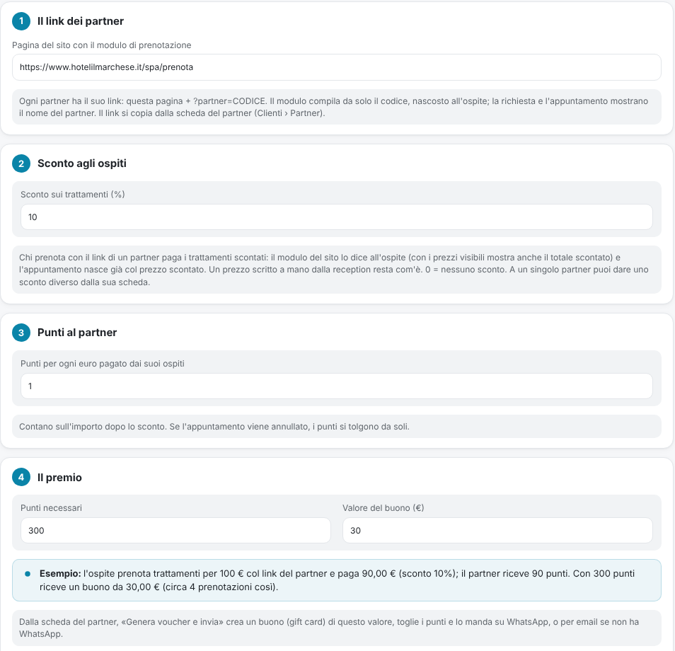 |

**Programma partner** (Configurazione › Promo › Programma partner):

1. **Il link dei partner**: la pagina del sito con il modulo; ogni partner
   ha il suo link (`?partner=CODICE`) e il modulo compila da solo il codice,
   che l'ospite non vede. Il sito lo ricorda per 30 giorni.
2. **Sconto agli ospiti** (es. 10%, anche diverso per partner): il modulo lo
   annuncia, l'appuntamento nasce col prezzo scontato e la conferma mostra
   lo sconto.
3. **Punti al partner** per ogni euro pagato dai suoi ospiti; un
   appuntamento annullato toglie i suoi punti.
4. **Il premio**: punti necessari, valore del buono e messaggio.

**Campagne partner**: email ai partner già pronte (oggetto e testo con i
segnaposto), con anteprima, *Invia prova* e invio in un giorno preciso o a
mano. Ogni email ha il link «Cancella l'iscrizione».

> In Italia le email promozionali richiedono il consenso preventivo del
> destinatario (art. 130 Codice Privacy), anche verso le aziende.

---

## 10. Voucher

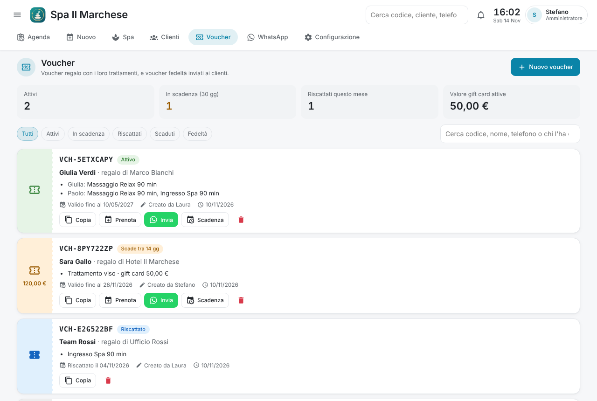

- **Riepilogo**: attivi, in scadenza nei prossimi 30 giorni, riscattati nel
  mese e (Manager) valore delle gift card attive. Toccando un numero si filtra.
- **Filtri**: Tutti, Attivi, In scadenza, Riscattati, Scaduti, Fedeltà;
  la ricerca trova anche chi ha creato il voucher.
- **Ogni voucher è un biglietto** colorato secondo lo stato, con codice,
  destinatario, chi l'ha regalato, trattamenti per persona, scadenza e
  **Creato da**. Azioni: *Copia*, *Prenota* (apre la prenotazione già
  compilata), *Invia* su WhatsApp, *Scadenza* ed *Elimina* (Manager).

**Nuovo voucher in tre passi**: acquirente e destinatario; persone,
trattamenti, accessori e gift card in euro; riepilogo. *Crea voucher* chiede
il **PIN** di chi lo vende, che resta firmato sul voucher.

| | |
|---|---|
|  |  |

I voucher venduti sullo **shop online** arrivano da soli con l'etichetta
«Sito» (vedi [Shop online](#14-shop-online-woocommerce)). I **voucher
fedeltà** nascono all'uscita, a mano dalla scheda cliente o come premio punti.

---

## 11. WhatsApp e Telegram

La scheda **WhatsApp** mostra tutto quello che passa da Spa Booking: i
messaggi degli ospiti, conferme, promemoria e richieste d'acconto inviati,
le offerte agli operatori e le loro risposte, i report. Sotto ogni messaggio
c'è chi l'ha mandato («Automatico» se è partito da solo). Filtri *Ospiti* /
*Operatori* e ricerca; *Crea richiesta* e *Salva cliente* dalla chat. Ogni
pulsante WhatsApp della card (agenda, scheda, clienti) apre qui la chat di
quel numero, anche se non avete mai scritto prima.

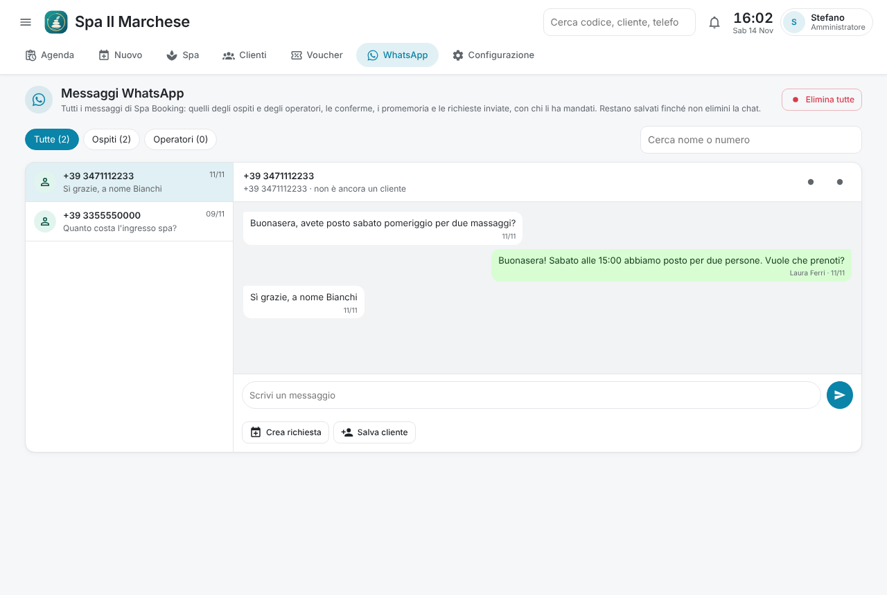

**Collegamento WhatsApp** (Configurazione › Notifiche › Collegamenti): Spa
Booking si collega da solo al numero dell'hotel, come WhatsApp Web. Premi
**Collega WhatsApp** e dal telefono dell'hotel: WhatsApp › Dispositivi
collegati › Collega un dispositivo, inquadra il QR (oppure *Ottieni codice*
con il numero). *Prova WhatsApp* manda un messaggio di prova.

**Bot Telegram integrato**, senza l'integrazione Telegram di Home Assistant:

1. su Telegram scrivi a **@BotFather** › `/newbot` e copia il token;
2. incollalo in Collegamenti e premi **Salva e collega**;
3. ogni operatore cerca il bot e scrive **/start**: il bot risponde con il
   codice della sua chat, che compare anche nella card con *Copia codice*;
4. incolla il codice nel campo Telegram della scheda dell'operatore.

Le offerte arrivano con i pulsanti Accetto / Rifiuto. Un bot si legge da un
solo programma: se era usato dall'integrazione Telegram di Home Assistant,
rimuovila (la card lo segnala).

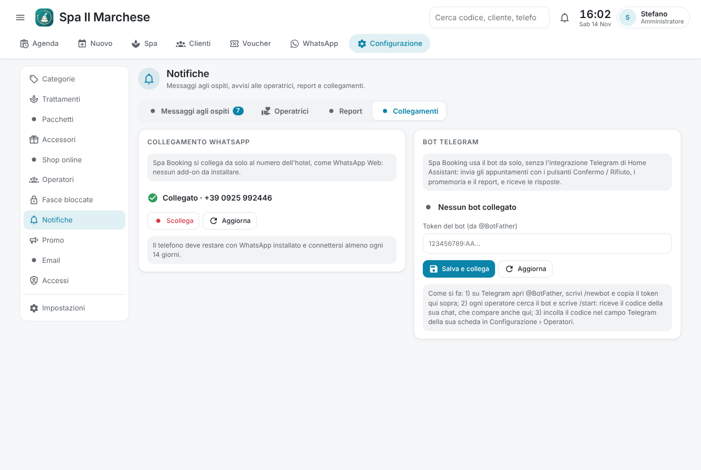

---

## 12. Configurazione

Solo per l'Amministratore. Su schermo largo il menu è una colonna a
sinistra, sul telefono una striscia di icone. In ogni pagina la barra
**Salva** compare solo quando cambi qualcosa.

### Categorie

Ogni categoria ha un colore, se richiede un'operatrice, la **pausa** dopo i
trattamenti, i **giorni** e le **fasce** di mattina e pomeriggio in cui
accetta prenotazioni, e **Non sovrapporre con**: le categorie con cui non
deve mai condividere l'orario (vale nei due sensi e non si può forzare).

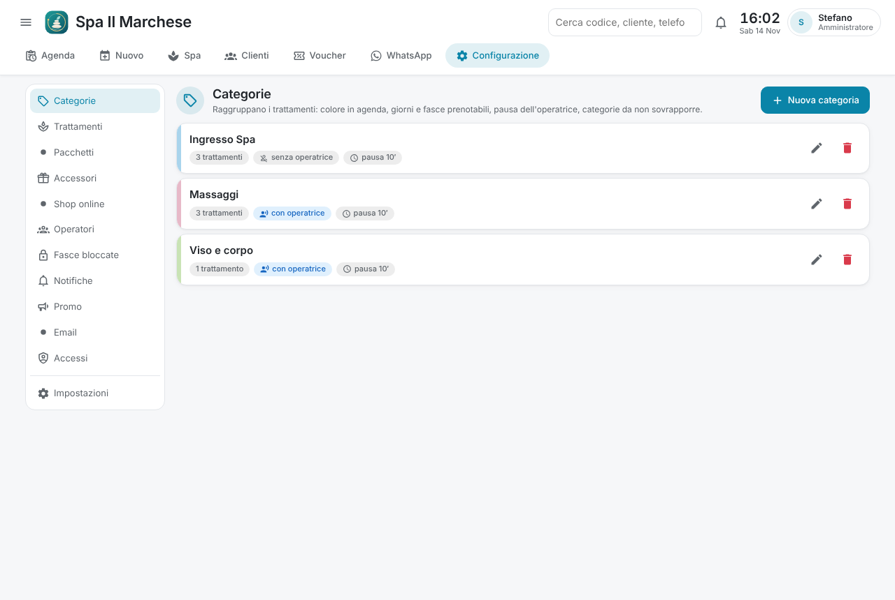

### Trattamenti

Divisi per categoria: durata, prezzo, **aliquota IVA** (22, 10, 5, 4, 0% o
predefinita), persone insieme (minimo e massimo), attivo, visibile sul sito,
operatrici abilitate. Con la **matita** si cambia l'ordine: trascina le
categorie e i trattamenti dalla maniglia ⋮⋮ (le categorie si possono
chiudere). L'ordine vale per il sito e per tutti i menu.

| | |
|---|---|
| 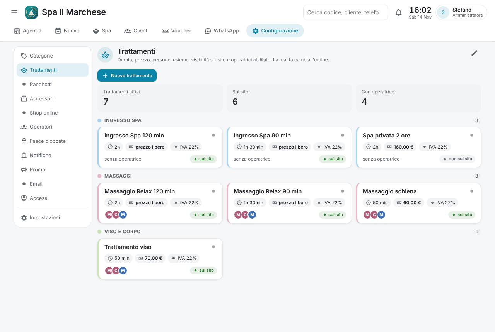 | 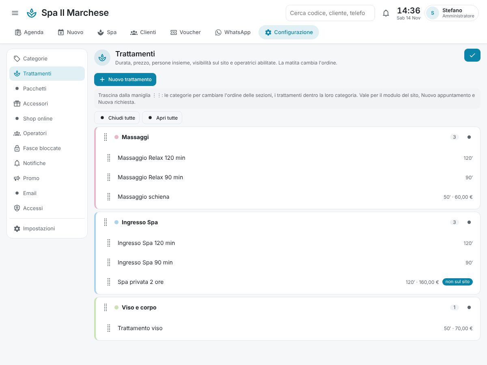 |

### Pacchetti

I pacchetti dello shop abbinati ai trattamenti: persone, trattamenti per
persona, accessori e prezzo. Due spunte decidono dove si vedono (**Modulo
web**, **Nuovo appuntamento e richiesta**) e si trascinano per cambiare
l'ordine. Gli abbinamenti si cambiano in Shop online.

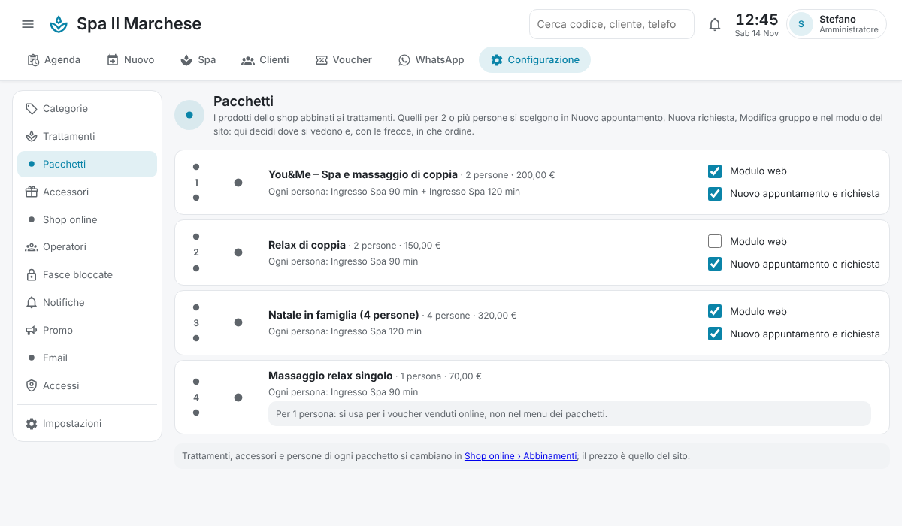

### Accessori

Kit, accappatoio, cuffia, ciabattine… con simbolo, prezzo e aliquota IVA.

### Operatori

Nome, telefono con prefisso, WhatsApp e/o Telegram, **genere** (per la
preferenza dell'ospite), **priorità** per le offerte automatiche, trattamenti
che fa, attivo.

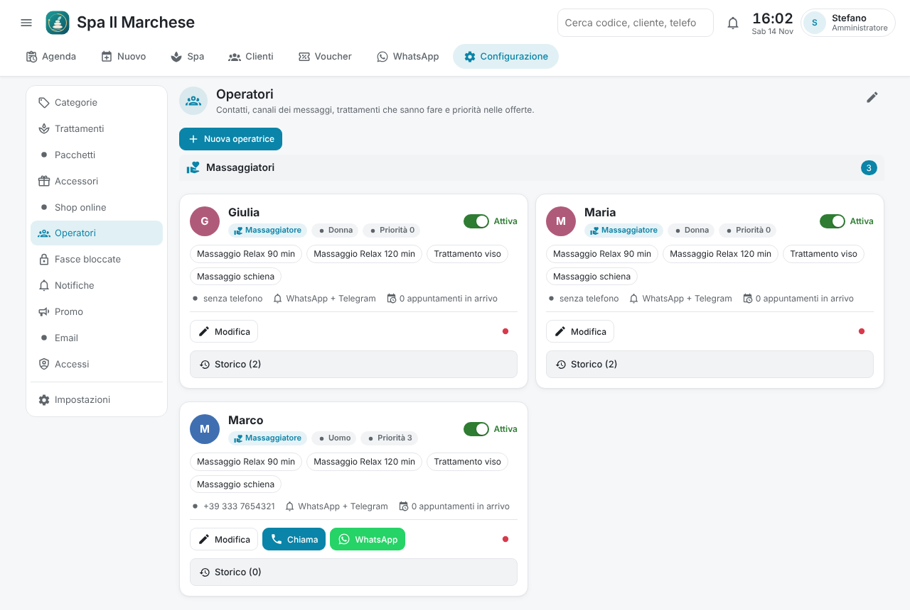

### Fasce bloccate

Chiusure della spa intera, di una categoria o di un'operatrice, a giornata o
con orario. Per i periodi lunghi, **Escludi i giorni** lascia aperti alcuni
giorni (es. tutto novembre chiuso tranne i sabati).

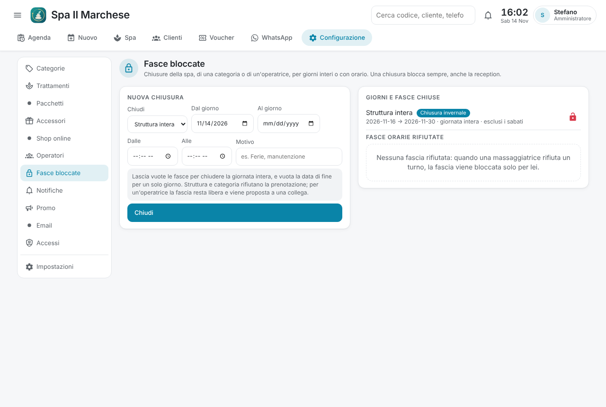

### Notifiche

- **Messaggi agli ospiti**: ricezione richiesta, proposta di un'altra data,
  conferma, richiesta d'acconto, annullamento, promemoria, recensione. Per
  ognuno: invio automatico e quando, testo con anteprima e segnaposto,
  *Ripristina testo base*, *Prova su WhatsApp*.
- **Operatori**: tempo per rispondere all'offerta, promemoria, riepilogo
  personale.
- **Report**: destinatari del report mensile, invio immediato e anteprima.
- **Collegamenti**: WhatsApp integrato e bot Telegram.

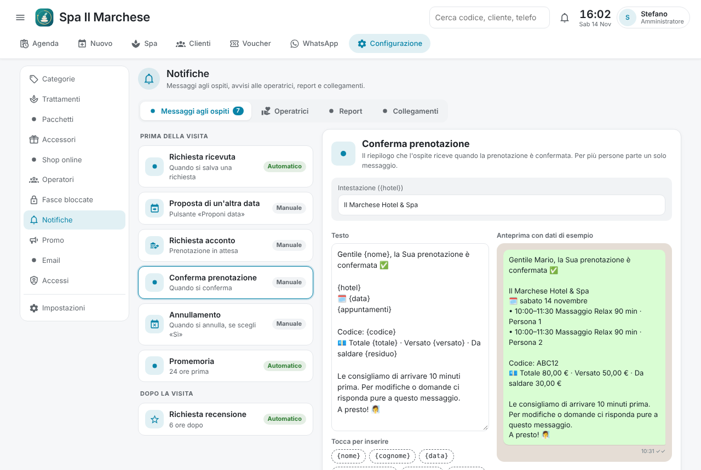

### Promo

- **Campagna promo**: le tue promo (programmata, ogni giorno, inviata,
  scaduta, bozza) e **Crea da un modello** (Natale, San Valentino, Pasqua,
  Black Friday, Weekend relax…): testo, codice e date già pronti. Si sceglie
  a chi va e quando (*Adesso*, *Un giorno preciso*, *Ogni giorno*). Si può
  allegare un **pacchetto dello shop** con prezzo in promo e link d'acquisto.
- **Voucher fedeltà**: regola dopo l'uscita (ore, sconto, spesa minima e
  massima, validità) e messaggio.
- **Punti fedeltà**: punti per euro, soglia e valore del buono premio, invio
  automatico, classifica.
- **Programma partner** e **Campagne partner**: vedi [Partner](#9-partner).

| | |
|---|---|
| 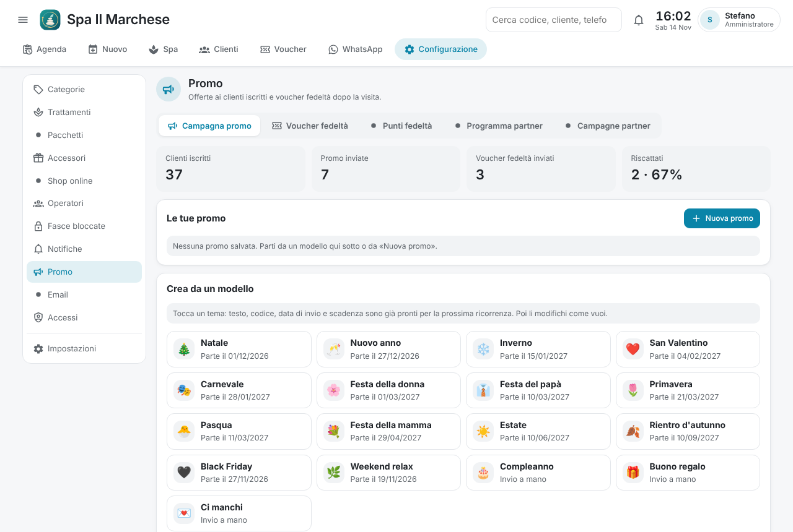 | 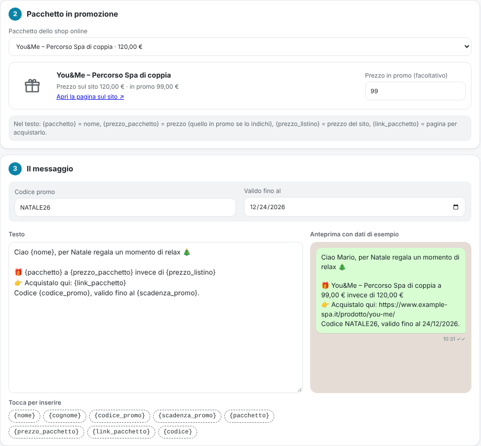 |

### Email

La casella da cui partono le email (voucher, campagne, avvisi):
**Accedi con Google** (senza password, solo permesso di invio) oppure SMTP
con password (Gmail con password per le app, Outlook / Microsoft 365, Aruba,
Libero, altro). Mittente, indirizzo per le risposte, *Invia email di prova*.

### Shop online

Vedi [Shop online](#14-shop-online-woocommerce).

### Accessi

Ogni utente con il suo ruolo; nella scheda dell'utente: **È in agenda come**
(collega l'utente alla sua operatrice), **PIN per il tablet**, **Tablet
condiviso**, nuova password, disattiva/riattiva. **Nuovo utente** crea
l'accesso di Home Assistant direttamente da qui (non amministratore, vede
solo questa dashboard). **Esci da solo dopo** imposta i minuti di
inattività del tablet.

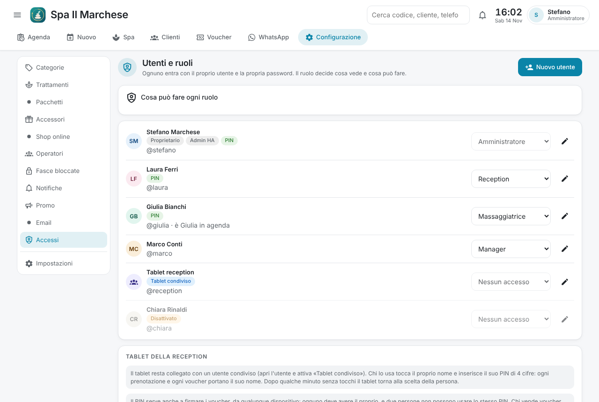

### Impostazioni

- **Generale**: aspetto (Segui Home Assistant, Chiaro, Scuro), titolo della
  card, versione.
- **Dati fatturazione**: aliquota IVA predefinita e dati dell'azienda per la
  ricevuta.
- **Sito web**: richieste dal sito, orari proposti, numeri della reception
  avvisati (*Prova avviso*), indirizzo pubblico, colore, prezzi, codice da
  incollare in WordPress.
- **Dati e backup**: esporta/importa i clienti in CSV, scarica o ripristina
  il backup completo, **backup automatico su Google Drive** ogni giorno
  (restano gli ultimi 3, con *Ripristina*).

| | |
|---|---|
| 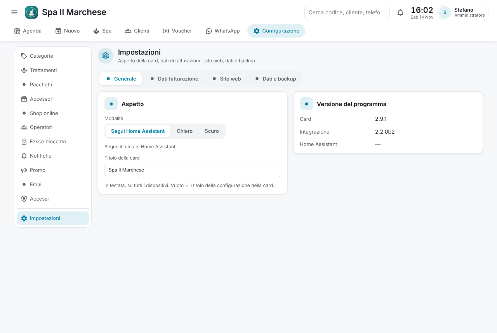 |  |

---

## 13. Modulo del sito

Il modulo che gli ospiti compilano sul sito dell'hotel. Su WordPress ci sono
solo due righe (Impostazioni › Sito web › *Copia codice per il sito*): il
modulo vero arriva da Home Assistant, quindi ogni aggiornamento compare sul
sito da solo, ed è isolato dal tema del sito.

1. **Quando**: data, persone e voucher (un voucher valido sceglie già i suoi
   trattamenti).
2. **Cosa scegliete**: per ogni persona trattamento e orario (solo quelli
   liberi, rispettando chiusure, regole e categorie che non si accavallano),
   preferenza massaggiatrice/massaggiatore; con 2 o più persone i
   **pacchetti dello shop**.
3. **I tuoi dati**: nome, cognome, telefono con prefisso, email, note.
4. **Controlla e invia**: riepilogo e, se attivo, totale indicativo (con lo
   sconto partner).

La richiesta arriva in Nuovo › Lista richieste con la campanella. Lingue:
italiano, inglese e tedesco (dal browser o con IT, EN, DE).

| | |
|---|---|
|  | 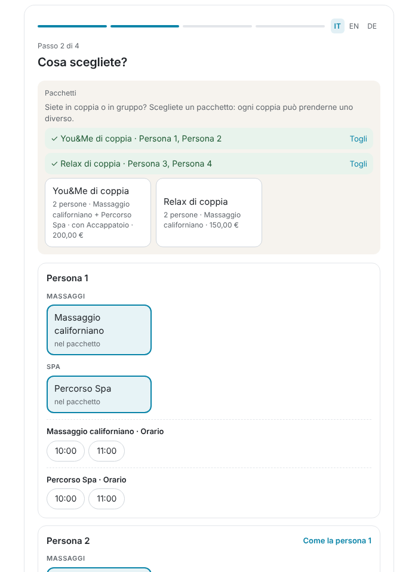 |
|  |  |

---

## 14. Shop online (WooCommerce)

I voucher venduti sullo shop WooCommerce (con «Buoni PDF») arrivano in Spa
Booking da soli.

1. Carica il plugin `wordpress/spa-booking-connector.zip` in WordPress e
   attivalo.
2. In Configurazione › Shop online scrivi l'indirizzo del sito, premi
   **Nuova chiave** e copia chiave e indirizzo di notifica in WordPress ›
   WooCommerce › Spa Booking.
3. *Leggi i voucher dal sito*, **Salva**, **Prova collegamento**.
4. **Abbina i prodotti**: per ogni prodotto i trattamenti, le persone, gli
   accessori inclusi; per le gift card *Valore fisso* o *Prezzo pagato*.

Ogni 15 minuti (e subito a ogni ordine pagato) i nuovi codici diventano
voucher «Sito»; all'**Entrata** del cliente il voucher risulta riscattato
anche su WordPress. I prodotti abbinati diventano i **pacchetti** usati in
prenotazioni, modulo del sito e promo.

| | |
|---|---|
|  |  |

---

## 15. Aggiornamenti

Se Spa Booking è installato da HACS, l'Amministratore vede in alto **Nuova
versione di Spa Booking** con *Novità*, *Installa* e *Più tardi*. Finita
l'installazione la card dice se basta **ricaricare la pagina** (solo card o
modulo) o se serve **riavviare Home Assistant** (*Riavvia ora*). Le beta
compaiono se in HACS è attivo «Mostra le versioni beta».

---

## 16. Telefono, tablet e tema scuro

Sul telefono le schede diventano icone, l'agenda mostra le schede del giorno
con un solo pulsante (quello che serve adesso), Nuovo appuntamento ha la
barra del totale in basso e WhatsApp mostra prima le conversazioni e poi la
chat.

| | |
|---|---|
| 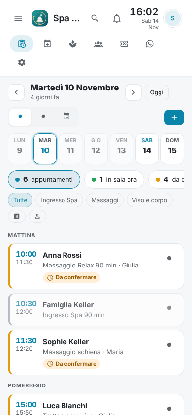 | 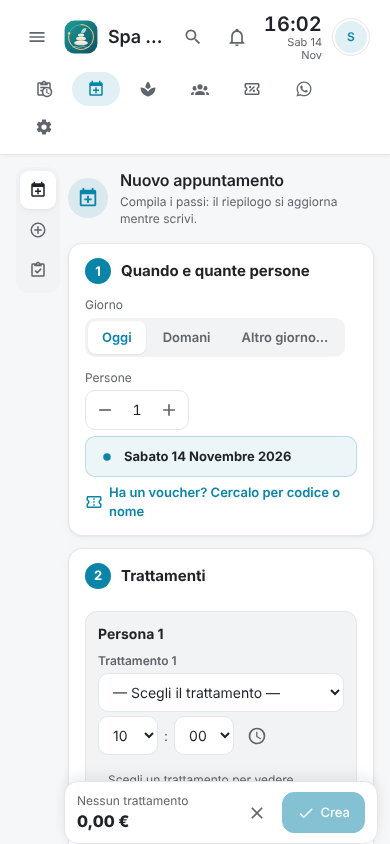 |

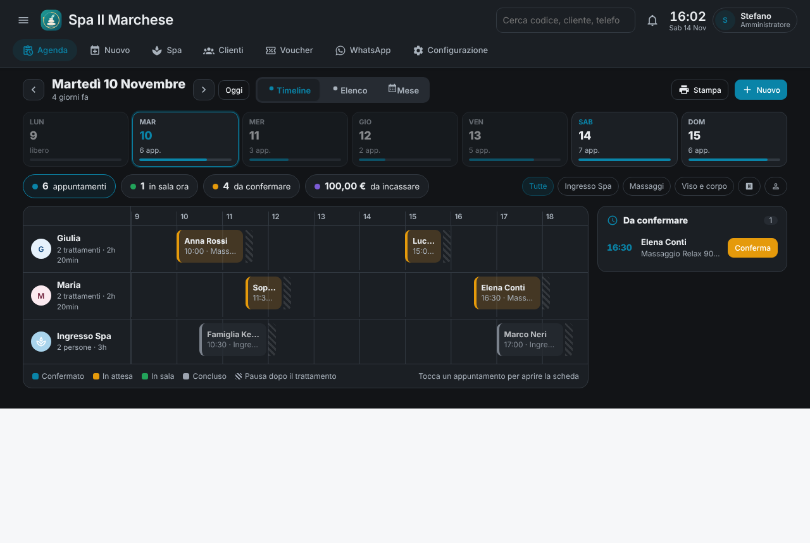
